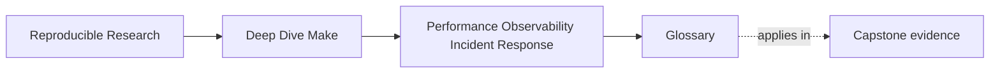
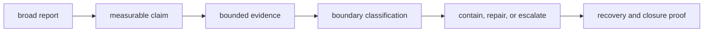

# Glossary

<!-- page-maps:start -->
## Page Maps

<!-- page-maps:end -->

Use this glossary when an incident discussion starts collapsing distinct ideas into one
word such as "slow," "flaky," "fixed," or "safe." The terms below are not extra jargon.
They protect decisions that must remain separate.

## Measurement and build state

| Term | Meaning in this module |
| --- | --- |
| baseline | A recorded set of comparable measurements with target, build state, versions, conditions, and raw samples. A baseline describes current or prior behavior; it does not by itself prove a regression. |
| build state | The relevant state before a route runs: clean, incremental, confirmed no-op, or preserved incident state. Timings from different states answer different questions. |
| clean build | A route executed after the repository's documented generated-state reset. It measures full production from that declared starting point, not an abstract machine-independent cost. |
| confounder | A condition that can change a measurement without being the change under review, such as cache warmth, background load, job count, network access, or tool version. |
| controlled comparison | Before-and-after or route-to-route measurements that hold the important target, state, environment, parallelism, and sample method steady. |
| critical path | The chain of dependent work that determines completion time. Removing work outside that chain may reduce total work without reducing wall-clock duration. |
| dry-run timing | Timing from `make -n`. It localizes work before ordinary recipe execution but does not isolate parsing perfectly; evaluation, include remake behavior, graph decisions, and recursive Make caveats remain. |
| freshness-decision cost | Cost incurred while Make determines which reachable targets are current and which recipes are eligible. |
| no-op build | A route run after its convergence precondition is confirmed, normally with successful query mode. A fast invocation is not a no-op merely because little output appeared. |
| parse and evaluation cost | Time spent reading makefiles, expanding variables, processing includes, and constructing Make's evaluated world. |
| recipe cost | Time spent in external commands such as compilers, tests, generators, and packagers. |
| regression | A measured deterioration relative to a comparable earlier baseline or explicit objective. One current timing cannot establish a regression. |
| representative value | A stated summary such as the median, retained alongside all samples and their range. It is not a replacement for the raw measurements. |

## Evidence and interpretation

| Term | Meaning in this module |
| --- | --- |
| causal evidence | Evidence showing why Make selected work, such as a trace naming a target and prerequisite. It does not alone prove that the modeled relationship is correct. |
| competing explanation | A plausible alternative to the leading diagnosis. Evidence is strongest when possible results can strengthen one explanation and weaken another. |
| debug by mutation | Changing semantic outputs, build state, or scheduling merely to make behavior visible. This risks destroying the condition being investigated. |
| decision gate | The information required before an edit: symptom, preserved state, leading and competing explanations, discriminating evidence, boundary, and invariant at risk. |
| evidence packet | A bounded collection of commands, context, raw observations, focused excerpts, interpretations, and decisions that lets another maintainer reconstruct an investigation. |
| evidence surface | A route or artifact that answers an operational question, such as non-executing trace, focused database inspection, target-attributed output, a manifest, or an audit target. |
| evidence-surface cost | Runtime, storage, search, attribution, or human interpretation cost created by evidence. Low line count does not automatically mean low responder cost. |
| focused excerpt | The smallest retained part of a large dump or trace that changed a decision, stored with the command needed to reproduce it. |
| observability target | A named, non-semantic route that answers one recurring question and has an expected output shape, side-effect contract, and owner. |
| output attribution | The ability to associate a log line or result with the target or recipe that produced it. GNU Make output synchronization can improve attribution without repairing graph defects. |
| trace report | State-labeled planning evidence containing the focus target, planned targets, rule locations, bounded-volume check, and raw trace. Volume is one usability dimension, not the whole result. |

## Incident response

| Term | Meaning in this module |
| --- | --- |
| boundary classification | Assignment of an incident to the responsibility that evidence currently supports: parse/evaluation, graph truth, recipe/tool, publication, environment, evidence, or external service. |
| containment | Immediate action that prevents additional harm, such as stopping publication of a suspect bundle. It does not claim the route has recovered. |
| escalation packet | The symptom, impact, preserved state, completed evidence branches, current classification, active containment, and exact unresolved question handed to another owner. |
| incident state | The timestamps, partial outputs, environment, command, and other conditions present when the symptom occurred. It should be preserved before cleanup when it has diagnostic value. |
| mitigation | A temporary route that restores some service or feedback while the defect remains, such as documented serial execution for a parallel-only failure. |
| pressure run | A controlled route that applies the condition under which a defect appears, such as higher parallelism, repeated execution, or a governed failure specimen. |
| recovery | Return of the affected route to a verified usable state. Recovery checks service and invariants; it does not necessarily remove the root cause. |
| repair | A change intended to remove the root cause, such as declaring a missing edge or establishing one writer for a trusted output. |
| reproduction matrix | A planned set of attempts across named states and pressure conditions. It prevents random reruns from changing several variables at once. |
| runbook entry condition | The symptom and scope that tell a responder when a runbook applies, plus non-entry conditions that route other incidents elsewhere. |
| symptom confirmation | Conversion of a broad report into a measurable claim with target, state, observed result, frequency or duration, expectation, and source. |
| triage ladder | A state-preserving sequence that confirms impact, makes explanations compete, chooses discriminating evidence, classifies ownership, and decides whether to repair, mitigate, or escalate. |

## Tuning and proof

| Term | Meaning in this module |
| --- | --- |
| artifact equality | Byte-for-byte equality. It is a useful proof when the contract requires reproducible bytes, but it may be too strict or too weak for some artifact meanings. |
| experiment contract | The pre-edit record of measured cost, localized boundary, proposed change, invariant at risk, controlled comparison, semantic proof, and rejection condition. |
| freshness contract | The declared conditions under which cached or generated state must refresh. Adding a cache creates this new correctness obligation. |
| rejection condition | A result that causes a proposed optimization to be reverted or abandoned, such as stale discovery, failed convergence, changed artifact meaning, or a timing effect within noise. |
| requested-work proof | Evidence that the same meaningful input change still triggers the necessary consumers after a tuning change. |
| semantic equivalence | Equality under the artifact's declared meaning rather than necessarily identical bytes. The comparison method must be defined before the experiment. |
| truth-preserving optimization | A change that removes measured waste while preserving requested work, convergence, artifact meaning, evidence access, failure safety, and applicable pressure behavior. |

## Distinctions to defend during review

| Do not collapse... | Why the distinction matters |
| --- | --- |
| current baseline and regression | A baseline needs a comparable past value or objective before it proves deterioration. |
| trace causality and semantic correctness | Trace can explain Make's decision while the graph still models the wrong contract. |
| command success and truthful output ownership | Two recipes can return zero while mutating one undeclared shared file. |
| clean build and incident reproduction | Cleaning is a measurement precondition in one case and destructive evidence loss in the other. |
| serial comparison and serial repair | `-j1` can localize a schedule-dependent defect without repairing its missing edge or shared writer. |
| containment, mitigation, recovery, and repair | Each action makes a different promise about harm, service, verification, and root cause. |
| artifact equality and semantic equivalence | Some contracts require identical bytes; others require a domain comparison. Neither should be assumed. |
| evidence volume and evidence usefulness | A short log can be opaque, while a larger attributed trace can be decisive. |
| selftest proof and performance proof | Build invariants can pass without establishing that a route became faster. |

## Use the vocabulary in one incident

A precise incident summary might say:

> We preserved the no-op incident state and confirmed that query mode reported pending
> work. Non-executing trace supplied causal evidence: a generated manifest was newer than
> its consumer. That did not settle semantic correctness, so we compared the edge with the
> artifact contract. The manifest was rewriting identical content, which classified the
> defect at the publication and convergence boundary. We contained publication, repaired
> the producer to publish only changed content, then verified requested work, convergence,
> semantic equivalence, and the parallel pressure route.

Every emphasized distinction changes what the responder can responsibly claim. Compare
that with:

> The build was flaky, so we fixed the stamp.

The shorter sentence hides state, evidence, ownership, and proof.

## Vocabulary self-check

Before closing Module 09, explain these pairs without looking them up:

- baseline versus regression
- causal evidence versus semantic correctness
- containment versus recovery
- mitigation versus repair
- artifact equality versus semantic equivalence
- selftest proof versus performance proof

If the distinction does not change a decision in your explanation, revisit the matching
lesson.
