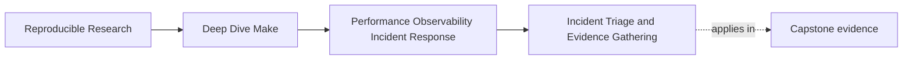
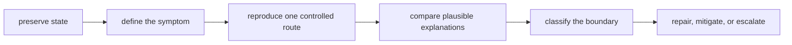
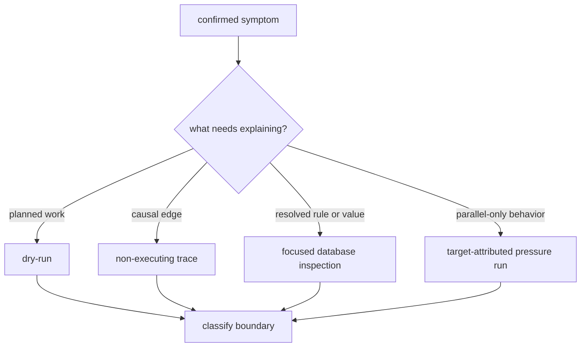
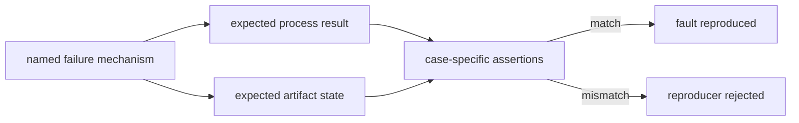

# Incident Triage and Evidence Gathering

<!-- page-maps:start -->
## Page Maps




<!-- page-maps:end -->

Build incidents interrupt feedback, so responders understandably reach for fast actions:

- rerun the route
- delete the build directory
- try serial mode
- add prints
- blame Make

Those actions can destroy the evidence. Cleaning removes timestamps and partial outputs.
Rerunning may replace the first failure with a later symptom. Serial mode removes the
pressure condition. Editing changes the system before its failure boundary is known.

This lesson teaches a safer sequence:

> preserve the incident, then follow a fixed evidence ladder before changing the system.

## The sentence to keep

When a build is slow, flaky, or surprising, ask:

> What evidence would distinguish the leading explanations while preserving the state I
> am trying to explain?

The objective is not to solve everything in one leap. It is to narrow the space of
plausible causes until one owner can make a justified decision.

## Preserve first, especially when reproduction is rare

Before cleaning or editing, capture what the current state can still tell you:

```sh
mkdir -p artifacts/module09-incident
git rev-parse HEAD > artifacts/module09-incident/revision.txt
git status --short > artifacts/module09-incident/worktree.txt
make --version > artifacts/module09-incident/make-version.txt
env | LC_ALL=C sort > artifacts/module09-incident/environment.txt
find build -type f -exec stat -f '%m %N' {} + \
  > artifacts/module09-incident/build-state.txt
```

The `stat` form above is for BSD/macOS. On GNU systems, use:

```sh
find build -type f -exec stat -c '%Y %n' {} + \
  > artifacts/module09-incident/build-state.txt
```

Review the environment file before sharing it. It may contain credentials or other
sensitive values. An incident packet needs reproducibility context, not an unfiltered
secret archive.

If the build tree is enormous, preserve only the failed target, its relevant
prerequisites, and their metadata. Evidence should be proportional to the incident.

## Establish impact before deep diagnosis

Triage begins with operational impact:

| Impact | Immediate action |
| --- | --- |
| wrong or corrupted trusted artifact | stop publication and preserve the outputs |
| parallel-only failure with a serial workaround | record serial mode as mitigation and keep the defect open |
| performance regression with correct outputs | preserve a baseline and continue controlled diagnosis |
| noisy evidence with no correctness impact | improve responder usability without declaring artifact failure |
| suspected credential or remote-service issue | stop expanding local logs and escalate to the owning boundary |

A mitigation restores a feedback route or limits damage. It is not automatically the
root-cause repair. Write down which one you are doing.

## Rewrite the complaint as an incident statement

Reports such as "CI flaked" and "it rebuilt for no reason" are not actionable yet. Use:

```text
At revision <sha>, from <build state>, command <route> produced <observed result>
in <frequency or duration>. The expected result is <expectation> because <source>.
```

Stronger examples include:

- `make -q all` returns `1` after a successful `make all`
- `make -j8 all` fails 6 of 20 attempts while `make -j1 all` passes 3 of 3
- no-op dry-run median increased from `0.3 s` to `2.8 s` on the same runner class

The expectation needs a source: a target contract, previous controlled baseline, CI
objective, or declared invariant. "It used to feel faster" is not enough.

## Use a reproducible evidence ladder

A strong default ladder is:

1. preserve the first useful state
2. state impact and apply only necessary containment
3. rewrite the symptom as a measurable claim
4. reproduce with the same target, state, environment, and parallelism
5. list a leading and competing explanation
6. choose the least disruptive evidence that distinguishes them
7. classify the boundary
8. decide whether to repair, mitigate, or escalate
9. repeat the original route and one adjacent invariant

The ladder is intentionally stable, but its evidence branch depends on the question.



## Keep reproduction controlled

Hold these conditions steady:

- target name
- checkout and local changes
- clean, incremental, no-op, or incident state
- relevant environment
- Make and tool versions
- parallelism level

When a symptom is intermittent, use a small reproduction matrix rather than random
reruns:

| State | `-j1` | `-j8` |
| --- | --- | --- |
| clean | 3 controlled attempts | 20 controlled attempts |
| no-op | 3 controlled attempts | 20 controlled attempts |

Choose counts appropriate to the failure rate and run cost. Record every attempt,
including passes. "Failed once" has a different meaning from "failed 17 of 20 times."

## Give the reproducer an acceptance contract

A small reproducer is useful only when it distinguishes the promised defect from unrelated
failure. This command is not yet an incident contract:

```sh
make -f repro.mk -j8 all
```

It may fail because an input is absent, a tool is unavailable, or a typo prevents parsing.
None of those outcomes proves a scheduling defect.

Before execution, write:

| Contract field | Question |
| --- | --- |
| starting state | which inputs and outputs must exist before the run? |
| pressure | which job count, repetition, or ordering condition exposes the defect? |
| process result | is zero, nonzero, or either acceptable? |
| semantic signature | which artifact state proves the promised mechanism occurred? |
| wrong-failure rejection | which result must make the reproducer fail its own audit? |
| preserved evidence | which logs, outputs, and workspace state support later review? |

The process result and semantic signature are separate. Consider three concurrency cases:

| Case | Process contract | Semantic contract |
| --- | --- | --- |
| two successful writers corrupt one logical record | exit `0` | both writers start before either completes |
| two recipes claim one directory setup action | nonzero | one claimant publishes and one cannot start |
| two outputs use one staging path | nonzero | one output survives after consuming the shared path |

The first case is an incident precisely because the process succeeds while the artifact
contract fails. The latter two need more than a nonzero status: the surviving filesystem
state must identify the intended collision.

Run the capstone matrix:

```sh
gmake -C programs/reproducible-research/deep-dive-make/capstone incident-audit
```

Then inspect:

```text
artifacts/audit/reproducible-research/deep-dive-make/incident/
├── summary.tsv
├── report.json
├── runs/
├── evidence/
├── workspace/
└── specimens/
```

The target returns `0` only when each deliberately broken specimen exhibits its declared
fault signature. Its aggregate `PASS` means "fault reproduced as promised," not "specimen
healthy."

This is a reusable incident-testing pattern:



Do not weaken the assertions just to make an intermittent reproducer green. Stabilize the
pressure condition, narrow the claim, or record that the defect has not been reproduced.

## Make explanations compete

Do not investigate only the first story someone proposed. For a parallel-only partial
bundle, use a table like this:

| Explanation | Evidence expected if true | Evidence that weakens it |
| --- | --- | --- |
| two targets write the same path | overlapping target-attributed output or writer search | one declared writer and stable hashes |
| a prerequisite edge is missing | consumer starts before producer completes | trace shows a complete producer-to-consumer edge |
| filesystem or runner is failing | errors outside one target route | failure follows the same graph edge across runners |

Now the next command has a purpose: it can move one explanation up and another down.

## Preview intent without changing ordinary outputs

If the question is what Make plans to do:

```sh
make -n all > artifacts/module09-incident/dry-run.txt 2>&1
```

Dry-run is useful for planned commands, unexpected route size, and apparent freshness
decisions. Inspect recursive Make lines before assuming it is fully non-mutating.

If the question is why Make selected a target:

```sh
make --trace -n all > artifacts/module09-incident/trace.txt 2>&1
```

Trace reveals causal graph decisions. It does not prove that the modeled edge is
semantically correct.

If the question is which rule or value survived includes and expansion:

```sh
make -np all > artifacts/module09-incident/make-database.txt
```

Search that dump for the specific target or variable. Do not hand off an enormous file
without the excerpt that changed your decision.

If failure only appears during parallel execution, preserve the original state first and
then capture an attributed pressure run:

```sh
make --output-sync=target --trace -j8 all \
  > artifacts/module09-incident/parallel-trace.txt 2>&1
```

Serial comparison is evidence. Permanently forcing `-j1` is not automatically a repair.

## Classify the boundary

Classification determines who should own the next action:

| Boundary | Typical evidence | Likely owner |
| --- | --- | --- |
| parse/evaluation | expensive dry-run, repeated shell-outs, include expansion | build architecture |
| graph truth | missing edge, false freshness, multiple writers | Make graph |
| recipe/tool | one external command dominates or fails | tool or recipe owner |
| publication | partial or non-atomic trusted output | producer/publication owner |
| environment | version, path, locale, shell, or runner drift | platform owner |
| evidence | output is unsearchable, interleaved, or semantically entangled | build operations |
| external service | authentication, remote state, quota, or outage | service or workflow owner |

"Make problem" is not a useful class. The table asks which responsibility is failing.

## Follow one unexpected rebuild

Suppose the report is:

> `app` rebuilds during a route expected to be a no-op.

A calm sequence is:

1. preserve timestamps and worktree state
2. confirm whether `make -q app` returns `1`
3. capture `make --trace -n app`
4. follow the named prerequisite
5. branch on the evidence

| Trace finding | Next action |
| --- | --- |
| a declared input is genuinely newer | verify whether that input changes artifact meaning |
| a generated prerequisite rewrites identical content | inspect convergence and publication behavior |
| a phony prerequisite is always reachable | decide whether always-run behavior is intentional |
| no relevant edge explains the behavior | inspect the resolved rule and implicit-rule selection |

The correct conclusion may be "the rebuild is required." Triage succeeds when it explains
behavior, not only when it finds a defect.

## Know when to stop local investigation

Escalate when:

- evidence points to credentials, remote state, or infrastructure you do not own
- collecting more data risks exposing secrets or regulated information
- artifact corruption affects a release or published research result
- containment requires changing a public target contract
- repeated evidence no longer narrows the explanations

An escalation packet should contain the symptom, impact, preserved state, commands already
run, current boundary classification, and the exact question the next owner must answer.
A raw log without that context transfers confusion, not the incident.

## Review drill

For one recent build incident, ask:

1. which state was preserved before the first mutation
2. what impact required containment
3. whether reproduction stayed controlled
4. which explanations were allowed to compete
5. whether each command increased evidence or merely changed conditions
6. whether the boundary was classified before editing
7. what should trigger escalation next time

Then write a triage note containing:

- the measurable symptom and impact
- the state to preserve
- the exact reproduction route and attempt count
- a leading and competing explanation
- the evidence that distinguishes them
- the classified boundary
- a repair, mitigation, or escalation decision

## End-of-page checkpoint

Before leaving this lesson, make sure you can explain:

- why state preservation comes before cleanup
- how impact changes immediate containment
- when dry-run, trace, database, and pressure evidence belong in the ladder
- how competing explanations improve evidence choice
- how to classify a build incident by responsibility boundary
- when local investigation should stop and escalation should begin
