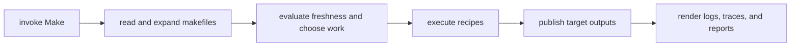
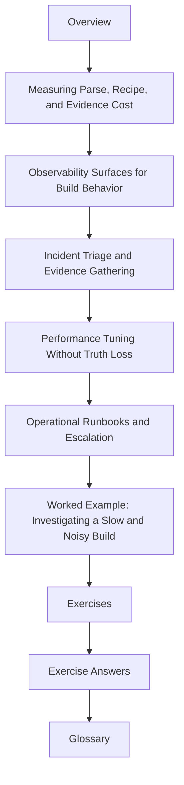

# Module 09: Performance, Observability, and Incident Response
By this point you know how to make a build correct, layered, and publishable. Module 09
starts when a real repository puts those claims under pressure:

- a route that took 40 seconds last week now takes 95
- a no-op build unexpectedly runs three recipes
- `-j8` fails once every twenty runs
- CI emits thousands of lines without explaining the failed target
- a proposed speedup removes work, but nobody can prove that the removed work was waste

Do not assume these are all performance problems. Some are graph defects, some are
environment changes, some are evidence-design failures, and only some are genuine
opportunities to tune. This module teaches you to tell the difference before changing the
build.

The goal is to protect engineering feedback loops by:

- understanding where time really goes
- making build behavior observable without changing its meaning
- responding to incidents with a repeatable ladder instead of guesswork
- tuning costs without hiding correctness defects

## Why this day matters

Late-course build work often fails in one of two ways: people optimize before they have
classified the problem, or they collect so much output that the useful evidence
disappears inside it.

The remedy is not "more profiling." It is a controlled investigation:

1. preserve the state in which the symptom occurred
2. rewrite the complaint as a measurable claim
3. choose the cheapest evidence that can distinguish the leading explanations
4. classify the boundary before proposing a change
5. verify both cost and build truth after the change

That sequence works for a slow clean build, an unexplained rebuild, a parallel-only
failure, or an unusable diagnostic route.

## Two questions that must stay separate

Every investigation in this module asks two different questions:

| Question | Example | Evidence |
| --- | --- | --- |
| What happened? | `report.pdf` rebuilt because `metadata.json` was newer | trace, timestamps, resolved prerequisites |
| Was that behavior correct? | the metadata change really does alter the report | declared contract, content comparison, convergence check |

Trace output can answer the first question without answering the second. A target may
rebuild for a visible reason and still reveal a bad dependency model. Conversely, a
surprising rebuild may be exactly correct.

Do not call a performance change safe until you can answer both questions.

## Plan for the day

| Time | Activity | Evidence you keep |
| --- | --- | --- |
| 35 minutes | Capture the complaint, route, state, and environment | incident statement |
| 70 minutes | Separate parse, decision, recipe, and evidence cost | controlled baseline |
| 55 minutes | Diagnose one unexpected rebuild without cleaning first | causality note |
| 55 minutes | Compare serial and parallel behavior | pressure comparison |
| 70 minutes | Test one truth-preserving change | before-and-after proof |
| 90 minutes | Complete the worked investigation | reusable incident packet |
| 90 minutes | Complete the ten exercises | operational runbook |

The timings are not interchangeable. A clean build, an incremental build, and a no-op
build answer different questions. Record the state before each sample, use at least three
comparable runs, and keep the command beside the number. One isolated timing is an
anecdote, not a baseline.

## What this module is for

By the end of Module 09, you should be able to explain five things clearly:

- how to separate parse cost, recipe cost, and observability cost
- which observability surfaces actually help a build incident
- how to triage a slow or flaky build without skipping straight to edits
- which performance changes preserve truth and which ones merely hide it
- how to write a runbook another engineer can use under time pressure

## Build one incident packet through the module

Create one directory for the evidence you will keep:

```text
artifacts/module09-incident/
├── incident.md
├── environment.txt
├── commands.txt
├── timings.tsv
├── dry-run.txt
├── trace.txt
├── make-database.txt
├── decision.md
└── runbook.md
```

The names describe evidence roles, not a required tool. If `make-database.txt` is too large
to retain, record the exact command and extract only the variables or rules that settled
the decision.

Build the packet in this order:


This packet is the through-line for the lessons, worked example, and exercises. A
missed-class learner should be able to inspect it later and reconstruct why each decision
was made.

## Turn “slow” into a testable statement

Before profiling, rewrite the complaint with facts that make another run comparable:

```text
Requested target:
Repository revision and local changes:
Build state: clean, incremental, no-op, or unknown
Execution mode: -j1, -jN, or inherited jobserver
Relevant environment and tool versions:
Observed result and repeated sample count:
Expected duration and source of that expectation:
```

Then separate the path:



A change aimed at the wrong box can make measurements look better while leaving the real
cost untouched. Worse, deleting prerequisites or checks can make a build faster by making
it less truthful. Keep convergence and artifact comparisons beside every timing result.

## Use a decision gate before editing

Do not move from evidence to a change until you can complete this table:

| Field | Your answer |
| --- | --- |
| measurable symptom | |
| preserved build state | |
| leading explanation | |
| competing explanation | |
| evidence that distinguishes them | |
| classified boundary | parse, decision, recipe, publication, environment, or evidence |
| invariant the change must preserve | |

If the "competing explanation" row is empty, you are at risk of collecting evidence that
only confirms your first guess. If the invariant row is empty, you are not ready to tune.

## The question to keep asking

Whenever someone says "the build is slow" or "the incident was noisy," ask:

> Which layer is expensive, and what exact evidence would prove that before we edit anything?

That question prevents a large amount of performative optimization.

## Study route



Read the module in that order the first time. Later, return directly to the page that
matches the incident or tuning question you are facing.

## The ten files in this module

1. Overview (`index.md`)
2. [Measuring Parse, Recipe, and Evidence Cost](measuring-parse-recipe-and-evidence-cost.md)
3. [Observability Surfaces for Build Behavior](observability-surfaces-for-build-behavior.md)
4. [Incident Triage and Evidence Gathering](incident-triage-and-evidence-gathering.md)
5. [Performance Tuning Without Truth Loss](performance-tuning-without-truth-loss.md)
6. [Operational Runbooks and Escalation](operational-runbooks-and-escalation.md)
7. [Worked Example: Investigating a Slow and Noisy Build](worked-example-investigating-a-slow-and-noisy-build.md)
8. [Exercises](exercises.md)
9. [Exercise Answers](exercise-answers.md)
10. [Glossary](glossary.md)

## How to use the file set

| If you need to... | Start here |
| --- | --- |
| figure out whether the cost is parse-time, recipe-time, or observability overhead | [Measuring Parse, Recipe, and Evidence Cost](measuring-parse-recipe-and-evidence-cost.md) |
| improve what the build tells you without mutating the build itself | [Observability Surfaces for Build Behavior](observability-surfaces-for-build-behavior.md) |
| respond to a slow or flaky build incident calmly | [Incident Triage and Evidence Gathering](incident-triage-and-evidence-gathering.md) |
| make the build faster without teaching it to lie | [Performance Tuning Without Truth Loss](performance-tuning-without-truth-loss.md) |
| leave behind an operational path others can follow | [Operational Runbooks and Escalation](operational-runbooks-and-escalation.md) |
| see the whole module in one realistic incident narrative | [Worked Example: Investigating a Slow and Noisy Build](worked-example-investigating-a-slow-and-noisy-build.md) |
| test your own understanding | [Exercises](exercises.md) |
| compare your reasoning against a reference | [Exercise Answers](exercise-answers.md) |
| stabilize the module vocabulary | [Glossary](glossary.md) |

## The running question

Carry this question through every page:

> what exact evidence would tell me where the cost or failure lives before I change the
> build?

Good Module 09 answers usually mention one or more of these:

- a measurement that separates layers instead of blending them
- an observability surface that reveals why the build behaved the way it did
- an incident ladder that narrows causes before edits begin
- a tuning move that keeps all semantic inputs visible
- a runbook that another engineer can follow without folklore

## What a strong Module 09 day looks like

By the end of the day, you should have:

- preserved one incident state before running cleanup or repair commands
- collected comparable measurements for named build states
- used one diagnostic surface to reject a plausible explanation
- classified the problem before proposing a change
- made or rejected one optimization based on convergence and artifact meaning
- written a runbook with branches, expected observations, and escalation conditions

## Commands to keep close

These commands form the evidence loop for Module 09:

```sh
make --trace -n all
make -p > build/make.dump
/usr/bin/time -p make -n all >/dev/null
/usr/bin/time -p make all >/dev/null
make -q all
```

The point is not to collect output for its own sake. The point is to know which evidence
answers which question. `make -q` belongs beside timing because a fast "no-op" route that
still reports work pending is not a no-op baseline.

## Learning outcomes

By the end of this module, you should be able to:

- measure distinct build costs instead of talking about "slowness" in the abstract
- add observability surfaces that help incidents without changing build semantics
- run a repeatable triage ladder for flaky or slow builds
- distinguish process status from the semantic signature that proves an incident mechanism
- tune shell-outs, discovery, and diagnostic overhead without hiding real graph issues
- publish an operational runbook that others can use under pressure

## Exit standard

Do not move on until all of these are true:

- you can show one measurement that separates parse and recipe cost
- you can point to one observability surface that meaningfully helps incidents
- you can preserve a failing state and follow a triage ladder without skipping to edits
- you can reject a reproducer that fails or passes for the wrong reason
- you can justify one performance change as truth-preserving
- you can hand another engineer an incident packet and runbook they could actually use
- you can complete all ten exercises and reproduce an incident diagnosis from saved evidence

When those feel ordinary, Module 09 has done its job.
