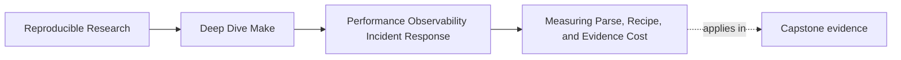
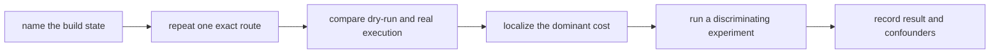

# Measuring Parse, Recipe, and Evidence Cost


<!-- page-maps:start -->
## Page Maps




<!-- page-maps:end -->

One of the most common mistakes in build-performance work is using the word "slow" as if it
meant one thing.

It rarely does.

A build can feel slow because:

- Make spends too much time parsing or expanding
- freshness decisions visit more graph state than expected
- recipes do expensive real work
- diagnostics and trace volume are operationally heavy
- humans cannot tell which of those is happening, so they make the wrong changes

This page is about separating those costs before tuning begins.

## The sentence to keep

When someone says "the build is slow," ask:

> Which route and build state are slow, and which measurement can localize the cost?

The build state comes first. A three-minute clean build and a three-minute no-op build have
very different meanings.

## Not all build time lives in the same place

A Make-based system has at least four performance surfaces worth naming:

1. parse and evaluation cost
2. freshness-decision cost
3. recipe execution cost
4. evidence-surface cost

Each one creates a different kind of problem and needs a different kind of fix.

Treating them as one undifferentiated "performance problem" is how teams end up rewriting
the wrong layer.

The first two are difficult to isolate perfectly with ordinary command-line timing because
both happen before recipes run. In this module, dry-run and no-op timings are localization
signals, not precise internal profiles. State that limitation instead of claiming that
`make -n` measures parsing alone.

## Parse and evaluation cost

This is the time Make spends:

- reading included files
- expanding variables
- running parse-time shell expressions
- constructing its internal view of the graph

Typical warning signs:

- `make -n all` already feels heavy
- the build has many `$(shell ...)` calls
- include files do expensive work at parse time
- rule generation or repeated expansions dominate before any real tool runs

This cost is architectural. It has more to do with how the build is described than with how
expensive the compiler or tests are.

## Freshness-decision cost

After parsing, Make decides whether each requested target is current and which recipes are
runnable. Cost can grow because of:

- a very large reachable graph
- broad generated dependency files
- repeated or recursive traversal of overlapping routes
- expensive included makefiles that must first be remade

Dry-run includes this work, so an expensive dry-run does not by itself prove that variable
expansion is the cause. A useful next experiment changes one suspected parse-time habit
while keeping the requested target and graph state constant. Another compares a narrow
target with a broad aggregate target. The contrast is what narrows the boundary.

## Recipe execution cost

This is the time spent in the actual external work:

- compilation
- linking
- testing
- packaging
- code generation

Typical warning signs:

- `make -n all` is cheap, but `make all` is expensive
- one tool invocation dominates the wall clock
- adding cores or changing tool flags matters more than changing Make structure

This is often where teams incorrectly blame Make for costs that belong to the underlying
tools.

## Evidence-surface cost

This is the cost of making the build understandable:

- trace volume
- dump size
- amount of output humans must sift through during incidents

This cost matters because a build can be semantically correct and still be operationally
painful if its evidence is too noisy to use under pressure.

Examples:

- `--trace` output is enormous
- one incident requires scrolling through thousands of low-value lines
- diagnostic targets dump unstable or redundant information no one can use

This is not purely cosmetic. Observability quality affects how quickly the team can debug
the build.

## Name the build state before timing

Use these states deliberately:

| State | How to establish it | Question it answers |
| --- | --- | --- |
| clean | use the repository's documented clean/reset route | how expensive is full production? |
| incremental | change one declared input | is the affected rebuild scope proportionate? |
| no-op | complete the route, then confirm `make -q` succeeds | what does an up-to-date invocation cost? |
| incident | preserve the state in which the symptom appeared | why did this particular behavior occur? |

Never run `clean` automatically during incident triage. Cleaning destroys timestamps,
partial outputs, and other state that may explain the event. Establish clean state only
when the measurement question explicitly requires it.

## A controlled measurement protocol

Before collecting numbers, record:

```text
repository revision:
local changes:
requested target:
build state:
job count:
Make version:
relevant tool versions:
machine or runner:
notable background load:
```

Then collect repeated samples without changing those fields. A small shell loop is enough
for a local comparison:

```sh
for sample in 1 2 3 4 5; do
  /usr/bin/time -p make -n all >/dev/null
done
```

Keep all samples. Report the median for a simple comparison, plus the minimum and maximum
so readers can see whether the route was stable. Five samples do not make a benchmark
scientific; they do make it harder to mistake one lucky run for the result.

## Pair measurements that answer different questions

Start with a no-op route when you want to localize Make-side overhead:

```sh
make all
make -q all
/usr/bin/time -p make -n all >/dev/null
/usr/bin/time -p make all >/dev/null
make --trace -n all > build/trace.log 2>&1
wc -l build/trace.log
```

This gives you:

- a confirmed no-op precondition
- a dry-run signal containing parse, evaluation, and freshness decisions
- a real no-op signal containing the same work plus any recipes that still run
- a rough size signal for one non-mutating trace

`--trace -n` is the safe first probe because ordinary `make --trace all` may execute
recipes and change the state you are trying to study. GNU Make can still execute recursive
Make recipe lines under `-n`; inspect the preview and use a disposable copy if the route
contains recursion or other unusual behavior.

That is not a full profiler. It is enough to stop guessing blindly.

## Why `make -n` is such a useful lens

`make -n` normally prints recipes instead of executing them, but it still performs parse,
evaluation, include-remake, and graph-decision work.

That means:

- if `make -n all` is already expensive, your first suspect is not the compiler
- if `make -n all` is cheap and `make all` is expensive, your first suspect is probably not Make itself

This is one of the simplest and most useful distinctions in the module.

It lets you say:

> this complaint is probably before ordinary recipe execution

or:

> this complaint appears only when recipes execute

Those are useful localizations, not final diagnoses. You still need a second experiment to
separate parsing from graph decisions or to identify the expensive recipe.

## Trace volume is a real operational metric

Some engineers treat trace volume as secondary because it does not always change wall-clock
time much. That misses the point.

A build whose evidence is too large or too noisy can still be expensive in practice because:

- incidents take longer to diagnose
- maintainers avoid using the evidence surfaces
- real signals get buried under routine noise

That is why a simple metric like trace line count can still be useful:

```sh
make --trace -n all > build/trace.log 2>&1
wc -l build/trace.log
```

Line count is only a proxy. A 2,000-line trace with stable target names and a clear failure
point may be more useful than a 200-line stream of interleaved shell output. Also record:

- whether target and prerequisite names are visible
- whether parallel output stays attributable to one target
- how long it takes a new responder to find the first causal line

The goal is not "fewest lines wins." The goal is evidence that a responder can search,
attribute, and interpret.

## A small comparison example

Assume both cases use the same no-op state and five repeated samples.

### Case A

```text
make -n all   -> 2.9s
make all      -> 3.2s
trace lines   -> 240
```

This localizes most cost before ordinary recipes. The next experiment should compare a
narrow and broad target or remove one suspected parse-time shell-out while preserving the
same graph state.

### Case B

```text
make -n all   -> 0.2s
make all      -> 18.0s
trace lines   -> 180
```

This suggests the added cost mostly appears during recipe execution. The next experiment
should time or profile the tools on the critical route rather than rewrite Make syntax.

This is why measurement separation matters so much. It changes what a rational next move
looks like.

## Interpret differences, not isolated numbers

Use a table like this:

| Observation | Plausible explanation | Discriminating next experiment |
| --- | --- | --- |
| dry-run and no-op are both slow | parse, evaluation, includes, or graph traversal | compare narrow and aggregate targets; audit parse-time shell-outs |
| dry-run is cheap, clean build is slow | recipe or tool cost | capture recipe timing on the critical route |
| no-op unexpectedly executes recipes | phony target, unstable output, or false freshness | use `--trace` and inspect timestamps or content |
| `-j1` is stable but `-j8` fails | missing edge, shared writer, or non-atomic publication | preserve failure and compare target-attributed output |
| trace is fast but hard to use | evidence design rather than runtime | test searchability and attribution, not only line count |

A good experiment is one whose possible outcomes imply different next actions. Repeating
the same timing with no competing explanation is activity, not diagnosis.

## Control common confounders

Build timings vary for reasons unrelated to the change under review:

- warm filesystem or compiler caches
- background load
- network access
- thermal throttling
- antivirus or indexing activity
- different jobserver or `-j` settings
- changing checkout state between samples

You do not need a laboratory to learn from local timings. You do need to record the
largest known confounders, compare like with like, and avoid precision the setup cannot
support. Report `1.3 s`, not `1.287431 s`, when the route varies by tenths of a second.

## Parse cost often comes from habits, not obvious bugs

A build may have parse overhead because of design habits like:

- repeated `$(shell find ...)`
- overuse of `eval`
- broad, unsorted discovery
- too many layers doing similar work at parse time

These are not dramatic failures. They are accumulations.

That is why Module 09 frames performance work as architecture plus operations, not just
micro-optimizations.

## Recipe cost often needs tool-level thinking

When recipe time dominates, the right next question is often not:

> how do we optimize the Makefiles?

It is often:

> which tool invocation is doing the expensive work, and is that work justified?

This might point to:

- compilation flags
- test scope
- packaging compression level
- repeated code generation

Make still matters because it orchestrates those steps, but the cost may not belong to its
own layer.

## Evidence cost should stay proportional to the incident value

A build should expose enough evidence to make incidents explainable. It should not emit so
much routine noise that the team stops using its own observability surfaces.

That means observability design is part of performance design:

- bounded diagnostic targets
- clear trace usage
- no unstable debug prints inside semantic outputs

This is the part of performance work many teams ignore until an incident forces them to
care.

## Failure signatures worth recognizing

### "`make -n all` is already slow"

That usually points to parse, expansion, or discovery cost.

### "`make all` is slow, but dry-run is cheap"

That usually points to real tool or recipe cost rather than Make structure.

### "We technically have trace output, but nobody can use it under pressure"

That means evidence-surface cost is too high.

### "We optimized something and saw no measurable difference"

That usually means the change targeted the wrong layer.

## A review gate for measurement claims

Before anyone proposes a build-performance change, ask:

1. what exact target and state were measured
2. whether commands, versions, job count, and all samples were retained
3. which layer the evidence localizes and what it cannot distinguish
4. what competing explanation was considered
5. which next experiment can separate those explanations
6. which correctness invariant must survive any optimization

If those answers are weak, the tuning proposal is probably weak too.

## What to practice from this page

Choose one build route and produce a short measurement note:

1. a named build state and exact route
2. five dry-run samples and five comparable real-run samples
3. a trace usability observation, not just its line count
4. one leading and one competing explanation
5. one experiment whose outcomes would distinguish them
6. one invariant that future tuning must preserve

If you can do that clearly, you have already improved the quality of performance
discussion a lot.

## End-of-page checkpoint

Before leaving this lesson, make sure you can explain:

- why "slow build" is not a sufficient diagnosis
- why build state must be named before timing
- what parse and evaluation cost means
- why dry-run cannot perfectly isolate parse cost
- what recipe cost means
- why evidence-surface cost is operationally real
- how a discriminating experiment changes the next engineering decision
