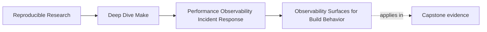
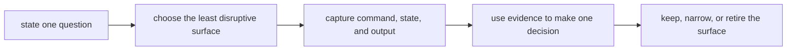

# Observability Surfaces for Build Behavior


<!-- page-maps:start -->
## Page Maps




<!-- page-maps:end -->

Teams often discover they have a build observability problem only during an incident.

They already know the build is:

- correct enough most days
- fast enough some of the time
- difficult to explain when something surprising happens

Then the team starts improvising:

- add `echo` lines to recipes
- print variables in random places
- dump timestamps into files
- leave debug scaffolding inside the real build

That is understandable under pressure. It is usually not a good long-term observability
strategy.

This page is about choosing evidence surfaces that help without mutating the truth you are
trying to observe. The goal is not a permanently verbose build. The goal is a repository
where a responder can ask one question, run one discoverable route, and interpret the
result.

## The sentence to keep

When you add build observability, ask:

> What decision will this evidence support, and what state could collecting it disturb?

That question separates operational evidence from accidental instrumentation.

## Observability should answer concrete questions

Good build observability tells you things like:

- what ran
- why it ran
- what Make believed about variables and rules
- which discovery or manifest state was in effect
- how much evidence was emitted

That is why the module treats observability as a set of specific surfaces instead of one
general desire for "more logs."

An evidence surface is useful only when its output changes a decision. Before collecting
anything, complete this sentence:

> If the evidence shows ___, I will test ___ next; if it shows ___, I will test ___ instead.

If both blanks lead to the same action, the surface may be ceremonial rather than
diagnostic.

## Start with the least disruptive surface

Move from low-disruption evidence to heavier inspection:

| Question | First surface | What it cannot establish alone |
| --- | --- | --- |
| what would run | `make -n <target>` | whether the recipes would succeed |
| why Make selected a target | `make --trace -n <target>` | whether the modeled dependency is semantically correct |
| what value or rule Make resolved | `make -np <target>` plus a focused search | why the value was intended |
| which outputs differ under pressure | serial/parallel artifact comparison | which edge or writer caused the difference |
| which target emitted a parallel log line | `--output-sync=target` | why the target failed |
| what discovery resolved | a stable audit target or manifest | whether the discovery policy is complete |

The final column matters. Every built-in surface exposes one view of the system, not
omniscience.

## `--trace` answers causality questions

If you want to know:

- why a target ran
- which prerequisite edge triggered the rebuild
- where the relevant rule lives

then `--trace` is one of the best built-in tools:

```sh
make --trace -n all > artifacts/module09-incident/trace.txt 2>&1
```

This is valuable because it grounds the incident in graph behavior rather than in stories.

Begin with `-n` so ordinary recipes do not change incident state. Inspect the preview
before trusting it as completely non-mutating: recursive Make lines can still execute
under GNU Make's dry-run behavior, and included makefiles may have remake semantics.

Trace tells you which rule and prerequisite caused Make's decision. It does not prove that
the edge is correct. After finding the causal line, compare the edge with the artifact
contract.

## `-p` answers evaluated-world questions

If the question is:

- what value did a variable really have
- which rule is actually present after includes and expansion
- what does the final Make database look like

then `-p` is more appropriate:

```sh
make -np all > artifacts/module09-incident/make-database.txt
```

Pairing `-p` with `-n` avoids ordinary recipe execution. The dump can still be large, so
search it for one named variable or target instead of reading from the top:

```sh
rg -n '^(SRCS|CPPFLAGS|build/report\\.pdf):' \
  artifacts/module09-incident/make-database.txt
```

Record the command and the focused excerpt that affected the decision. A multi-megabyte
dump with no interpretation is storage, not evidence.

That distinction matters because one of the most common observability mistakes is using the
right tool for the wrong question.

## Preserve target attribution in parallel output

Parallel builds can turn useful recipe output into an interleaved stream. Before adding
custom logging, try GNU Make's output synchronization:

```sh
make --output-sync=target -j8 all \
  > artifacts/module09-incident/parallel.txt 2>&1
```

This groups each target's output so a responder can tell which recipe emitted a message.
It does not repair races or missing edges. It improves attribution while preserving the
pressure condition that exposed them.

Do not "debug" a parallel-only failure by switching permanently to `-j1`. A serial
comparison is evidence; serialization is not automatically a repair.

## Bounded diagnostic targets are healthier than scattered debug prints

A good repository often grows one or two focused diagnostic targets such as:

- `trace-report`
- `perf`
- `discovery-audit`
- `contract-audit`
- `profile-audit`

These are healthier than ad hoc `echo` statements scattered through normal recipes because
they:

- answer a specific question
- keep the evidence surface discoverable
- avoid changing normal semantic outputs

For example, the capstone exposes:

```make
.PHONY: trace-report

trace-report:
	@$(MAKE) clean
	@$(MAKE) --trace -n all > trace.log 2>&1
	@python3 scripts/analyze_trace_evidence.py ...
```

Use `$(MAKE)` for recursive invocations so GNU Make can propagate jobserver and command-line
context correctly. The report records:

- `state=clean-plan`, so the line count has a declared meaning
- `focus_target=all`, so the report can prove the requested route is visible
- planned targets and rule locations, so causality remains attributable
- separate checks for focus visibility, rule attribution, and bounded volume

This is much easier to explain, test, and retire than a hundred one-off debug prints.

The capstone's `perf` target is a different kind of bounded surface. It writes repeated
timings, scenario policy, context, convergence proof, and trusted-output inventories to one
review bundle. That route answers a cost question. `trace-report` answers a planning
causality and usability question. Keeping both distinctions visible prevents one convenient
integer from carrying claims it cannot support.

A converged trace may contain only “all is up to date.” A clean-plan trace contains every
planned producer. Comparing those line counts without the state label is invalid. Fewer
lines can mean less evidence because there was less requested work, not a better diagnostic
surface.

Run the gate tests when reviewing the evidence route itself:

```sh
gmake performance-selftest
```

The controlled rejection cases matter as much as the passing capture. They demonstrate
that failed commands, incompatible policies, unequal sample counts, and artifact drift
cannot quietly produce an accepted comparison.

## Debug prints become dangerous when they leak into artifacts

One easy way to make observability harmful is to let diagnostics become part of semantic
outputs.

Examples:

- writing timestamps into generated files just to see when something ran
- printing local host info into a packaged artifact
- mixing debug status text into manifests that are supposed to be stable

That is not observability anymore. That is output mutation disguised as debugging.

This is why the module keeps insisting that observability should stay beside the artifact or
inside dedicated evidence routes, not inside the meaning of the build itself.

## An evidence-selection table

Here is a practical split:

| Question | Better surface | Evidence to retain |
| --- | --- | --- |
| why would this rebuild | `make --trace -n <target>` | smallest causal excerpt |
| what variable or rule is resolved | `make -np <target>` | command and focused excerpt |
| which target emitted output under `-j` | `--output-sync=target` | target-attributed failure block |
| is a clean plan bounded and attributable | `trace-report` | state, focus, checks, planned targets, raw trace |
| what do declared build states cost | `perf` | policy, all samples, context, convergence, inventories |
| did cost change under one semantic contract | `performance-compare` | both bundles and comparison report |
| what discovery resolved | discovery audit or stable manifest | sorted resolved list |
| what changed between serial and parallel output | artifact hashes or comparison selftest | both commands and comparison result |

This table is useful because it prevents the common habit of treating all evidence as one
generic "debug output" category.

## Discovery and manifest audits can be real observability surfaces

Some of the most useful build evidence is not about timing or trace. It is about resolved
state:

- which files discovery found
- what a manifest currently declares
- what a contract file contains

That evidence becomes more valuable when it is exposed through stable, named routes rather
than by asking every maintainer to remember one-off shell commands.

For example:

```make
.PHONY: discovery-audit

discovery-audit:
	@printf '%s\n' $(SRCS)
```

This surface is safe only if printing `$(SRCS)` cannot reinterpret spaces or other
unsupported path characters in a way the build itself does not support. An audit target
should reveal the actual contract, including its limitations, rather than pretend the
contract is broader than it is.

The architectural point is:

- observable state should have a home
- not merely a memory

## Observability should be bounded

More output is not automatically better observability.

If the build emits:

- too much trace
- too many redundant debug lines
- too many unstable dumps

then the evidence surface becomes expensive to use.

This is why the course prefers bounded diagnostic targets:

- they answer one question
- they keep output size proportional to value
- they make normal build routes easier to live with

That is a much better pattern than sprinkling temporary prints everywhere and never cleaning
them up.

## Every retained surface needs a lifecycle

When a diagnostic route becomes permanent, give it four properties:

1. a named question
2. an expected output shape
3. an explicit side-effect contract
4. an owner who will update or remove it

Some incident-only evidence should not become a target at all. Keep the command in the
incident packet and retire it when the question is settled. Permanent surfaces are for
questions maintainers expect to ask again.

## A useful anti-pattern: "debug by mutation"

One of the clearest observability anti-patterns is debugging by mutation:

- change outputs to prove a step ran
- bake local state into artifacts
- add hidden files inside normal routes just to inspect them later

This is tempting because it produces visible evidence quickly. It is still a bad habit
because it changes the system you are trying to observe.

The healthier move is:

- add a sidecar evidence surface
- add a bounded diagnostic target
- use non-executing `--trace` or database inspection first

Those choices preserve trust.

## Worked decision: an unexpected rebuild

Suppose `build/report.pdf` rebuilt during a no-op route.

1. Confirm the state:

   ```sh
   make -q build/report.pdf
   ```

2. Capture causality without running the recipe again:

   ```sh
   make --trace -n build/report.pdf \
     > artifacts/module09-incident/report-trace.txt 2>&1
   ```

3. If the trace names `build/metadata.json`, inspect only the relevant rule:

   ```sh
   make -np build/report.pdf \
     > artifacts/module09-incident/make-database.txt
   rg -n '^build/(report\\.pdf|metadata\\.json):' \
     artifacts/module09-incident/make-database.txt
   ```

4. Compare the modeled edge with the contract:
   does metadata content alter the report, or is the edge merely ordering work?

The observability route ends in a semantic decision. It does not end when the command
produces output.

## Failure signatures worth recognizing

### "We added more logging, but incidents are still hard to explain"

That often means the output answers no specific question or is too noisy to use.

### "The only way to debug this build is to edit the Makefiles"

That means the repository is missing named observability surfaces.

### "Our manifests or bundles keep changing because of debug info"

That means observability has leaked into semantic outputs.

### "No one knows whether to use `--trace` or `-p`"

That means the team lacks a shared map from questions to tools.

## A review question that improves observability design

Take one evidence surface and ask:

1. what decision its result can change
2. how a newcomer discovers and invokes it
3. what state collecting it might mutate
4. whether its output is attributable, searchable, and bounded
5. what it cannot establish without another source
6. whether a built-in Make surface already answers the question
7. who owns its lifecycle if it remains permanent

If those answers are weak, the observability design is weak too.

## What to practice from this page

Choose one Make-based build and write down:

1. one operational question with two possible outcomes
2. the least disruptive surface that distinguishes those outcomes
3. the exact command and retained excerpt
4. one conclusion the surface supports and one it cannot support
5. whether the route should be permanent, incident-only, or removed

If you can do that cleanly, you are treating observability as design instead of as a pile
of prints.

## End-of-page checkpoint

Before leaving this lesson, make sure you can explain:

- why observability should answer explicit questions
- when `--trace` is the right tool
- when `-p` is the right tool
- how output synchronization helps preserve target attribution
- why bounded diagnostic targets are healthier than scattered debug prints
- why debug-by-mutation is dangerous in a build system
- why evidence collection must end in a semantic or operational decision
