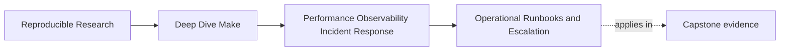

# Operational Runbooks and Escalation


<!-- page-maps:start -->
## Page Maps




<!-- page-maps:end -->

By the time a Make build reaches production usefulness, one question becomes unavoidable:

> if the maintainer who understands the build best is unavailable, can another engineer
> still respond to an incident competently?

If the answer is no, the build is operationally weak even if the Makefiles are beautiful.

This page is about turning build knowledge into a runbook that transfers.

## The sentence to keep

When you write a runbook, ask:

> What should a responder observe, decide, and preserve at each point before they edit,
> contain, recover, or escalate?

That is the difference between an executable runbook and a list of familiar commands.

## A runbook is not a memoir

Weak runbooks often read like this:

- remember that this used to fail on CI once
- ask the maintainer if `-j` is involved
- maybe run a few commands

That is institutional memory, not an operational tool.

A useful runbook should give:

- a precise entry condition and scope
- safety warnings and state-preservation instructions
- commands with expected observations
- branches that change the next action
- containment and recovery routes
- verification after recovery
- an owner and escalation packet

This is why Module 09 ends here. The module is not complete until the knowledge becomes
transferable.

## Start with a runbook contract

The first screen should tell a responder whether this is the right document:

```text
Title: Parallel release bundle failure
Use when: `make -j8 dist` fails, publishes a partial bundle, or differs from `-j1`
Do not use when: upload authentication or remote publication has failed
Trusted outputs at risk: dist/report.tar.gz and checksum
First safety action: stop publication; do not clean or rerun yet
Owner: build maintainers
Escalation owner: release engineering
Last verified: <date and repository revision>
```

A runbook without entry and exit boundaries becomes a catch-all. A runbook without an
owner becomes historical prose.

## What a build runbook should answer

A serious build runbook often needs to answer at least these questions:

- how do I confirm convergence
- how do I compare serial and parallel behavior
- how do I inspect resolved variables or rules
- how do I collect evidence without mutating the system
- what observations change the next action
- what containment is safe while diagnosis continues
- how do I know service or feedback has recovered
- when is the incident large enough to escalate

Those questions are stable even as the exact repository evolves.

## Use an executable structure

One practical shape is:

1. purpose, entry condition, and owner
2. trusted outputs and safety warnings
3. state-preservation commands
4. symptom confirmation
5. decision branches with expected observations
6. containment options labeled as temporary
7. recovery and invariant checks
8. escalation criteria and packet
9. closure evidence and follow-up owner

That keeps the runbook short enough to use while still being concrete enough to matter.

## Commands need expected observations

This is weak:

```text
Run `make --trace all`.
```

This is operational:

```text
Run `make --trace -n dist > artifacts/incident/trace.txt 2>&1`.
Expected: one declared writer for `dist/report.tar.gz`.
If two targets name the same output, classify as graph/publication ownership and stop.
If one writer is present, continue to the prerequisite-completion branch.
```

The command, expected observation, and branch form one unit. Removing any one of them
forces the responder to improvise.

## Branch on trusted state before exit status

Runbooks often begin with:

```text
If the command failed, follow the failure branch.
If it passed, close the incident.
```

That split is too weak for build systems. A command can succeed while leaving stale,
interleaved, incomplete, or wrongly owned artifacts. A command can also fail after one
producer has already published trusted state.

Use a two-axis entry table:

| Process result | Trusted artifact satisfies its contract? | Runbook action |
| --- | --- | --- |
| zero | yes | continue to convergence and adjacent invariants |
| zero | no | contain publication; classify semantic corruption |
| nonzero | yes | preserve artifact and classify recipe or evidence failure |
| nonzero | no | contain publication; inspect partial state before cleanup |

The second and fourth rows are easy to mishandle. The capstone incident matrix makes both
visible:

```sh
gmake -C programs/reproducible-research/deep-dive-make/capstone incident-audit
```

- the shared-log case exits zero but fails its record-order contract
- the directory case exits nonzero after one claimant publishes
- the staging case exits nonzero after one output consumes the shared staging path

An executable runbook should therefore name the artifact assertion beside the command:

```text
Run: `gmake incident-audit INCIDENT_CASE=shared-log-interleaving`
Expected process result: audit exits zero after verifying the controlled fault
Expected finding: `SEMANTIC_CORRUPTION_REPRODUCED`
Required evidence: both writer starts precede both writer ends in preserved `shared.log`
Reject: zero exit with contiguous records, absent records, or an unrelated parse failure
Next branch: publication ownership
```

Notice the two levels of status. The inner specimen exits zero because its append commands
succeed. The outer audit exits zero only because it verified the promised corruption.
Without named findings and artifact assertions, responders can confuse those meanings.

For a successful-but-stale production build, use the same structure:

```text
Observed process: zero
Observed artifact: still contains the pre-change value
Expected artifact: reflects the changed semantic input
Classification: graph truth, likely missing producer or consumer edge
Containment: stop publication; preserve inputs, outputs, timestamps, and trace
Repair proof: rerun from the same mutation, observe the causal trace, refreshed artifact,
and convergence
```

Do not run `clean` before preserving this state. A clean rebuild may produce the correct
artifact while erasing the missing-edge evidence.

## Convergence belongs near the top of recovery checks

One of the most useful operational checks is still:

```sh
make all
if make -q all; then
  printf '%s\n' 'converged'
else
  status=$?
  printf 'not converged or query failed: %s\n' "$status"
fi
```

Do not reduce every nonzero status to "not converged." GNU Make uses query-mode status to
distinguish up-to-date work from pending work and errors. The runbook should say which
status and output are expected in this repository.

Convergence belongs in recovery verification because it asks whether the repaired build
settles after a successful run. If the incident itself is an unexplained rebuild, preserve
state and trace first rather than running `make all` immediately.

## Compare serial and parallel routes without contaminating them

Many build incidents become clearer when the runbook teaches a comparison like:

```sh
make -j1 dist
sha256sum dist/report.tar.gz > artifacts/incident/serial.sha256

make -j8 dist
sha256sum dist/report.tar.gz > artifacts/incident/parallel.sha256

cmp artifacts/incident/serial.sha256 artifacts/incident/parallel.sha256
```

These commands are illustrative, not safe to run back-to-back in the same build tree
unless the repository provides a documented reset that recreates identical starting
state. A real runbook should use isolated workspaces or a governed fixture so the serial
run cannot warm or mutate the parallel run's inputs.

This is operationally valuable because it gives the responder a standard test for:

- hidden races
- shared output paths
- publication-order bugs

Without that explicit step, engineers often improvise their own parallel tests and make the
incident harder to compare.

## Runbooks should map questions to commands

One strong habit is to pair questions with the right surface:

| If you need to know... | Start with... |
| --- | --- |
| why a target would rebuild | `make --trace -n <target>` |
| what Make believes about variables and rules | `make -np <target>` plus a focused search |
| whether the build converges | `make -q` after a successful run |
| whether the issue is parse-time or recipe-time | timed `make -n` versus timed `make all` |
| whether parallelism changes behavior | isolated serial versus `-j` artifact comparison |

This is a very practical way to make the runbook teach judgment rather than just list tools.

## Escalation should not be vague

A good runbook also says when the responder should stop treating the incident as a local
repair and escalate.

Reasonable escalation triggers include:

- the incident cannot be reproduced with a stable route
- the likely failure boundary crosses tool ownership lines
- the evidence suggests environment or infrastructure drift beyond the repository contract
- the fix would require weakening correctness to recover speed
- the incident affects a trusted release or published research result
- logs may contain secrets or protected data
- the responder has repeated the same branch without narrowing the boundary

These criteria matter because they protect the build from panicked shortcuts under pressure.

## A branched runbook example

```text
Entry: `make -j8 dist` failed or produced a bundle that differs from `-j1`.

Safety:
- stop `publish`
- do not clean either workspace
- retain both bundles, checksums, command output, revision, and Make version

Confirm:
- repeat only in the governed fixture or isolated workspace
- record pass/fail counts and target-attributed output

Branch A: two routes write the same trusted path
- classify as graph/publication ownership
- containment: use the documented serial route, labeled as temporary
- escalate to build maintainers with both traces

Branch B: one writer starts before a prerequisite completes
- classify as missing graph edge
- do not publish either bundle
- repair the edge, then repeat serial/parallel comparison and convergence

Branch C: artifacts match and only output is interleaved
- classify as evidence attribution
- test `--output-sync=target`
- keep semantic outputs unchanged

Close only when:
- original pressure route passes the stated repetition count
- serial and parallel artifact comparisons satisfy the contract
- the next run converges
- incident packet and follow-up owner are recorded
```

This is still compact, but each observation has a different next action.

## Separate containment, recovery, and repair

These words describe different responsibilities:

| Action | Purpose | Example |
| --- | --- | --- |
| containment | prevent further harm | stop publication of suspect bundles |
| mitigation | restore a usable route temporarily | document `-j1 dist` while preserving the parallel reproducer |
| recovery | return the route to a verified service state | rebuild from a governed input state and verify the artifact |
| repair | remove the root cause | declare the missing edge or establish one writer |

A runbook should label each action. Otherwise a temporary workaround quietly becomes the
permanent architecture.

## Make escalation packets actionable

An escalation packet should answer:

- what happened and what impact remains
- which state was preserved
- what containment is active
- which commands and branches were completed
- which explanations were weakened or strengthened
- which boundary appears to own the problem
- what exact question the next owner must answer

The packet should not require the next owner to reread every log before understanding why
they were contacted.

## Runbooks should preserve evidence discipline

One easy way to ruin a runbook is to fill it with commands that change the system too early:

- `rm -rf build`
- rebuild from scratch
- disable parallelism
- comment out rules

Those steps may eventually be necessary. They should not be the first moves.

The runbook should teach responders to gather evidence before changing conditions so that
the investigation remains explainable.

Destructive recovery commands belong after explicit evidence preservation, and only when
the runbook names what they remove and how the starting state will be recreated.

## A runbook should have a human reader in mind

The audience for a runbook is not the original author on their best day. It is usually:

- a teammate under time pressure
- someone less familiar with the build
- someone trying to avoid making the problem worse

That means the runbook should:

- avoid inside jokes and maintainers-only shorthand
- use stable target names
- explain what success or failure of a command means
- avoid depending on history lessons
- define abbreviations and repository-specific assumptions
- state how the runbook itself is verified

This is a pedagogy issue as much as an operations issue.

## Failure signatures worth recognizing

### "Only one person knows which commands to run first"

That means the build knowledge has not been operationalized.

### "Our runbook starts with destructive cleanup"

That usually means the runbook is skipping evidence discipline.

### "People escalate too late and keep trying random edits"

That means escalation criteria are too vague or missing.

### "The runbook lists commands but not what they mean"

That means it is not yet teaching interpretation.

## A review question that improves runbooks

Take one build runbook and ask:

1. whether its entry and exit conditions are unambiguous
2. whether a teammate could follow it without private context
3. whether the first commands preserve evidence
4. whether each command has an expected observation and branch
5. whether containment, recovery, and repair are labeled correctly
6. whether escalation names an owner and packet
7. when the runbook was last exercised against a governed fixture

If those answers are weak, the runbook is weak too.

## What to practice from this page

Write a small runbook for one build route that includes:

1. a precise entry condition and trusted outputs at risk
2. the first preservation and containment actions
3. two evidence branches with different next actions
4. one safe convergence check
5. one isolated serial/parallel comparison
6. one escalation trigger, owner, and packet requirement
7. closure criteria and a date for the next runbook exercise

If you can do that cleanly, you are moving from personal debugging skill to operational
support skill.

## End-of-page checkpoint

Before leaving this lesson, make sure you can explain:

- why runbooks are part of build health
- why commands require expected observations and branches
- why containment, mitigation, recovery, and repair must stay distinct
- how to compare serial and parallel routes without contaminating the experiment
- why escalation criteria should be explicit
- what makes an escalation packet actionable
- why operational transfer is different from one maintainer "just knowing the system"
