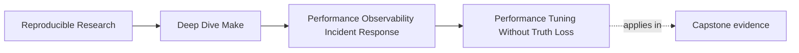
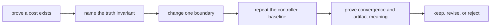
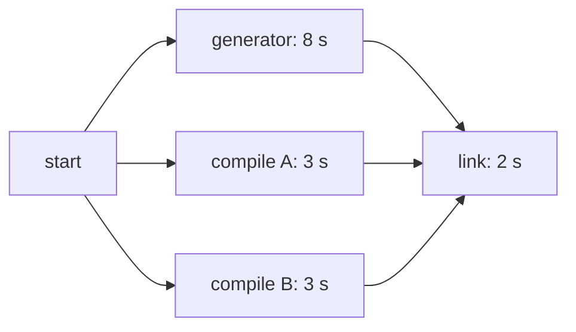

# Performance Tuning Without Truth Loss


<!-- page-maps:start -->
## Page Maps




<!-- page-maps:end -->

Once a team can measure cost and triage incidents, the next temptation is obvious:

optimize quickly.

That is where a lot of build systems get into trouble, because "faster" changes are often
proposed in forms like:

- skip a rebuild by dropping a prerequisite
- serialize a flaky route to make the symptom disappear
- cache something without modeling the cache boundary
- reduce logs by removing the evidence that showed the bug

Those changes can make the build look faster. They do not make it healthier.

This page is about a stricter rule:

> a performance change only counts if it reduces waste while preserving the build's truth.

## The sentence to keep

Before calling something a performance improvement, ask:

> What cost did this remove, which invariant could it break, and what evidence proves that
> invariant still holds?

If the invariant and its proof are missing, the change is not ready for review.

## Write the experiment contract before the edit

Use this table before touching the Makefile:

| Field | Example |
| --- | --- |
| measured cost | no-op `make -n all` median is `2.4 s` |
| localized boundary | repeated source-discovery shell-outs during evaluation |
| proposed change | resolve declared shallow roots with Make functions |
| invariant at risk | the resolved source set must still include additions and removals |
| controlled comparison | same revision, no-op state, machine, target, and five samples |
| semantic proof | compare resolved source lists; add and remove one source; verify convergence |
| rejection condition | source discovery becomes stale or timing change is within observed noise |

The rejection condition prevents every implemented idea from being described as a win.
Sometimes the responsible result is: the optimization did not reduce meaningful cost, so
we reverted it.

## Good tuning removes waste, not responsibility

Healthy performance work often removes one of these:

- repeated parse-time shell calls
- unnecessary recomputation of stable derived state
- redundant rule generation
- oversized evidence surfaces that answer no useful question

What it should not remove is:

- a real semantic input
- a necessary rebuild
- a useful diagnostic route
- a safety boundary around publication

The distinction matters because builds are easiest to "speed up" by making them less honest.

## Prefer removing repeated work before adding a cache

The safest performance changes often simplify repeated work:

- compute one simply expanded variable instead of repeating an expensive expansion
- replace several identical shell probes with one declared result
- narrow a broad aggregate route when callers need a smaller public target
- stop rewriting a file when its content is unchanged

These changes preserve the same observation contract while doing less redundant work.
Caching adds a new freshness contract, so it needs stronger justification.

## Caching is allowed only behind a truthful refresh boundary

One good performance move is to cache expensive derived state behind a truthful boundary.

Suppose source-name discovery is expensive and the repository supports only two shallow
source roots. A manifest can depend on the script and those directory-entry sets:

```make
SOURCE_ROOTS := src/app src/lib

build/discovery.manifest: scripts/list_sources.py $(SOURCE_ROOTS) | build/
	@set -eu; \
	tmp="$@.tmp"; \
	trap 'rm -f "$$tmp"' 0; \
	python3 scripts/list_sources.py $(SOURCE_ROOTS) > "$$tmp"; \
	if ! cmp -s "$$tmp" "$@" 2>/dev/null; then mv "$$tmp" "$@"; fi
```

This is healthy if:

- additions and removals in the supported roots change a declared directory prerequisite
- the script and supported discovery policy are explicit
- the manifest converges
- consumers depend on it honestly

It is not a general recursive-discovery recipe. If nested directories can appear without
changing one of the declared roots, the refresh boundary is incomplete. Either model every
relevant directory, use a checked-in manifest with an explicit update policy, or reject the
cache.

The performance win must come from avoiding repeated work across invocations, not from
silently ceasing to observe a real input.

## Moving shell work into a script can be healthy

Another useful tuning move is consolidating repeated shell logic into one dedicated script
with explicit inputs.

That may improve:

- readability
- maintainability
- parse-time cost

But the script should not become a black box that secretly widens or narrows the build
contract.

The script must still be:

- declared as an input where relevant
- inspectable
- deterministic enough that unchanged inputs converge
- explicit about the output or evidence it owns

This is the same architectural discipline from earlier modules, applied to performance work.

## Reducing evidence noise is allowed

A build can also become operationally faster by reducing low-value evidence noise.

Examples:

- replacing scattered debug prints with one bounded diagnostic target
- moving unstable verbose output out of the default route
- creating a named `trace-count` or audit surface instead of flooding every run

This is a legitimate optimization because it reduces the cost of using the build, not only
the wall-clock time of running it.

The important condition is that the build still has a path to the evidence when an incident
occurs.

## Distinguish critical-path work from total work

Removing ten seconds of work does not guarantee a ten-second wall-clock improvement. If
that work ran in parallel beside a longer independent recipe, it may not be on the critical
path.

Use the graph before interpreting timing:



Halving either three-second compile may not change the eight-second wait for the generator.
Speedup claims need graph context as well as local recipe timing.

## Prove four dimensions after the change

A performance result is reviewable when it includes:

| Dimension | Question | Example proof |
| --- | --- | --- |
| cost | did the controlled metric improve beyond noise? | before/after samples and stated representative value |
| requested work | does the same input change trigger the same necessary route? | touch or edit a declared input, then inspect trace |
| convergence | does the second run become a no-op when it should? | `make all && make -q all` |
| artifact meaning | are trusted outputs equivalent or intentionally changed? | hashes, manifests, or domain-specific comparison |
| pressure behavior | does parallel execution remain correct? | serial/parallel selftest or artifact comparison |

Byte-identical output is not always required. Timestamps inside an intentionally
non-reproducible report may differ, for example. In that case, define the semantic
comparison before running the experiment. "Looks fine" is not a comparison method.

## Make requested work executable

The capstone no longer leaves “change one input” as an informal instruction. Run:

```sh
gmake -C "$CAPSTONE" performance-incremental
```

Read `performance/incremental-policy.tsv` before the report. It declares:

| Mutation | Must rebuild | Must remain untouched |
| --- | --- | --- |
| advance `src/util.c` | `build/util.o`, `app`, `all` | unrelated objects, dynamic binaries, generated header |

The collector first converges the build, records output timestamps, advances the declared
source beyond every observed output, executes `--trace all`, and restores the source
timestamp even when the build fails. Its report separates:

- `missing_rebuild`: necessary work the graph failed to select
- `unexpected_rebuild`: collateral work the graph selected without need
- `observed_rebuild`: the actual affected scope

This catches two different false optimizations. Removing the `util.c` edge can improve an
incremental timing by leaving `app` stale. Broadening the edge can keep correctness while
making every edit rebuild unrelated binaries. Final output inventory alone cannot explain
either rebuild scope.

After a tuning change, the same policy must pass before and after. If the intended product
contract changes, review and change the policy explicitly rather than weakening the
collector until the edit passes.

## Common anti-pattern: tuning by hiding prerequisites

One of the most dangerous fake optimizations is simply hiding an input so fewer rebuilds
happen.

That may feel like a performance win because the build does less work. It is still a defect
because the build is now lying about when work is needed.

This includes moves like:

- dropping a header prerequisite
- ignoring a generator input
- quietly freezing a variable that still changes artifact meaning

Fast wrong builds are still wrong. This course has been saying that since Module 01, and it
still applies here.

Test the input that the optimization is most likely to forget. For discovery changes, add
and remove a supported source file. For generated manifests, change the producer script.
For include restructuring, change a variable at the ownership boundary.

## Common anti-pattern: tuning by removing evidence

Another false win is removing the very evidence that helped reveal a real problem:

- deleting diagnostic routes because they produce too much output
- suppressing useful trace instead of making it bounded
- removing selftests because they cost time

Sometimes the evidence surface does need redesign. It should not simply disappear because
its presence is inconvenient.

The right question is:

> how do we make the evidence cheaper or more targeted without losing the ability to explain
> the build?

That is a much better tuning posture.

## Common anti-pattern: tuning by serialization

When a parallel route is flaky, teams often force serial behavior and call the problem
solved.

That can reduce operational pain temporarily. It is not automatically a legitimate
performance or correctness fix.

If the route was flaky because of:

- a shared output path
- a missing edge
- non-atomic publication

then serialization is hiding a truth problem, not solving it.

This is why the module keeps tying tuning back to incident classification.

Serial mode can be an incident mitigation when the alternative is a blocked release or
feedback route. Label it as mitigation, retain the parallel reproducer, and do not present
the slower route as the completed fix.

## A good tuning note should sound like this

A strong performance change summary sounds like:

> Five no-op dry-run samples fell from a median of `2.4 s` to `0.8 s` after repeated
> discovery shell-outs were replaced with one manifest refreshed from two declared shallow
> roots. Adding and removing a source changed the manifest and rebuilt its consumers;
> unchanged inputs converged under `make -q`; serial and parallel artifact hashes matched.

That is much stronger than:

> We optimized the Makefiles and now they feel faster.

The difference is not style. It is a reproducible cost claim plus semantic accountability.

## Review the diff as a changed contract

For every tuning diff, mark:

- work removed
- state added, especially caches or manifests
- dependencies added or removed
- evidence routes changed
- failure and cleanup behavior changed

A small timing patch can have a large semantic footprint. Review the footprint, not only
the line count.

## Failure signatures worth recognizing

### "The build got faster, but now the wrong things stay stale"

That means the tuning change removed truth, not waste.

### "The default route is quieter, but we lost our best incident signal"

That means observability was removed instead of redesigned.

### "`-j1` fixed the issue, so we kept it"

That usually means a real correctness problem is still hiding under the performance choice.

### "We cached something expensive, but no one can explain the cache boundary"

That means the optimization is not yet trustworthy.

## A review question that improves tuning discipline

Take one proposed performance change and ask:

1. which controlled measurement proves the cost exists
2. whether the work is on the critical path
3. which invariant the change could break
4. what new state or refresh contract the change introduces
5. how requested work, convergence, artifact meaning, and pressure behavior were checked
6. what result would cause the team to reject the optimization

If those answers are weak, the tuning change is probably weak too.

## What to practice from this page

Choose one expensive build habit and write down:

1. the exact target, state, and measured cost
2. the graph path that makes the cost operationally relevant
3. the proposed truth-preserving change
4. the invariant most at risk
5. before-and-after cost evidence
6. requested-work, convergence, artifact, and pressure proof
7. the rejection condition

If you can do that clearly, you are doing real build tuning rather than just chasing
"faster" feelings.

## End-of-page checkpoint

Before leaving this lesson, make sure you can explain:

- what makes a performance change truth-preserving
- why the experiment contract comes before the edit
- why removing repeated work is safer than inventing an unexplained cache
- why truthful caching is different from hiding dependencies
- why critical-path context changes timing interpretation
- why reducing evidence noise can be legitimate if the evidence remains available
- why serialization is not automatically a healthy optimization
- how to prove cost, requested work, convergence, artifact meaning, and pressure behavior
