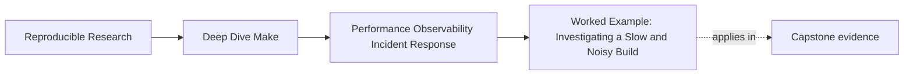
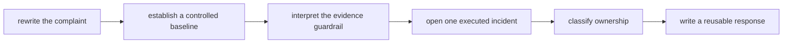

# Worked Example: Investigating a Slow and Noisy Build

<!-- page-maps:start -->
## Page Maps




<!-- page-maps:end -->

This worked example uses the course capstone. It does not ask you to imagine a repository
or accept invented timings. You will:

1. turn "slow and noisy" into separate claims
2. establish clean and no-op evidence on the reference build
3. inspect its bounded trace guardrail
4. generate an executed parallel incident bundle
5. distinguish successful exit status from truthful output ownership
6. write the first runbook branch

Run the commands from the repository root. They use `gmake` because macOS commonly reserves
`make` for an older GNU Make. On Linux, use `make` only after `make --version` confirms GNU
Make 4.3 or newer.

Set a shell variable only to keep the commands readable:

```sh
CAPSTONE=programs/reproducible-research/deep-dive-make/capstone
```

The variable is local convenience, not part of the build contract.

## The report

Assume a teammate files this message:

> The capstone build is slow, the trace is noisy, and parallel execution looks suspicious.
> Can we reduce the diagnostics and force serial mode?

There are at least three claims hidden inside it:

| Complaint | Measurable claim | First evidence |
| --- | --- | --- |
| slow | one named route and state exceeds a stated baseline | repeated clean, no-op, or dry-run samples |
| noisy | one evidence surface is too large or hard to interpret | trace count plus usability inspection |
| suspicious under parallelism | a pressure route changes output or correctness | governed serial/parallel comparison or incident repro |

The proposed changes do not follow yet. Removing diagnostics could hide causality. Forcing
serial mode could hide an ownership defect. First, classify each claim.

## Preserve the starting context

Create the incident packet:

```sh
mkdir -p artifacts/module09-incident
git rev-parse HEAD > artifacts/module09-incident/revision.txt
git status --short > artifacts/module09-incident/worktree.txt
gmake --version > artifacts/module09-incident/make-version.txt
```

Write `artifacts/module09-incident/incident.md` in this shape:

```text
Route under review: capstone `all`
Build states: clean and no-op
Parallel concern: controlled shared-output repro
Observed claim: not yet established
Expected contract: `all` converges; selftest proves serial/parallel equivalence
Proposed shortcuts to evaluate: remove diagnostics; force serial execution
```

Notice the phrase "not yet established." A ticket is not a baseline.

## Read the public route before measuring it

Discover the capstone surface:

```sh
gmake -C "$CAPSTONE" help \
  > artifacts/module09-incident/help.txt
gmake -C "$CAPSTONE" perf \
  > artifacts/module09-incident/perf.txt 2>&1
```

The relevant target meanings are:

- `all` builds the application, dynamic binaries, and a convergence sentinel
- `trace-count` reports a heuristic size for a non-executing trace
- `selftest` checks convergence and serial/parallel equivalence
- `incident-audit` executes one controlled failure specimen and saves a review bundle
- `perf` prints measurement commands; it is not a benchmark

This reading step matters. Timing an undocumented helper would not establish the cost of
the public build contract.

## Establish a clean baseline

Cleaning is appropriate here because the measurement question explicitly asks about a
clean route. It would not be the first action on an unpreserved production incident.

Run five clean samples:

```sh
: > artifacts/module09-incident/clean-timings.txt
for sample in 1 2 3 4 5; do
  gmake -C "$CAPSTONE" clean >/dev/null
  printf 'sample=%s\n' "$sample" \
    >> artifacts/module09-incident/clean-timings.txt
  /usr/bin/time -p gmake -C "$CAPSTONE" -j4 all >/dev/null \
    2>> artifacts/module09-incident/clean-timings.txt
done
```

Do not copy this loop into a repository whose clean route is undocumented or destructive
beyond generated outputs.

Keep every sample. Summarize the median and range in `decision.md`; do not select the
fastest run.

## Establish a real no-op baseline

The final clean sample leaves `all` built. Confirm that state:

```sh
if gmake -C "$CAPSTONE" -q all; then
  printf '%s\n' 'precondition=converged' \
    > artifacts/module09-incident/noop-precondition.txt
else
  status=$?
  printf 'precondition=failed status=%s\n' "$status" \
    > artifacts/module09-incident/noop-precondition.txt
  exit "$status"
fi
```

Now collect five no-op samples:

```sh
: > artifacts/module09-incident/noop-timings.txt
for sample in 1 2 3 4 5; do
  printf 'sample=%s\n' "$sample" \
    >> artifacts/module09-incident/noop-timings.txt
  /usr/bin/time -p gmake -C "$CAPSTONE" all >/dev/null \
    2>> artifacts/module09-incident/noop-timings.txt
done
```

Interpretation:

- clean timing describes full production cost
- no-op timing describes an already converged invocation
- neither number alone proves a regression
- comparison with a previous controlled baseline is required before calling the build slow

If no previous baseline exists, the honest outcome is "baseline established," not
"regression confirmed."

## Separate pre-recipe cost

Collect dry-run samples from the same converged state:

```sh
: > artifacts/module09-incident/dry-run-timings.txt
for sample in 1 2 3 4 5; do
  printf 'sample=%s\n' "$sample" \
    >> artifacts/module09-incident/dry-run-timings.txt
  /usr/bin/time -p gmake -C "$CAPSTONE" -n all >/dev/null \
    2>> artifacts/module09-incident/dry-run-timings.txt
done
```

Compare the dry-run and no-op distributions. If both are similar, most no-op cost is
before ordinary recipe execution. If no-op is materially slower, inspect what still runs
despite the convergence expectation.

Do not describe dry-run as pure parse timing. It includes evaluation and graph decisions,
and GNU Make may execute recursive Make recipe lines under `-n`.

## Inspect the evidence guardrail

Run:

```sh
gmake -C "$CAPSTONE" trace-count \
  > artifacts/module09-incident/trace-count.txt
gmake -C "$CAPSTONE" --trace -n all \
  > artifacts/module09-incident/trace.txt 2>&1
```

One observed run of the current capstone reports:

```text
trace-lines=48
```

Your count can differ as the capstone evolves. The number is a guardrail, not a universal
target. Inspect the trace itself:

- can you find the `all` target quickly
- are rule locations visible
- can you identify why work would or would not run
- does the trace avoid changing semantic outputs

If the trace is searchable and bounded, "noisy" has not been established. If it is hard to
use, redesign the surface around a specific responder question rather than deleting it.

## Generate a controlled incident

The capstone includes a repro where two targets append to one shared file. Generate its
incident bundle:

```sh
gmake -C "$CAPSTONE" incident-audit \
  REPRO_CASE=repro/shared-log-interleaving.mk
```

The bundle appears under:

```text
artifacts/audit/reproducible-research/deep-dive-make/incident/
```

Read these files in order:

1. `command.txt`
2. `run.txt`
3. `exit-status.txt`
4. `shared-log-interleaving.mk`
5. `INCIDENT_REVIEW_GUIDE.md`

An observed bundle contains:

```text
printf 'A\n' >> shared.log
printf 'B\n' >> shared.log
```

and:

```text
exit_status=0
```

That is the important surprise. The route can exit successfully while the graph still
models shared mutable output dishonestly.

## Classify from ownership, not from exit status

The copied repro contains:

```make
all: log1 log2

log1:
	printf 'A\n' >> shared.log

log2:
	printf 'B\n' >> shared.log
```

Ask the ownership question:

> Which target owns `shared.log`?

The honest answer is "neither owns it uniquely." Two independent targets mutate the same
path, and `shared.log` is not even a declared target. Parallel scheduling exposes the
problem, but parallelism did not create it.

Classify the incident:

| Field | Decision |
| --- | --- |
| boundary | graph truth and publication ownership |
| immediate risk | nondeterministic shared output |
| misleading signal | exit status `0` |
| mitigation | serial mode may reduce exposure but does not repair ownership |
| repair direction | one target owns the file, or each worker owns separate output followed by a declared merge |
| proof after repair | repeated pressure runs, stable content, one writer, and convergence |

Now the suggestion to force serial mode can be rejected as a completed fix. It changes the
scheduler while leaving two undeclared writers.

## Connect the repro back to the real build

Do not "repair" the controlled repro and stop. It is a teaching specimen. Use the real
capstone proof route:

```sh
gmake -C "$CAPSTONE" selftest-report
```

Read:

```text
artifacts/proof/reproducible-research/deep-dive-make/selftest/
├── summary.txt
├── settings.env
├── commands.txt
├── schedule-comparison.json
├── serial-inventory.json
├── parallel-inventory.json
├── hidden-input.txt
├── logs/
└── workspace/
```

The comparison classifies missing, unexpected, and changed artifacts before the two
inventories provide path-level detail. The command logs and preserved workspace keep a
failed stopping boundary reviewable. The repro demonstrates the failure class; the
selftest bundle demonstrates the production proof shape.

## Write the runbook branch

Add this to `artifacts/module09-incident/runbook.md`:

```text
Entry: a route differs under parallel execution or mutates one shared output.

Preserve:
- command, revision, Make version, job count, output, and artifact state
- do not clean before capture

Classify:
- search for every writer of the suspect path
- use target-attributed output and non-executing trace

If multiple targets write one path:
- stop publication of that output
- treat serial mode only as labeled mitigation
- repair to one owner or isolated worker outputs plus one merge target

Close when:
- repeated pressure runs pass
- serial and parallel artifact comparisons satisfy the contract
- the route converges
```

This branch can be used by someone who did not attend the class.

## The final decision

The original complaint does not produce one verdict:

- "slow" requires comparison with a controlled historical baseline; this exercise
  establishes the missing baseline
- "noisy" must be evaluated by trace usability and responder value, not dislike of output
- the parallel concern is real in the controlled repro, but serial mode is only mitigation
- removing diagnostics would weaken the evidence needed to classify the ownership defect

A strong incident summary is:

> We separated the broad complaint into cost, evidence, and pressure claims. The capstone
> now has recorded clean, no-op, and dry-run baselines; its trace is evaluated by
> searchability as well as line count. The executed repro exits successfully but reveals
> two undeclared writers to one shared file, so the defect is output ownership rather than
> "too much parallelism." Serial execution is temporary mitigation; repair requires one
> publication owner and schedule-equivalence proof.

## Exit check

You have completed the example when you can point to:

- five clean, no-op, and dry-run samples with their preconditions
- the trace count and one usability judgment
- the incident bundle's command, output, status, and copied makefile
- a classification that does not rely on exit status alone
- the selftest report that represents the repaired proof shape
- a runbook branch another learner could follow without you
