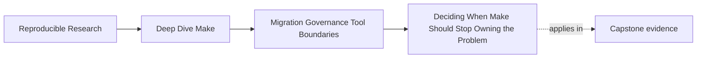
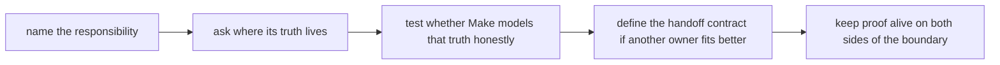
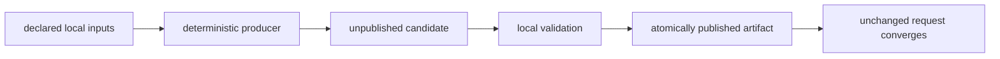
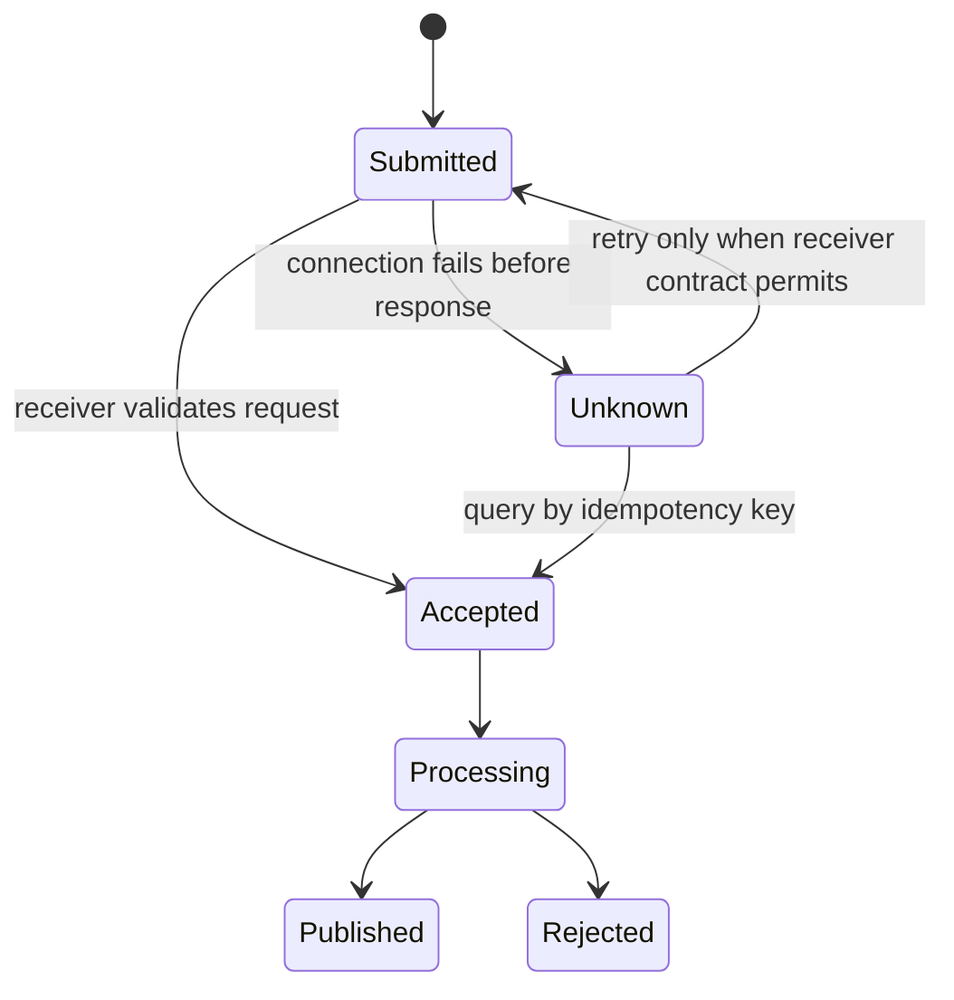

# Deciding When Make Should Stop Owning the Problem

<!-- page-maps:start -->
## Page Maps




<!-- page-maps:end -->

This page is about ownership, not fashion.

Teams usually get boundary decisions wrong in one of two ways:

- they keep work inside Make because it is already there
- they move work out of Make because another tool feels more modern

Both mistakes come from the same failure: nobody names what kind of responsibility is
actually being owned.

## Ownership has more than one dimension

“Make owns deployment” can hide five different claims:

| Ownership dimension | Question |
| --- | --- |
| decision | who decides that the action is allowed now? |
| execution | who starts and performs the work? |
| state | who records the authoritative current state? |
| recovery | who decides whether to retry, compensate, or stop? |
| evidence | who produces the durable acceptance or failure record? |

Make may own execution of a local recipe without owning approval, remote state,
recovery, or acceptance evidence. Name each dimension before deciding whether ownership
should move.

## The sentence to keep

When you are unsure about a boundary, ask:

> where does the truth of this responsibility live, and is Make still the most honest
> owner of that truth?

That question is stronger than asking whether Make is "capable." Many tools are capable.
The real issue is whether the chosen owner makes the responsibility reviewable.

## Start with the responsibility, not the tool

Do not begin with:

- "can Make call the script?"
- "does the new system have a feature for this?"
- "what do other teams usually use?"

Begin with a one-sentence responsibility statement:

- build a binary from declared source inputs
- generate a manifest that describes package contents
- sign a release using controlled external authority
- coordinate staged deployment across remote environments

If you cannot state the responsibility in one sentence, you are not ready to assign an
owner.

## What Make owns well

Make is a strong owner when the responsibility is dominated by repository-local truth:

- explicit inputs produce explicit outputs
- publication happens through files, manifests, or package artifacts
- incremental rebuild logic is meaningful
- review requires seeing why a route ran and what it produced
- failures can be diagnosed from repository-local evidence

Typical strong fits:

- compilation
- generated-file pipelines
- package assembly
- checksums and manifests tied to produced artifacts
- local audit and comparison routes

This is not nostalgia. It is a match between model and problem.

A practical test is whether the responsibility can be represented as a convergent file
transaction:



When that model fits, Make can expose dependency, publication, and failure truth directly.

## What Make often only imitates

Make is a weak owner when the responsibility is dominated by truth it cannot observe or
govern honestly:

- long-lived remote state
- approvals granted by external systems or humans
- staged deployment controllers with rollback state
- service health, live traffic, and environment drift
- policy engines that encode authority, timing, or access control

Make can still trigger those systems. Triggering is not the same as owning.

Remote responsibilities usually look different:



The `Unknown` state is the boundary Make cannot resolve from a recipe exit code alone.
The receiver may have accepted the request before the connection failed. Blindly rerunning
a phony target can duplicate remote work.

## Use one ownership test

Answer these questions in order:

1. what is the published truth of this responsibility?
2. where does that truth live while the responsibility is active?
3. can Make model the important inputs, outputs, and state transitions directly?
4. can failures be explained without hidden remote state?
5. would another tool clarify the ownership boundary rather than just hide it?

If questions 2 through 4 keep pointing to remote mutable state or external authority,
Make should probably stop owning the problem.

## Distinguish a launch command from a state machine

Consider:

```make
.PHONY: publish
publish: dist/report-bundle.tar.gz dist/report-bundle.tar.gz.sha256
	./scripts/submit-release.sh $^
```

This can be a useful entrypoint, but its contract must stay narrow:

- Make ensures the local artifact and checksum exist
- the client submits an immutable artifact identity
- the receiver owns acceptance, retry, approval, and publication state
- success means the receiver returned a durable acceptance record, not that Make now owns
  remote truth

Do not model the remote system with a local `published.stamp` touched after an HTTP call.
The stamp can become true while the service later rejects the release, or remain absent
after the service accepted a request whose response was lost.

## A quick decision table

| Responsibility shape | Better owner | Why |
| --- | --- | --- |
| build graph over local files | Make | edges, outputs, and incremental rebuilds are first-class |
| package artifact creation | Make | publication can stay file-oriented and reviewable |
| artifact signing with external authority | hybrid | Make owns artifact production; signer owns authority |
| staged remote deployment | deployment system | truth lives in remote state and operational control loops |
| approval workflow with roles and windows | policy or release system | Make cannot honestly own the governing state |
| distributed workflow scheduling | workflow engine | scheduler state is the real truth, not local prerequisites |

The table is useful because it forces you to name the dominant truth boundary.

## Do not confuse orchestration with ownership

This target does not tell you who owns deployment truth:

```make
deploy:
	@./scripts/deploy-prod.sh
```

It only tells you that Make can start something.

A reviewable ownership statement is more explicit:

- Make owns artifact build, package assembly, and local verification
- the deployment system owns rollout state, health checks, approval gates, and rollback
- the handoff boundary is a named artifact plus release metadata

That distinction removes a large amount of inherited ambiguity.

## Define the handoff contract when ownership changes

A boundary change is incomplete until the handoff contract is written down. The contract
should answer:

- what produced thing is being handed over
- what evidence must travel with it
- who validates the handoff
- what failure means on each side of the boundary

Example:

| Question | Example answer |
| --- | --- |
| handoff object | `dist/report-bundle.tar.gz` |
| attached evidence | checksum manifest, build metadata, package contents manifest |
| sending owner | Make-driven package build |
| receiving owner | release signer and publication service |
| sender failure | artifact or evidence was not produced truthfully |
| receiver failure | signing, approval, or publication failed after handoff |

Without this contract, teams end up with vague "release failed" incidents that mix build
truth and remote-state truth together.

## Require an immutable handoff identity

A handoff object should be:

- complete before submission
- immutable for the lifetime of the request
- addressable by a digest or release identity
- accompanied by the metadata the receiver needs to validate it
- independent of mutable workspace paths after acceptance

An example request envelope:

```json
{
  "release_id": "report-2026-07",
  "artifact": "report-bundle.tar.gz",
  "sha256": "4e8b...d19a",
  "manifest_sha256": "82d1...77c0"
}
```

The full digest values come from the actual artifacts. The release identity and artifact
digest together can form an idempotency key if the receiver contract supports it.

## Assign retry ownership before the first failure

| Failure point | What is known | Responsible owner | Safe action |
| --- | --- | --- | --- |
| local package creation fails | no handoff object exists | Make-owned build | repair input or producer, then rebuild |
| local verification fails | candidate is not acceptable | Make-owned build | reject before submission |
| receiver rejects before acceptance | request was evaluated and refused | receiver/client contract | report reason; do not rebuild artifact unless reason concerns artifact |
| connection fails with unknown acceptance | remote state is unknown | receiver state model | query by idempotency key before retry |
| processing fails after acceptance | receiver owns accepted request | receiver | retry or compensate using receiver policy |
| publication succeeds but local response is lost | remote success may already exist | receiver | retrieve durable receipt; do not submit a different artifact |

“Retry three times” is not a boundary design. The owner must know whether the operation is
idempotent and whether acceptance occurred.

## Make the receipt reviewable

The receiver's durable record should identify:

- request or idempotency key
- accepted artifact digest
- acceptance time and responsible system
- final state or a query route for current state
- failure or rejection reason when applicable

A local copy may be stored under `artifacts/` for review, but it is evidence about remote
truth, not the authority that creates that truth. If the record is mutable, document how
reviewers refresh and authenticate it.

## Keep proof alive on both sides of the boundary

Boundary work often gets harder because the team moves ownership and deletes the evidence
that used to make the old route understandable.

Protect one proof route for each side:

- before handoff: a route that proves Make produced the expected artifact or manifest
- after handoff: a route that proves the external owner accepted, signed, published, or
  deployed the intended object

If either side lacks proof, the ownership split is not yet healthy.

Test the boundary with at least four receiver fixtures:

| Fixture response | Expected sender behavior |
| --- | --- |
| accepts and returns receipt | preserve receipt tied to submitted digest |
| rejects checksum | fail without changing local artifact |
| returns acceptance after duplicate idempotency key | treat as the same request, not a second publication |
| drops connection after accepting | query by key and recover receipt before any resubmission |

A success-only mock teaches invocation, not ownership. The unknown-outcome fixture is the
one that reveals whether retry truth lives in the right system.

## Good reasons to keep ownership in Make

Keep the responsibility in Make when all of these remain true:

- the truth is still primarily file-oriented
- the outputs can be named and reviewed
- another tool would add indirection but not better modeling
- incremental rebuild behavior is still meaningful
- repository-local debugging remains a major advantage

Example:

- code generation from declared schemas
- compilation
- packaging a reproducible archive with checksums

That is classic Make territory and should not be handed away casually.

## Good reasons to hand ownership off

Move ownership away from Make when these begin to dominate:

- the responsibility depends on remote mutable state
- approvals or authorities live elsewhere
- the workflow is really about controllers, not prerequisites
- failure diagnosis depends on information Make cannot represent clearly
- the convenience wrapper is obscuring, not clarifying, the system

Example:

- progressive production deployment with approvals, health checks, pauses, and rollback

Make may still provide a launch or audit entrypoint. It should not pretend to be the
source of operational truth.

## Hybrid ownership is often the strongest answer

Many healthy systems are neither "all Make" nor "no Make."

Example hybrid:

- Make builds and packages the artifact
- a signing service attaches trusted release authority
- a release controller publishes or deploys the signed object

This works when the boundary is explicit:

- Make owns artifact truth
- the signer owns authority
- the release controller owns remote rollout state

Hybrid answers usually fail only when the handoff object or proof route is vague.

## Compare three ownership designs

| Design | Local artifact truth | Remote state truth | Main defect or strength |
| --- | --- | --- | --- |
| Make recipe builds and uploads mutable workspace files | mixed | inferred from exit code | rebuild and retry can change the submitted object |
| Make builds immutable bundle; shell client owns ad hoc retry | clear | still partly hidden | handoff improves, but unknown outcomes remain weak |
| Make builds and verifies bundle; receiver owns idempotent submission and receipts | clear | authoritative receiver | responsibility and recovery align with truth location |

The middle design can be a useful bounded improvement. Do not describe it as the completed
boundary if retry and acceptance remain opaque.

## Failure signatures that reveal the wrong owner

These sentences are strong warning signs:

### "Our Makefile mostly waits for remote systems now"

Make is probably acting as a weak wrapper around the real owner.

### "We moved packaging out, but now nobody can inspect what actually shipped"

The handoff improved fashion but damaged evidence.

### "Deploy failures and build failures look identical in review"

The boundary mixes two different truths under one target name.

### "The new platform is powerful, but local review got much harder"

The team may have handed off a responsibility that was still naturally local.

## A practical review route

When you audit a suspicious boundary, write a short packet:

1. responsibility statement
2. current owner
3. where truth lives
4. proof route before handoff
5. proof route after handoff
6. recommended owner and why
7. retry and unknown-outcome owner
8. durable acceptance evidence

If you cannot fill all six lines, the boundary is still under-described.

## Review drill

Take one target from an inherited repository and answer:

1. what responsibility does this target actually own?
2. where does the truth of that responsibility live?
3. is Make modeling that truth directly or hiding another owner?
4. what handoff object and evidence would exist if ownership moved?
5. who resolves a lost response after possible acceptance?

## Exit check

You are ready to use this lesson when you can:

- explain why ownership is not the same as invocation
- identify when Make is still the most honest owner of a responsibility
- identify when another tool should own remote state, approval, or policy truth
- write a concrete handoff contract instead of saying "the other system handles it"
- assign retry, unknown-outcome recovery, and receipt ownership explicitly
