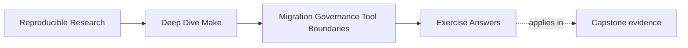
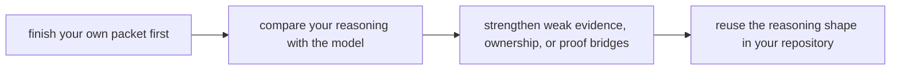

# Exercise Answers

<!-- page-maps:start -->
## Page Maps




<!-- page-maps:end -->

Use this page after you have finished the exercises yourself. The aim is not to borrow
phrasing. The aim is to compare your reasoning with a model that stays evidence-first.

## How to use the answer page well

A weak study habit is:

1. read the model answer first
2. copy its vocabulary
3. pretend the reasoning is now yours

A stronger habit is:

1. finish your own review tables and packet
2. write one plain-language answer for each exercise
3. compare your answer with the model
4. revise where your answer has weak evidence, a vague rollback point, or a blurry owner

These answers are not "the only correct wording." They are examples of the reasoning
shape Module 10 is trying to teach.

## What strong Module 10 answers keep doing

Across the whole set, good answers usually:

- describe current behavior before proposing redesign
- classify the finding before naming the repair
- preserve proof while moving a boundary
- separate local artifact truth from remote-state truth
- write rules another maintainer could really enforce

If your answer says only "clean this up" or "use a better tool," the reasoning is still
too weak.

## Exercise 1: Write a first-pass build review

### Model answer shape

| Review section | Strong answer example |
| --- | --- |
| public targets | "`all` is the default build contract; `prepare-release` appears to be a helper that CI accidentally treats as public; `publish` mixes build and remote-state concerns." |
| trusted outputs | "`dist/report.tar.gz` is treated as a release artifact, but both `release` and `publish` appear to regenerate inputs on the way there." |
| hidden inputs | "Environment variables alter report mode, but the graph does not model them clearly." |
| pressure finding | "`make -j8 release` sometimes leaves partial files in `dist/`, which suggests the release boundary is not being published atomically." |
| risk classes | "Main risks are contract drift, multi-writer output behavior, and boundary confusion between local packaging and remote publication." |

### Why this is strong

- it names observable behavior instead of insulting the file
- it ends with classified findings that can guide later work
- it makes clear why redesign should wait until review is complete

### Common weak version

"The Makefile is messy and should be rewritten."

That answer tells the next maintainer nothing about what is risky, what is contractual,
or what should be reviewed first.

## Exercise 2: Inventory ownership instead of listing targets

### Model answer shape

| Public target | Promise | Owned output or side effect | Writer or owner |
| --- | --- | --- | --- |
| `all` | build normal analysis outputs | `build/report.html` | report rule |
| `dist` | build release artifact | `dist/report.tar.gz` | package rule |
| `publish` | submit verified bundle | remote release record | publication service |

Add findings such as:

- "`build/report.html` appears in two routes, so it may be a multi-writer surface"
- "remote publication success is trusted by callers but not represented as a repository
  artifact"

### Why this is strong

- it treats outputs and side effects as the real contract
- it exposes both unowned and multiply owned surfaces
- it gives you something a target list alone cannot give: actual trust boundaries

### Sentence worth keeping

> Ownership inventory is more useful than a target list because consumers rely on
> deliverables and side effects, not on names alone.

## Exercise 3: Preserve proof before changing anything

### Model answer shape

Possible checks:

```sh
make all
make -q all
make -j1 dist && find dist -type f | sort > artifacts/layout-serial.txt
make clean
make -j8 dist && find dist -type f | sort > artifacts/layout-parallel.txt
diff -u artifacts/layout-serial.txt artifacts/layout-parallel.txt
```

Then explain:

- the no-op check proves convergence expectations
- the layout snapshots prove what the release boundary currently contains
- the serial-versus-parallel comparison proves whether the boundary is pressure-safe

Also say explicitly:

- "partial files observed under `-j8` are a defect to document, not a behavior to preserve"

### Why this is strong

- it distinguishes characterization from approval
- it preserves comparison routes that support rollback
- it names which current behavior is contractual and which behavior is defective

## Exercise 4: Choose the first safe migration move

### Model answer shape

- current contract:
  - "`publish` currently means rebuild, package, and upload the report bundle."
- first boundary move:
  - "Split local artifact production into `dist` and make `publish` consume the finished
    artifact."
- proof route that must survive:
  - "Current release-layout and serial-versus-parallel checks."
- rollback point:
  - "Old `publish` route remains callable until `dist` and `publish` have been compared
    successfully."
- retirement condition:
  - "The old route can be removed once the new `dist` surface produces the expected
    artifact set and `publish` uses only that set."

### Why this is strong

- the move is small enough to verify
- the answer preserves proof rather than trusting memory
- retirement depends on evidence, not on optimism

### Common weak version

"Move release to another tool."

That is not a first move. It is a slogan pretending to be a plan.

## Exercise 5: Write a governance note that another maintainer could enforce

### Model answer

```text
Public targets are all, test, selftest, dist, publish, clean, and help.
Changes to public target names or meanings require maintainer review and docs updates.
CI may call only public targets.
New include files require a one-sentence responsibility statement.
New macros must state whether they compute text, define rules, or both.
Proof routes such as selftest and release audits may not be removed without a documented replacement.
Exceptions require approval from maintainers responsible for public contract integrity.
```

### Why this is strong

- another maintainer can apply it during review
- it protects both user-facing contracts and proof surfaces
- it avoids vague language like "keep things simple"

### Enforcement note

The answer should also say whether each rule is enforced by review, automation, or both.
Rules without an enforcement path are only aspirations.

## Exercise 6: Diagnose one recurring antipattern

### Model answer shape

Example:

- antipattern:
  - multi-writer outputs
- confirming signals:
  - "`build/report.html` changes when both `all` and `dist` run"
  - "packaging routes invoke the same generator ordinary build routes invoke"
- smallest honest repair:
  - "Assign one route as the sole writer of `build/report.html` and make packaging depend
    on that published output."
- why this helps:
  - "It restores output ownership and makes incremental behavior easier to trust."

### Why this is strong

- the repair is proportional to the finding
- it explains how truth or ownership clarity improves
- it does not confuse a naming cleanup with a real ownership repair

## Exercise 7: Make the tool-boundary argument

### Model answer shape

Example concern:

- remote publication

Example answer:

> Make should keep owning local artifact production and checksum generation, but it should
> not remain the full owner of remote publication. Publication depends on authentication,
> approval, and remote state that Make cannot model honestly. The handoff object should be
> the archive plus checksum and metadata manifest. Make verifies the local object before
> handoff; the publication service verifies receipt and records remote status after
> handoff.

### Why this is strong

- it does not replace Make out of fashion
- it keeps Make where Make is still honest
- it names a handoff object and proof route on both sides

### Common weak version

"Use a deployment platform because it is more modern."

That does not explain the responsibility boundary at all.

## Exercise 8: Turn governance prose into verification

### Model answer shape

Rule 1:

- rule:
  - "CI may call only public targets."
- check:
  - "parse the public target list and fail when workflow files call anything else."
- deliberate failure:
  - "edit one workflow to call `prepare-release` and confirm the check fails."

Rule 2:

- rule:
  - "Each trusted output has one writer."
- check:
  - "inspect the make database or maintain a contract test for critical outputs."
- deliberate failure:
  - "add a second route that writes the release artifact and confirm the check flags it."

### Why this is strong

- it proves the rule can fail meaningfully
- it identifies the owner for changing the rule
- it separates policy from enforcement clearly

## Exercise 9: Compare Make with a neighboring tool

### Model answer shape

| Concern | Make | Publication service |
| --- | --- | --- |
| local file graph | strong fit | weak fit |
| credentials and approvals | weak fit | strong fit |
| remote retry state | awkward | owned feature |
| handoff object | archive plus checksum | accepted release record |
| observability | strong before handoff | strong after handoff |

Ownership decision:

- "Keep deterministic local artifact production in Make and hand remote publication state
  to the publication service."

Independent verification:

- "Make verifies the archive and checksum before handoff."
- "The publication service verifies receipt and records acceptance after handoff."

### Why this is strong

- both sides have their own proof route
- the handoff object is explicit
- the boundary is based on truth location, not branding

## Exercise 10: Produce a stewardship handoff packet

### Model answer shape

A strong packet contains:

- current contract and risk review
- ownership inventory
- proof-preserving migration step
- before-and-after evidence
- governance note
- boundary decision
- remaining risks and next repair

Example maintainer handoff sentence:

> The current release boundary is now split between `dist` and `publish`, but parallel
> safety for generated figures still needs review. The next likely repair is to remove the
> remaining multi-writer path for report generation while preserving the current layout and
> convergence checks.

### Why this is strong

- it says what improved
- it says what is still risky
- it gives the next maintainer a concrete next move instead of a vague promise

## What all ten answers have in common

The best answers in this module usually:

1. describe current behavior before prescribing redesign
2. classify findings in terms of truth, contract, or boundary
3. keep evidence alive during migration
4. write rules other maintainers could really use
5. justify ownership by modeling fit and truth location

If your packet does those five things, you are using Module 10 the right way.
