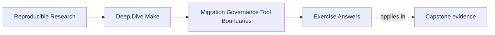

# Exercise Answers


<!-- page-maps:start -->
## Page Maps




<!-- page-maps:end -->

Use this page after you have written your own answers. The value is in comparing
reasoning, not in copying sentences.

## How to use the answer page well

Do not read a model answer first and then retrofit your stewardship packet to sound
similar.

A better rhythm is:

1. finish the exercise with your own review tables, proof bridges, and notes
2. write one plain-language explanation of the stewardship question
3. compare that explanation with the model answer
4. revise where the model answer exposes a weaker rollback point, blurrier governance
   rule, or handoff without proof

The answers below are reference-quality examples. Your own repository and target names
will vary. What should stay stable is the reasoning shape:

- start from observable behavior
- classify the finding before recommending a repair
- preserve proof while changing contracts or boundaries

Strong Module 10 answers usually do four things:

- they describe current behavior before prescribing redesign
- they classify findings in terms of truth, contract, or boundary
- they keep evidence alive during migration
- they write rules other maintainers could really use

The strongest self-study packets also leave behind six concrete artifacts:

- one first-pass review
- one proof-preserving migration step
- one enforceable governance note
- one ownership inventory
- one tool-boundary comparison
- one bounded repair with honest handoff

If your answers rely only on "this build should be cleaned up," the reasoning is still too
weak.

## Exercise 1: Write a first-pass build review

A strong answer does not try to solve everything. It makes the current system legible.

Example answer shape:

| Review section | Strong answer example |
| --- | --- |
| public targets | "`all` builds the default outputs, `release` packages and uploads, and `prepare-release` appears to be an accidental semi-public helper because CI calls it directly." |
| trusted outputs | "`dist/report.tar.gz` is treated as trusted, but both `release` and `publish` appear to regenerate inputs on the way there." |
| hidden inputs | "Environment variables choose report mode, but the graph does not model them explicitly." |
| pressure finding | "`make -j8 release` occasionally leaves partial files in `dist/`, which suggests publication is not atomic." |
| risk classes | "Top risks are contract drift, multi-writer output behavior, and boundary confusion between local packaging and remote publication." |

Why this is strong:

- it names behavior instead of insulting structure
- it uses evidence or likely evidence
- it ends with classified findings that can guide migration

Weak answers usually say only "the Makefile is messy" or "we should use a different
tool."

## Exercise 2: Sequence a safe migration

A strong migration answer changes one boundary and preserves one proof route.

Example:

- current contract:
  - "`release` currently means build, validate, package, and publish."
- first boundary move:
  - "Split local package production into `dist` and keep publication separate."
- preserved proof:
  - "Record the current release layout with `find dist -type f | sort` before changing the
    packaging route."
- retirement condition:
  - "The old `release` implementation can disappear once `dist` produces the same declared
    artifact set and `publish` consumes only that artifact set."

Why this is strong:

- the first change is narrow
- the answer does not remove evidence before the new route is trusted
- retirement is based on proof, not optimism

## Exercise 3: Write a governance note that could actually be enforced

A strong answer is short and operational.

Example:

```text
Public targets are all, test, selftest, dist, publish, clean, and help.
Changes to public target names or meanings require maintainer review and docs updates.
CI may call only public targets.
New include files require a one-sentence responsibility statement.
New macros must state whether they compute text, define rules, or both.
Proof routes such as selftest and release audits may not be removed without a documented replacement.
```

Why this is strong:

- another maintainer could apply it in review
- it protects both contracts and proof surfaces
- it addresses the common drift points directly

Weak governance notes use language like "try to keep things simple" because nobody can
enforce that.

Exceptions should be approved by the same maintainers responsible for public contract
changes and proof-surface integrity.

## Exercise 4: Diagnose one recurring antipattern

Choose one pattern and name the first honest recovery move.

Example:

- antipattern:
  - multi-writer outputs
- confirming signals:
  - "`build/report.html` changes when both `all` and `dist` run"
  - "packaging routes invoke the same generator that ordinary build routes invoke"
- first repair:
  - "Assign one rule or route as the sole writer of `build/report.html` and make
    packaging depend on that published output instead of regenerating it."
- why this helps:
  - "It restores output ownership and makes incremental behavior easier to reason about."

The key is to explain why the repair restores truth or ownership clarity, not just why it
looks cleaner.

## Exercise 5: Make the tool-boundary argument

A strong answer focuses on ownership fit.

Example:

- concern:
  - remote publication
- judgment:
  - "Make should not remain the full owner."
- argument:
  - "Make is still a good owner for producing the local artifact and checksum, but remote
    publication depends on authentication, approval, and remote state that Make cannot
    model honestly. A dedicated service should own publication policy and status."
- handoff artifact:
  - "`dist/report.tar.gz` plus its checksum and metadata manifest"
- proving the boundary works:
  - "The build can produce and verify the local artifact without talking to the remote
    system, and publication errors are reported by the owning service rather than hidden
    inside packaging behavior."

Why this is strong:

- it does not replace Make out of fashion
- it keeps Make where it is still honest
- it defines the handoff surface explicitly

## Exercise 6: Inventory target and output ownership

A useful inventory distinguishes interfaces, files, and side effects:

| Public target | Promise | Owned output or side effect | Writer |
| --- | --- | --- | --- |
| `all` | build normal analysis | `build/report.html` | report rule |
| `dist` | build release bundle | `dist/report.tar.gz` | package rule |
| `publish` | submit verified bundle | remote release record | publication service |

Use `rg` to find target callers and `make --trace` to observe writers. An output absent
from the table may be unowned; an output written by both `all` and `dist` is a
multi-writer risk. The table is useful only when observed behavior and declared ownership
agree.

The key explanation is:

> Ownership inventory is more useful than a plain target list because consumers rely on
> trusted outputs and side effects, not on names alone.

## Exercise 7: Write characterization checks

Durable checks might include:

```sh
make all
make -q all
make -j1 dist && find dist -type f | sort > artifacts/layout-serial.txt
make clean
make -j8 dist && find dist -type f | sort > artifacts/layout-parallel.txt
diff -u artifacts/layout-serial.txt artifacts/layout-parallel.txt
```

The paths can follow the repository's governed artifact location. Preserve intended
package contents and convergence. Do not enshrine partial publication or nondeterministic
files merely because the inherited build currently produces them; characterization must
label defects separately from contracts.

These checks support rollback because they give the maintainer a concrete before-and-after
comparison instead of a memory of how the build "used to feel."

## Exercise 8: Turn governance prose into verification

For "CI calls only public targets," parse or maintain the declared public-target list,
search workflow Make invocations, and fail when a caller uses anything else. For
"trusted outputs have one writer," inspect the Make database or maintain a targeted
contract test for critical outputs.

A strong submission deliberately changes a workflow to call an internal helper and shows
the check fail. It also names who may approve public API changes. Automation enforces the
rule; ownership governs legitimate changes to the rule.

## Exercise 9: Compare Make with a neighboring tool

A defensible comparison could look like:

| Concern | Make | Publication service |
| --- | --- | --- |
| local file graph | strong fit | weak fit |
| credentials and approvals | weak fit | strong fit |
| remote retry state | awkward | owned feature |
| handoff | archive plus checksum | accepted release record |

The resulting boundary keeps deterministic local artifact production in Make and hands
authentication, approval, retries, and remote status to the service. Both sides verify the
archive checksum: Make before handoff and the service on receipt.

The strongest answers also explain how each side can fail independently without blurring
who owns the remediation.

## Exercise 10: Produce a stewardship portfolio

A mastery portfolio is concise enough to review but complete enough to repeat. It contains:

- public target, output writer, hidden input, and side-effect inventory
- classified risks supported by dry-run, trace, database, convergence, and pressure checks
- characterization checks that remain useful after the change
- one bounded repair with the smallest credible ownership change
- evidence that current contracts remain intact or deliberately changed
- enforceable governance and an explicit tool handoff
- unresolved risks, owners, and verification routes

The change itself may be small. The advanced skill is preserving trust while improving
ownership, not maximizing diff size.

## What all ten answers have in common

The best answers in this module usually do five things:

1. they describe current behavior before prescribing a redesign
2. they classify findings in terms of truth, contract, or boundary
3. they keep evidence alive during migration
4. they write rules other maintainers could really use
5. they justify tool boundaries by modeling fit and ownership

If your answers do those five things, you are using Module 10 the right way.
