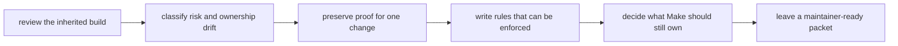
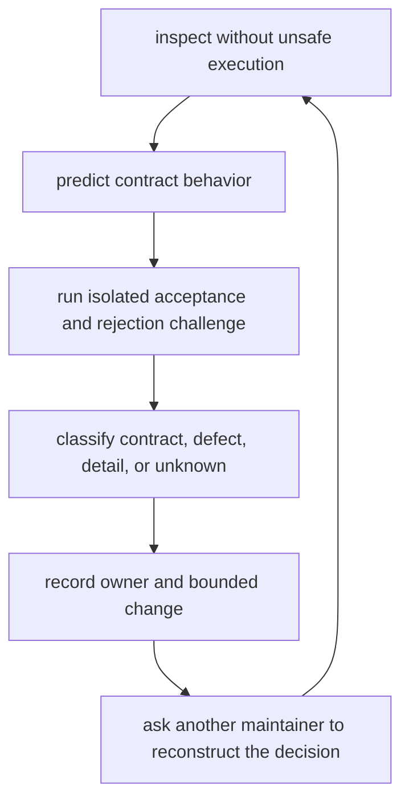

# Exercises

Use this set after the five core lessons and the worked example. Treat it as one full
stewardship session, not as ten disconnected prompts.

The module is not asking you to sound authoritative about build systems. It is asking you
to review a real build, move one boundary safely, preserve proof, and leave behind rules
another maintainer could apply.

## How to use the set

Complete the exercises in order. Each one should feed the next.

By the end, you should have a single stewardship packet containing:

- one first-pass review
- one ownership inventory
- one proof bridge for a migration
- one enforceable governance note
- one tool-boundary argument
- one bounded repair with a handoff note

If those six artifacts do not exist, you are probably writing opinions about the build
instead of stewarding it.

## One packet, not ten isolated answers

Keep one running packet while you work. A simple structure is enough:

```text
build-stewardship/
├── review.md
├── ownership-table.md
├── migration-plan.md
├── governance-note.md
├── boundary-decision.md
├── evidence-index.md
└── evidence/
```

Keep two live tables open as you go.

### Review table

| Surface | Current behavior | Evidence | Risk class | Suggested owner |
| --- | --- | --- | --- | --- |

### Proof bridge table

| Boundary moved | Established evidence | Replacement evidence | Rollback trigger | Receiving owner |
| --- | --- | --- | --- | --- |

Those tables stop the exercise day from drifting into vague cleanup language.

Add a claim index:

| Claim | Acceptance evidence | Rejection or disproof evidence | Confidence | Open question |
| --- | --- | --- | --- | --- |

The packet must distinguish what you observed, what you inferred, and what you have not
yet verified.

## The progression for the day



Do not skip ahead. The later exercises are weak if the earlier review work is thin.

Use one evidence loop throughout:



## Exercise 1: Write a first-pass build review

Choose one inherited Make-based repository and write a short review.

Your review must cover:

- public target meanings
- trusted outputs and their writers
- hidden inputs, hidden state, or host assumptions
- one pressure finding from dry-run, trace, or serial-versus-parallel comparison
- the top three risk classes you found
- the boundary of your review: what you did not execute, inspect, or contact

What to hand in:

- one page or less
- the exact safe commands you ran
- three named risk classes such as graph-truth risk, contract drift, or boundary risk
- an observation/inference/confidence table for the most consequential finding
- one proposed disproof route for that finding
- one sentence explaining why review comes before redesign

Quality bar:

- describe what the build currently does before saying what it should do
- classify the findings in durable language rather than saying only "messy"
- do not run a publication, deployment, or install route merely to discover its meaning

## Exercise 2: Inventory ownership instead of listing targets

List every public target, its promised outputs or side effects, and the rule or external
system that owns them.

Include:

- outputs with zero obvious writers
- outputs with multiple writers
- side effects that are trusted even though they are not file outputs
- the publication commit point or acceptance record for each trusted result

What to hand in:

- the ownership table
- caller-search, Make-database, writer-search, and trace evidence
- one unowned surface and one multi-writer surface
- one case where two convenience targets legitimately share a prerequisite but not a writer
- one confidence limit caused by generated rules, shell indirection, or external state
- one sentence explaining why ownership inventory is stronger than a plain target list

Quality bar:

- target names alone are not enough
- consumers rely on outputs and side effects, so your table should too

## Exercise 3: Preserve proof before changing anything

Design three characterization or comparison routes for the current build:

- one for current package membership and artifact identity
- one for no-op or convergence behavior
- one for serial-versus-parallel agreement

Run each route in an isolated workspace. Classify every observed behavior as contract,
implementation detail, defect, or unknown.

What to hand in:

- the three checks
- what each check is trying to prove
- the normalization rule used before comparison
- one observed defect that should be documented rather than preserved as contract
- one relevant and one irrelevant mutation
- one sentence explaining how the checks support rollback without sharing outputs

Quality bar:

- characterization is not the same as approval
- keep proof that helps future comparison, not noise that nobody will reuse

## Exercise 4: Choose the first safe migration move

Pick one painful build surface, such as packaging, generated metadata, test orchestration,
or publication. Choose the first change you would actually make.

What to hand in:

- the current contract in one sentence
- the first boundary move
- the proof route that must survive that move
- any intentional divergence from the established contract
- the rollback trigger and decision owner
- the complete retirement gates for the established route

Quality bar:

- the first move must be small enough to review honestly
- "replace the whole system" is not a first move
- elapsed time alone is not a retirement gate

## Exercise 5: Write a governance note that another maintainer could enforce

Draft a short governance note for the repository.

It must define:

- which targets are public
- what review bar applies to public-target changes
- one rule for new include files or macros
- one rule protecting proof surfaces
- who can approve exceptions
- the evidence obligation and rejection challenge for one high-risk change class

What to hand in:

- a note of six to ten lines
- one sentence naming the drift pattern it is meant to prevent
- one sentence naming how it would be enforced in review or automation
- one bounded exception with scope, owner, safety evidence, and removal condition

Quality bar:

- avoid "keep things simple" language
- write rules another maintainer could really apply
- do not use a calendar promise as the only exception-removal condition

## Exercise 6: Diagnose one recurring antipattern

Choose one of these recurring smells:

- ritual ordering instead of real edges
- multi-writer outputs
- opaque orchestration through wrappers
- meaningless stamps or manifests
- a release target that does too much
- truth-erasing optimization

What to hand in:

- the antipattern name
- two signals that confirm it
- the controlled challenge and repeatable failure signature
- the smallest honest recovery
- acceptance and rejection tests after recovery
- the governance rule that prevents recurrence
- one sentence explaining how that repair restores truth or ownership clarity

Quality bar:

- the first repair should make the system more legible before it makes it more ambitious
- a suspicious shape without a reproduced causal signature is still a hypothesis

## Exercise 7: Make the tool-boundary argument

Choose one concern from a real build:

- compilation
- code generation
- packaging
- signing
- deployment
- remote publication

Argue whether Make should:

- remain the owner
- hand ownership off
- share ownership through an explicit hybrid boundary

What to hand in:

- the concern you chose
- an ownership table covering decision, execution, state, recovery, and evidence
- the handoff object or interface if another tool is involved
- one proof route on each side of the boundary
- the idempotency identity, retry owner, and unknown-outcome recovery route
- the durable acceptance or failure record

Quality bar:

- justify the answer from truth location and modeling fit
- do not argue from novelty alone
- “Make invokes it” does not establish that Make owns its state

## Exercise 8: Turn governance prose into verification

Take two governance rules and design automated checks for them.

Good examples:

- CI may call only public targets
- each trusted output has one writer
- proof routes cannot be removed without replacement

What to hand in:

- the rule text
- the check command or test
- one passing example
- one deliberately failing example
- the check's declared parsing or repository boundary
- the diagnostic a maintainer sees on failure
- the review owner for changing the rule

Quality bar:

- automation enforces the rule
- governance defines who may legitimately change the rule
- do not call a text-search heuristic a complete ownership proof

## Exercise 9: Compare Make with a neighboring tool

Choose one real concern and compare Make with a workflow engine, package manager, CI
service, release tool, or deployment system.

Evaluate:

- file-graph fit
- remote state
- retries or scheduling
- observability
- handoff artifacts
- unknown-outcome recovery and acceptance authority

What to hand in:

- a comparison table
- the ownership decision
- the exact interface between tools
- one independent verification route for each side
- four receiver fixtures: accept, reject, duplicate idempotency key, and lost response

Quality bar:

- hybrid boundaries are strongest when both sides can verify the handoff independently

## Exercise 10: Produce a stewardship handoff packet

Return to the same repository and turn the day into one maintainable packet.

Your handoff must include:

- current contract and risk review
- ownership inventory
- proof-preserving migration step
- established and replacement evidence
- intentional-divergence record
- governance note
- boundary decision
- retirement-gate results
- remaining risks and next likely repair

What to hand in:

- the packet itself
- one bounded repair or one detailed repair proposal
- a maintainer note that says what still remains risky
- a reviewer note mapping completeness, compatibility, failure safety, retry safety, and
  retirement claims to exact artifacts

Quality bar:

- the advanced skill here is not larger diffs
- the advanced skill is preserving trust while improving ownership
- another maintainer must be able to reconstruct one decision without an oral briefing

## Mid-session self-check

Before reading the answers, stop and confirm you can answer these plainly:

- which risk classes matter most in this build and why
- which proof route must survive the first migration move
- which governance rule would actually prevent one observed drift pattern
- which concern Make should keep and which one it should stop owning
- what handoff object and evidence define the tool boundary
- who owns an unknown receiver outcome after a lost response
- which retirement gate is still open and what evidence would close it

If any answer is still vague, strengthen the packet before moving on.

## Mastery standard for the set

Across all ten exercises, the module wants the same habits:

- review behavior before prescribing redesign
- preserve proof while changing boundaries
- write governance in enforceable language
- classify antipatterns as truth loss or ownership drift
- justify tool boundaries by modeling fit rather than novelty
- distinguish established contract, implementation detail, defect, and unknown behavior
- prove both warranted behavior and rejected behavior
- make retry and retirement ownership explicit

If your answers say only "the build should be cleaned up," keep working.
