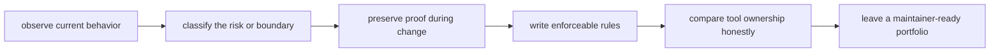

# Exercises

Use these after reading the five core lessons and the worked example. The goal is to make
your review, migration, and governance judgment visible, not to produce generic build
advice.

## How to work through this set

Treat the ten exercises as one full lab day on stewardship.

Before each answer:

1. describe current behavior before proposing a redesign
2. name the proof surface that must survive the change
3. state who will own the boundary after the change and how that ownership will be checked

If you skip the proof-preservation question, migration advice turns into cleanup rhetoric.
This module is about changing boundaries without losing trust.

Do the exercises in order. The day is one progression:

- Exercises 1-3 review the current build, sequence a safe migration, and define
  enforceable governance
- Exercises 4-6 classify antipatterns, tool boundaries, and ownership inventory
- Exercises 7-9 preserve proof during change and compare Make with neighboring tools
- Exercise 10 turns all of that into one complete stewardship portfolio

For every migration proposal, include a proof bridge:

| Boundary moved | Before evidence | After evidence | Rollback point | New owner |
| --- | --- | --- | --- | --- |

Do not accept "tests pass" unless the named tests protect the contract being moved.

Keep one stewardship packet as you go. By the end of the day it should contain:

- one evidence-grounded first-pass review
- one narrow migration step with a retained proof route
- one enforceable governance note
- one ownership inventory
- one comparison with a neighboring tool
- one bounded repair plus maintainer handoff

If those six artifacts are missing, you are probably giving opinions about the build
instead of stewarding it.

## Recommended working layout

If you want one lab tree that can support the whole day, use something like:

```text
module10-lab/
├── Makefile
├── mk/
├── ci/
├── dist/
├── notes/
├── audits/
└── artifacts/
```

Keep one review table while you work:

| Surface | Current behavior | Evidence | Risk class | Suggested owner |
| --- | --- | --- | --- | --- |

Also keep one governance table:

| Rule | Enforced by review, automation, or both | Who may change it |
| --- | --- | --- |

That second table matters because governance text without an enforcement path is only
aspirational.



Use that route on purpose. It keeps the day centered on stewardship and accountability
instead of on unbounded refactoring.

## Exercise 1: Write a first-pass build review

Choose one inherited Make-based repository. Write a short review that covers:

- public target meanings
- trusted outputs and their writers
- hidden inputs or stateful behavior
- one pressure finding from dry-run, trace, or serial/parallel comparison
- the top three risk classes you found

What to hand in:

- one page or less
- at least one concrete command you ran or would run
- the three risk classes in clear language such as graph truth, contract drift, or
  boundary risk
- one sentence explaining why review comes before redesign

Study note:
The point is not to solve everything. The point is to make the current system legible
enough that change can be prioritized honestly.

## Exercise 2: Sequence a safe migration

Pick one painful part of the build, such as release packaging, generated metadata, or
test orchestration. Design a migration plan that changes that part without deleting the
old proof surface too early.

What to hand in:

- the current contract in one sentence
- the smallest boundary move you would make first
- one proof surface you would preserve during the migration
- one retirement condition that must be true before the old route disappears

Study note:
The first migration step should be small enough that rollback is real rather than
theoretical.

## Exercise 3: Write a governance note that could actually be enforced

Draft a short governance note for the repository. It should define:

- which targets are public
- what review bar applies to public-target changes
- one rule for new include files or macros
- one rule protecting proof surfaces

What to hand in:

- a note of six to ten lines
- wording another maintainer could apply during review
- one sentence explaining which kind of drift the note is meant to prevent
- one sentence naming who should approve exceptions

Study note:
Governance becomes useful only when another maintainer can act on it consistently during
real review.

## Exercise 4: Diagnose one recurring antipattern

Pick one of these recurring smells:

- ritual target ordering instead of real edges
- multi-writer outputs
- opaque orchestration through wrappers
- meaningless stamps or manifests
- a release target that does too much

Explain how you would recognize it in a real repository and what the first honest recovery
move would be.

What to hand in:

- the antipattern name
- two signals that would confirm it
- the smallest repair you would try first
- one sentence on why that repair restores truth or ownership clarity

Study note:
The first repair should improve understanding before it maximizes ambition.

## Exercise 5: Make the tool-boundary argument

Choose one concern from a real build:

- compilation
- code generation
- packaging
- deployment
- release metadata
- remote publication

Argue whether Make should remain the owner, hand it off, or share it through a hybrid
boundary.

What to hand in:

- the concern you chose
- a one-paragraph argument
- the handoff artifact or interface if another tool becomes involved
- one sentence on what evidence would prove the boundary is working

Study note:
This is not a novelty contest. The right answer depends on fit, ownership, and proof.

## Midday self-check

Before you move into ownership inventory, characterization checks, and automated
governance, make sure your packet can already answer these questions cleanly:

- which risk classes are most important in the current build and why
- which proof surface must survive the first migration step
- which governance rule would actually prevent one observed drift pattern
- which concern Make should keep and which one it should not own alone

If you cannot answer those four questions in plain language, return to Exercises 1-5 and
make the packet more explicit before continuing.

## Exercise 6: Inventory target and output ownership

List every public target, its promised outputs or side effects, and the rule or external
system that owns them. Identify outputs with zero or multiple writers.

What to hand in:

- the inventory table
- the commands used to find callers and writers
- one ownership gap and one multi-writer risk
- one sentence explaining why ownership inventory is more useful than a plain target list

Study note:
Public target names matter, but trusted outputs and side effects are what consumers
actually rely on.

## Exercise 7: Write characterization checks

Before changing an inherited build, create durable checks for current package layout,
no-op convergence, and serial-versus-parallel agreement.

What to hand in:

- the three checks
- their initial results
- an explanation of which behavior is contractual and which observed defect should not be
  preserved
- one sentence explaining how these checks support rollback

Study note:
Characterization is not the same as approval. Some current behavior must be documented as
defect rather than preserved as contract.

## Exercise 8: Turn governance prose into verification

Choose two governance rules, such as "CI calls only public targets" or "each trusted
output has one writer," and design automated checks for them.

What to hand in:

- the enforceable rule text
- the check command or test
- one passing and one deliberately failing example
- the review owner for changing the rule

Study note:
Automation enforces the rule; governance defines who may legitimately change it.

## Exercise 9: Compare Make with a neighboring tool

Choose one real concern and compare Make with a workflow engine, package manager, CI
service, or deployment system. Evaluate file-graph fit, remote state, retries,
observability, and handoff artifacts.

What to hand in:

- a comparison table
- the ownership decision
- the exact interface between tools
- independent verification on both sides of the boundary

Study note:
Hybrid boundaries are strongest when both sides can verify the handoff independently.

## Exercise 10: Produce a stewardship portfolio

Review one real Make-based repository from entrypoint to release boundary. Make one
bounded repair or boundary change while preserving proof and documenting ownership.

What to hand in:

- current-contract and risk review
- durable characterization checks
- the bounded change and its commit rationale
- before-and-after evidence
- governance rules and tool-boundary decision
- a maintainer handoff that states remaining risks honestly

Study note:
The advanced skill is not maximizing diff size. It is preserving trust while improving
ownership.

## Before you read the answers

Do not open `exercise-answers.md` until you can already point to:

- one review finding grounded in evidence rather than taste
- one migration step small enough to verify honestly
- one governance rule you could enforce in review
- one boundary decision argued from responsibility instead of novelty
- one proof bridge that would survive rollback

If you do not yet have those five things, the answer page will sound stronger than it can
teach.

## Mastery standard for this exercise set

Across all ten answers, the module wants the same habits:

- you review behavior before proposing rewrites
- you preserve proof while changing boundaries
- you write governance in enforceable language
- you name antipatterns in terms of truth loss or ownership drift
- you justify tool boundaries by modeling fit, not by novelty

If an answer says only "this build should be cleaned up," keep going.
