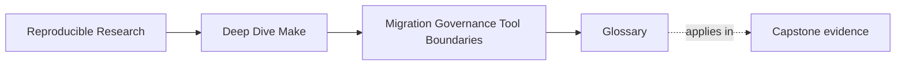
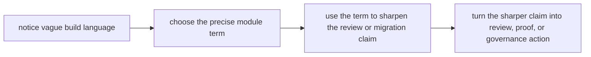

# Glossary

<!-- page-maps:start -->
## Page Maps

<!-- page-maps:end -->

Use this glossary to keep the language of Module 10 stable while you move between review,
migration, governance, boundary decisions, and practice.

The purpose is not to add jargon. The purpose is to stop stewardship discussions from
collapsing into phrases like "clean this up" or "modernize the build" when a more precise
term would reveal the real problem.

## How to use this glossary

When a build discussion feels slippery, look for the word doing the most argumentative
work.

If someone says:

- "this target is weird"
- "the release path feels fragile"
- "maybe we should move it to another tool"

pause and replace the vague phrase with the most precise term below. Module 10 gets much
stronger when vocabulary and action stay connected.

## Terms in this module

| Term | Meaning in this module | Why it matters |
| --- | --- | --- |
| accidental public target | A helper target that callers such as CI, scripts, or teammates started relying on even though nobody intentionally promoted it. | It explains why "internal helper" is no longer an honest description. |
| boundary risk | A sign that Make owns a concern it cannot model honestly, or that a handoff to another owner is vague and untestable. | It tells you the problem is about ownership fit, not just syntax. |
| change class | A category of change, such as public-contract change, proof-surface change, or internal refactor, used to choose the right review bar. | It keeps review proportional to risk. |
| comparison route | A target, script, or repeatable command used to compare old and new behavior during migration. | It preserves evidence so rollback and proof remain possible. |
| contract drift | A situation where a target name, output promise, or caller expectation no longer matches what the build really does. | It helps you name a trust problem instead of saying the build is "confusing." |
| governance note | A short rule set defining what is public, what review bar applies, and which proof surfaces must be protected. | It turns lessons learned into enforceable maintenance behavior. |
| handoff contract | The explicit statement of what object, evidence, and responsibility move from one owner to another. | It keeps hybrid boundaries from becoming vague excuses. |
| hidden state | Any input, environment fact, cache, shared mutation, or host assumption that changes behavior without being modeled clearly in the contract or graph. | It explains why a build can be surprising even when rules look correct. |
| hybrid boundary | A deliberate split where Make keeps ownership of one responsibility and another tool owns a different concern through an explicit handoff. | It gives a strong answer between "Make owns everything" and "Make owns nothing." |
| ownership argument | A justification for why one tool should remain responsible for a concern, based on truth location and modeling fit rather than habit or fashion. | It raises the quality of tool-choice discussions. |
| ownership inventory | A table showing targets, outputs, side effects, and who owns or writes them. | It is more useful than a target list because it maps actual trust surfaces. |
| proof bridge | The before-and-after evidence path kept alive while a migration changes one boundary. | It is what makes a migration safe instead of merely hopeful. |
| proof surface | Any route, artifact, or check that helps explain and verify build behavior, such as `selftest`, `--trace`, a manifest, or a serial-versus-parallel comparison. | It names what must be protected when the build changes. |
| public target contract | The stable meaning promised by a target that humans or automation are expected to rely on. | It keeps target names tied to promises instead of habits. |
| retirement condition | The explicit condition that must be true before an old route can be removed during migration. | It stops teams from deleting old paths too early. |
| review artifact | A concise written output from build review, usually summarizing contracts, outputs, hidden state, pressure findings, and classified risks. | It leaves behind something another maintainer can inspect. |
| risk class | The type of problem identified in review, such as graph-truth risk, contract drift, environment risk, or boundary risk. | It helps prioritize repairs instead of treating every issue as equal. |
| single-writer discipline | The rule that each trusted output should have one clear writer or owner. | It protects incremental trust and output ownership. |
| stewardship | The practice of maintaining a build as a long-lived product with explicit contracts, proof routes, and ownership decisions. | It frames Module 10 as maintenance discipline, not just advanced syntax. |
| target promotion rule | The rule a team uses to decide when a helper target becomes part of the public contract. | It stops accidental public surfaces from emerging silently. |
| tool-boundary decision | The act of deciding whether Make should keep owning a concern, share it through a hybrid boundary, or hand it off entirely. | It keeps boundary conversations tied to responsibility instead of novelty. |
| truth-preserving migration | A migration sequence that improves the build without deleting the evidence needed to trust old and new behavior. | It defines the quality bar for safe change in this module. |
| multi-writer output | A trusted output that is rewritten by more than one route, making ownership and incremental behavior hard to trust. | It points directly to one of the most common stewardship failures. |

## Useful contrasts

These pairs are worth keeping straight:

| Do not blur these | Better distinction |
| --- | --- |
| messy build vs contract drift | "messy" is a feeling; contract drift names a broken promise |
| wrapper convenience vs ownership | calling a tool is not the same as owning the concern |
| characterization vs approval | documenting current behavior is not the same as endorsing it |
| hybrid boundary vs vague split | a hybrid boundary has an explicit handoff contract |
| helper target vs accidental public target | the difference is whether callers now rely on it |

If you keep these contrasts clear, Module 10 becomes easier to apply under pressure.

## The vocabulary standard for this module

Strong Module 10 sentences sound like:

- "this is contract drift, not just awkward naming"
- "we need a proof bridge before retiring the old release path"
- "that helper target became an accidental public target"
- "deployment policy is a boundary risk, not a packaging problem"
- "the handoff contract is vague, so the hybrid boundary is not healthy yet"

Those sentences are more useful than saying only "the build needs cleanup."

## Exit check

The glossary is doing its job when you can:

- replace vague frustration with a precise stewardship term
- connect that term to a review, migration, or governance action
- explain boundary and proof problems without needing instructor translation
