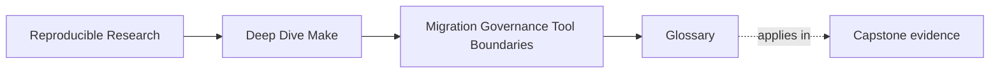
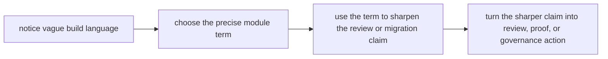
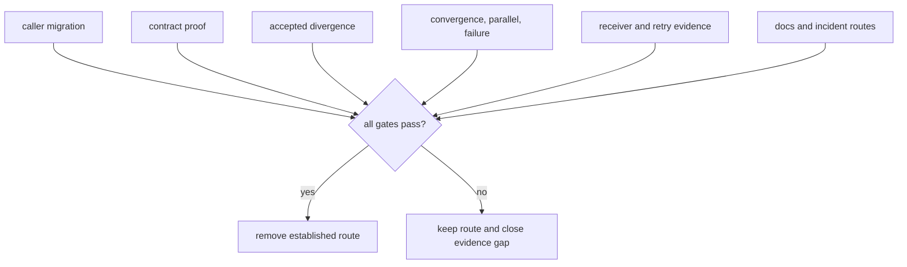
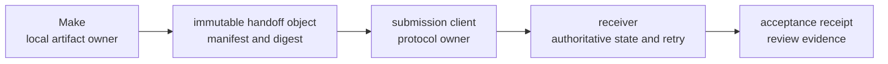

# Build Stewardship Vocabulary

<!-- page-maps:start -->
## Page Maps




<!-- page-maps:end -->

Use this page when a review claim sounds confident but does not yet identify evidence,
ownership, or a decision boundary. The terms are grouped by the work they help you do.

## Review language

| Term | Meaning in this module | Evidence question |
| --- | --- | --- |
| established contract | Behavior that current supported callers are entitled to rely on. | Which caller, document, contract test, or artifact proves the obligation? |
| accidental public target | A helper that real callers began using without deliberate promotion. | Which current caller makes removal a compatibility change? |
| public target contract | The stable promise made by a target supported for humans or automation. | Can its meaning, outputs, side effects, and failure boundary be stated precisely? |
| target promotion rule | The evidence and approval required before a helper becomes public. | Who needs it, how is it documented, and who accepts maintenance responsibility? |
| contract drift | A mismatch among target name, documented promise, caller expectation, and actual behavior. | Which two surfaces disagree? |
| observation | A fact directly supported by source, command output, artifact, or authoritative record. | Where can another reviewer inspect it? |
| inference | A bounded interpretation derived from observations. | What alternative explanation remains possible? |
| confidence | The strength of support for an inference within the declared review boundary. | What additional evidence would raise or lower it? |
| disproof route | A controlled observation that would show a finding is incorrect. | What result would make you withdraw or narrow the claim? |
| review boundary | The repositories, paths, targets, environments, and external systems actually inspected or exercised. | What remains outside the conclusion? |
| risk class | A category such as graph truth, contract, environment, parallel safety, observability, or tool boundary. | What type of repair does the evidence justify? |
| review artifact | A durable packet containing contracts, ownership, evidence, risks, uncertainty, and recommendations. | Can a maintainer reconstruct the conclusion without oral context? |

Review reasoning should flow like this:

```mermaid
flowchart LR
  observe["observation"] --> infer["bounded inference"]
  infer --> confidence["confidence and open question"]
  confidence --> class["risk class"]
  class --> consequence["credible consequence"]
  consequence --> recommendation["bounded recommendation"]
  recommendation --> disprove["disproof and verification routes"]
```

Jumping directly from a suspicious file shape to a redesign skips most of the chain.

## Behavior-classification language

| Term | Meaning | Migration treatment |
| --- | --- | --- |
| contract behavior | Supported behavior that must remain or change through an explicit decision. | Preserve with a proof bridge or record an accepted divergence. |
| implementation detail | A mechanism callers do not rely on as part of the supported contract. | May change when required outcomes and evidence remain valid. |
| defect | Behavior that violates truth, safety, or the stated contract. | Reproduce, repair, and prove removal; do not preserve for compatibility. |
| unknown behavior | An observed difference or dependency not yet classified. | Investigate before approval or retirement. |
| characterization | Repeatable capture of current behavior for later comparison. | Describes behavior without automatically approving it. |
| acceptance evidence | Proof that warranted work, output, failure, or handoff behavior occurs. | Use a relevant mutation or required receiver response. |
| rejection evidence | Proof that unwarranted work or forbidden behavior does not occur. | Use an irrelevant mutation, competing writer, or bad receiver response. |
| normalization | Removal of irrelevant variation before comparing contract-relevant results. | Canonicalize workspace paths, member order, or trace noise without hiding semantic differences. |
| intentional divergence | An approved difference between established and replacement contracts. | Record owner, rationale, evidence, and a regression check. |
| unresolved regression | A replacement difference that violates the contract or lacks an accepted decision. | Blocks retirement. |

“The outputs differ” is incomplete. The reviewer needs to know whether the difference is
irrelevant variation, an intentional correction, an added contract, or a regression.

## Migration and proof language

| Term | Meaning here | Required content |
| --- | --- | --- |
| proof surface | A command, artifact, fixture, or check that explains and verifies behavior. | Claim, inputs, output, and failure semantics. |
| proof bridge | The same controlled claim tested against established and replacement routes in isolated workspaces. | Fixture, normalization, acceptance, and divergence policy. |
| comparison route | A responsibility-named command that produces reviewable evidence from both implementations. | Must not let routes share or overwrite outputs. |
| rollback trigger | A specific observation that requires callers or responsibility to return to the established route. | Evidence threshold and decision owner. |
| recovery route | The action used when an irreversible or remote effect cannot be undone by source rollback. | State owner, compensation or retry rule, and evidence. |
| retirement gate | One required category of evidence before an established route can be removed. | Caller, contract, divergence, pressure, handoff, recovery, or documentation evidence. |
| caller migration | Deliberate movement of every established consumer to the supported replacement contract. | Repository search plus known external-caller confirmation. |
| evidence index | A mapping from each review or migration claim to its exact artifact. | Lets reviewers find proof without oral guidance. |
| truth-preserving migration | A sequence of responsibility moves that retains review and disproof ability throughout. | Each unit has a contract, proof bridge, rollback trigger, and owner. |

Retirement is a conjunction, not a date:



## Governance language

| Term | Meaning here | Review question |
| --- | --- | --- |
| change class | A category used to assign evidence and approval requirements. | Does this touch a public contract, proof surface, architecture, product output, or handoff? |
| review bar | The evidence, rejection challenge, and decision owner required for a change class. | What must a reviewer see before accepting the change? |
| governance note | A concise repository rule set for public contracts, ownership, proof, exceptions, and enforcement. | Can another maintainer apply it consistently? |
| contract manifest | One reviewable source listing governed targets, outputs, or interfaces. | Do help, CI, tests, and policy consume the same source? |
| governance check | A repeatable automated test of one governed rule. | What syntax and paths does it actually understand? |
| rejection challenge | A deliberate violating fixture that must make a governance check fail clearly. | Does the diagnostic identify the broken contract? |
| declared check boundary | The exact language, directories, and indirection a check can inspect. | Which cases still require human review? |
| evidence obligation | The artifacts required before a class of change may be approved. | Does it include acceptance and rejection evidence? |
| decision owner | The maintainer role authorized to accept a contract change or exception. | Is ownership specific enough to act without heroic knowledge? |
| bounded exception | A documented waiver limited by rule, scope, evidence, owner, and removal condition. | What repository state ends it? |
| hard stop | A prohibited shape rejected before later incident evidence is needed. | Does it fail near the violated boundary? |

Automation enforces the current rule. Governance explains who may change the rule and
with what evidence.

## Ownership and handoff language

| Term | Meaning here | Example |
| --- | --- | --- |
| single-writer discipline | Each trusted path has one publishing recipe or system. | `dist/report.tar.gz` has one package rule; convenience targets only request it. |
| ownership inventory | Targets, outputs, side effects, writers, readers, commit points, and authorities. | Extends a target list into a map of trusted state. |
| publication commit point | The operation after which a result becomes trusted at its stable boundary. | Same-directory rename for a file; authenticated acceptance for a remote request. |
| authoritative state | The system whose record determines the actual current truth. | A deployment controller, not the shell that launched it. |
| ownership dimension | Decision, execution, state, recovery, or evidence responsibility. | Make may execute submission while the receiver owns state and retry. |
| ownership argument | A justification based on truth location and modeling fit. | Local file graph stays in Make; remote approvals move to a release system. |
| hybrid boundary | Different owners connected by an explicit object and evidence contract. | Make produces bundle; receiver owns approval and publication. |
| handoff object | The complete immutable artifact submitted to a receiving owner. | Bundle plus manifest and checksum identity. |
| handoff contract | Object, evidence, sender, receiver, validation, failure, and recovery semantics. | Defines both sides instead of saying “the other system handles it.” |
| idempotency key | Stable identity the receiver uses to recognize repeated submission of the same request. | Release identity plus immutable artifact digest. |
| unknown outcome | A state where the sender lost the response and cannot know whether acceptance occurred. | Connection closes after receiver accepted the request. |
| retry owner | The system able to decide whether resubmission is safe from authoritative state. | Receiver client queries the idempotency key before retry. |
| acceptance receipt | Authenticated receiver evidence tying request identity and artifact digest to acceptance. | Stored locally for review but authoritative at the receiver. |
| boundary risk | Responsibility is assigned to a tool that cannot model its truth, failure, or authority honestly. | Make touches a local stamp to represent mutable remote deployment state. |

The same command can cross several owners:



Invocation does not imply state ownership.

## Antipattern and recovery language

| Term | Meaning here | Proof requirement |
| --- | --- | --- |
| visual smell | A suspicious shape that suggests investigation. | Not enough to justify repair alone. |
| failure signature | A repeatable observable result tied to a controlled challenge. | Exact command, state, output, and consequence. |
| ritual ordering | Correctness depends on callers requesting phony targets in a customary order. | Direct target or parallel challenge exposes the missing edge. |
| multi-writer output | More than one recipe or system can publish a trusted path. | Trace actual writers; shared prerequisites alone are not multi-writer. |
| opaque orchestration | Important selection or ownership is hidden behind wrappers or host-dependent branching. | Top-level evidence cannot explain decisive work. |
| meaningless stamp | A file whose represented fact, stability, or consumer promise is unclear. | Relevant change and unchanged convergence tests fail or cannot be explained. |
| overgrown target contract | One target combines unrelated validation, artifact, install, deployment, or remote-state meanings. | Failure and rerun semantics cannot be isolated. |
| truth-erasing optimization | Speed improvement removes semantic inputs or diagnostic obligations. | Mutation correctness fails even if benchmark improves. |
| bounded recovery | The smallest change that restores a truthful edge, owner, publication, or handoff. | Acceptance and rejection tests plus prevention rule. |

## Confusable pairs

| Do not collapse | Distinction |
| --- | --- |
| target list vs ownership inventory | A list names entrypoints; an inventory names trusted state, writer, reader, and authority. |
| helper target vs accidental public target | Current callers turn an intended helper into a compatibility obligation. |
| observation vs inference | Source or output is observed; its meaning is interpreted with stated confidence. |
| characterization vs approval | Capturing a defect supports comparison but does not make the defect contractual. |
| proof route vs success demo | Proof includes a falsifiable claim and rejection behavior. |
| rollback vs recovery | Source or caller rollback may restore local behavior; accepted remote effects need authoritative recovery. |
| retirement date vs retirement gate | Time can supply operational evidence but does not prove callers, contracts, or failure behavior. |
| invocation vs ownership | A Make recipe can launch a receiver without owning its state, authority, or retry policy. |
| local receipt copy vs remote authority | The copy supports review; the receiver defines acceptance truth. |
| text-search check vs ownership proof | A bounded search may enforce a convention but cannot parse arbitrary generated Make behavior. |

## Replace vague stewardship language

| Vague sentence | Reviewable sentence |
| --- | --- |
| “The Makefile is messy.” | “`publish` rewrites the package and triggers remote state, so the target has contract drift and boundary risk.” |
| “We should modernize release.” | “Separate deterministic package production from receiver-owned approval and retry state.” |
| “The outputs look the same.” | “Normalized member manifests agree; SHA-256 identity intentionally differs because archive metadata is now canonical.” |
| “We can roll back.” | “CI can select `dist-shell-packager` until package membership and failure-safety gates pass; the release owner controls the switch.” |
| “The migration has run long enough.” | “All callers migrated, comparison and pressure checks pass, intentional divergences are governed, and receiver fixtures pass.” |
| “Make handles deployment.” | “Make submits an immutable digest; the deployment controller owns acceptance, rollout state, retry, and receipt evidence.” |
| “The policy check passed.” | “The literal CI-target check passed within `.github/`; wrapper-generated calls remain a manual review boundary.” |

## Vocabulary checkpoint

Choose one consequential finding and explain it in this order:

1. observation, inference, confidence, and disproof route
2. established contract and affected callers
3. risk class and credible consequence
4. bounded recovery or ownership move
5. proof bridge with acceptance and rejection evidence
6. governance rule, check boundary, and decision owner
7. rollback trigger or authoritative recovery route
8. retirement gates and evidence index

If one line is missing, the vocabulary has located an evidence or ownership gap. Do not
hide it behind “cleanup,” “migration complete,” or “the other tool handles it.”
