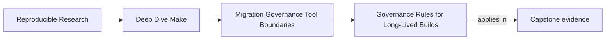
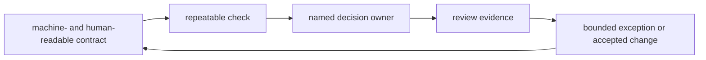

# Governance Rules for Long-Lived Builds

<!-- page-maps:start -->
## Page Maps



```mermaid
flowchart LR
  class["classify the kind of change"] --> bar["assign the right review bar"]
  bar --> protect["protect public contracts and proof surfaces explicitly"]
  protect --> own["name who owns exceptions and boundary changes"]
  own --> enforce["connect prose to review or automation"]
```
<!-- page-maps:end -->

This page turns good build taste into enforceable build rules.

If the build matters to more than one engineer, it needs governance: who may change what,
what must stay stable, and what every new addition must prove before it is trusted.

## Why governance matters here

Many teams do excellent repair work once and then quietly drift back into the same old
patterns:

- new public targets appear without review
- helper macros grow until nobody can explain them
- CI begins depending on internal routes
- audit commands disappear because they feel inconvenient
- release and install semantics change without anyone naming the break

That is not a lack of intelligence. It is a lack of rules.

Governance is how you keep the build from becoming a private superstition again.

Governance has four linked parts:



Prose alone is easy to ignore. Automation alone cannot decide whether a contract should
change. Ownership without evidence becomes authority by intuition. Long-lived governance
needs all four.

## The sentence to keep

When a build change is proposed, ask:

> What contract, ownership boundary, or proof surface does this change touch, and what is
> the review bar for that kind of change?

That question is governance in one line.

## Start by classifying the change

Not every edit deserves the same review weight.

For example:

- fixing a typo in help text
- renaming a public target
- adding a new included layer
- changing release artifact contents
- removing a selftest or audit target

Those are all "build changes" in one sense. They are not equal changes.

Governance starts by recognizing classes of change and assigning each class a review bar.

## A simple governance matrix

Use a matrix like this:

| Change class | Example | Expected review bar |
| --- | --- | --- |
| public contract change | rename `release-check`, alter `test` meaning | explicit maintainer review and updated docs |
| proof-surface change | remove `selftest`, alter audit target output | evidence that a replacement exists and remains usable |
| architecture change | add a new include layer or macro abstraction | justification of the responsibility boundary |
| product-output change | modify package contents or install destination | output comparison or artifact evidence |
| internal repair | fix a hidden edge in one helper rule | normal review with proof of correctness |

The exact categories can vary. What matters is that the team stops pretending all build
changes are interchangeable.

## Give each change class an evidence obligation

“Maintainer review required” is incomplete unless the maintainer knows what to inspect.

| Change class | Required evidence before approval | Rejection challenge |
| --- | --- | --- |
| public contract | caller inventory, compatibility decision, updated help and docs | an established caller still uses the removed meaning |
| proof surface | replacement claim, acceptance and failure tests, reviewer route | deliberately broken behavior escapes the replacement |
| architecture boundary | responsibility statement and dependency direction | a lower layer reaches back into policy or publication |
| product output | normalized manifest and checksum comparison | unexpected member or missing metadata is rejected |
| external handoff | sender manifest, receiver receipt, retry ownership | receiver failure is distinguishable from build failure |
| internal graph repair | relevant and irrelevant mutation traces | unrelated target rebuilds or affected target remains stale |

The rejection challenge is important. A check that only passes on the intended example
does not prove it guards the rule.

## Public targets need a promotion rule

A common source of governance drift is uncontrolled target growth.

If every useful helper becomes top-level and undocumented, the build surface gets noisy
and fragile. A better rule is:

Before a target becomes public, it must satisfy all of these:

1. its meaning can be explained in one sentence
2. a human or automation consumer actually needs it
3. the name is stable enough to support for a long time
4. its behavior is visible enough to debug
5. the team is willing to treat changes to it as interface changes

That promotion rule prevents accidental APIs.

Keep the public surface in one reviewable contract file rather than copying the list
across CI, help text, and policy prose:

```text
# build-contracts/public-targets.txt
all
test
selftest
dist
publish
clean
help
```

The filename describes stable ownership: build contracts. It does not describe when the
file was introduced. CI checks and help generation can consume the same list.

## Includes and macros need governance too

Teams often govern target names and forget the supporting structure.

That is dangerous because long-lived build complexity often hides in:

- shared macros with magical side effects
- include layers that mix policy and mechanism
- variables whose scope is unclear
- helper files that become dumping grounds for every new case

Useful rules are simple:

- each included file should own one responsibility
- macros should either compute text or define a rule pattern, not both invisibly
- new abstraction layers need a reason stronger than "the file got long"
- helper names should signal ownership and usage clearly

These rules do not make the build rigid. They make it teachable.

## Proof surfaces should be protected explicitly

One of the most expensive forms of drift is when teams slowly delete the very evidence
that helps them review the system.

Examples:

- `make --trace` guidance disappears from docs
- `selftest` stops running in CI
- a manifest or dump target is removed because it seems noisy
- serial/parallel comparison stops being part of review

Governance should name proof surfaces as first-class assets.

A rule worth adopting:

> No proof surface may be removed unless an equivalent or better one replaces it and the
> replacement is documented where maintainers already look.

That rule saves teams from trading clarity for short-term tidiness.

## Governance should define ownership, not only approval

Approval is only part of governance. Ownership matters just as much.

Someone should be able to answer:

- who curates public target meaning
- who reviews architecture changes in `mk/` or included files
- who decides whether a new tool boundary is justified
- who keeps proof routes usable
- who is responsible for migration retirement steps

If the answer is "everybody," the answer is often "nobody."

This does not require one heroic maintainer. It requires named stewardship.

## Connect prose to review or automation

A governance rule is much stronger when you can say how it is enforced:

| Rule | Enforced by |
| --- | --- |
| CI may call only public targets | workflow review and CI lint check |
| trusted outputs have one writer | contract review plus targeted ownership check |
| proof routes cannot disappear silently | maintainer review and docs update |
| new include files need one stated responsibility | code review checklist |

This is the difference between policy language and real governance.

## Build one executable governance check

Suppose CI workflow files call Make directly. A bounded check can compare literal calls
with the public-target contract:

```sh
set -eu
allowed=build-contracts/public-targets.txt
observed=artifacts/governance/ci-make-targets.txt

mkdir -p artifacts/governance
rg --no-filename --only-matching \
  'make[[:space:]]+[A-Za-z0-9_.-]+' .github \
  | awk '{print $2}' \
  | LC_ALL=C sort -u > "$observed"

while IFS= read -r target; do
  test -z "$target" && continue
  rg --fixed-strings --line-regexp --quiet "$target" "$allowed" || {
    printf 'CI calls non-public Make target: %s\n' "$target" >&2
    exit 1
  }
done < "$observed"
```

This check has a declared boundary: it recognizes literal `make target` calls in
`.github/`. It does not understand shell variables, matrices, wrappers, or generated
workflow commands. Record that limit instead of describing the check as a complete
parser.

Prove the rejection path in a fixture by adding `make prepare-release` to a workflow
sample and expecting the check to fail with the target name. Then restore the fixture and
expect success. The failure message is part of the teaching surface: it should tell the
maintainer which contract was violated.

## Protect single-writer contracts with focused tests

General Makefile parsing is difficult, especially with generated rules. Critical
artifacts can still have focused ownership tests:

```make
.PHONY: governance-package-owner
governance-package-owner:
	@writers="$$( { rg -l 'dist/report-bundle\\.tar\\.gz' Makefile mk scripts || true; } | sort)"; \
	count="$$(printf '%s\n' "$$writers" | sed '/^$$/d' | wc -l | tr -d ' ')"; \
	test "$$count" -eq 1 || { \
	  printf 'expected one package writer, found %s:\n%s\n' "$$count" "$$writers" >&2; \
	  exit 1; \
	}
```

This text search is only valid if the repository convention requires the trusted path to
appear literally at its writer. If rules generate the path, use a contract test around
the generated Make database or the publisher script instead. Governance must not pretend
a weak heuristic is a proof.

## A small example of enforceable governance

Here is a short build-governance note that another maintainer could actually use:

```text
Public targets are all, test, selftest, clean, help, release-check, and dist.
Changes to their names or meanings require maintainer review and docs updates.

New include files require a stated responsibility boundary.
New macros must document whether they compute text, define rules, or both.

Proof routes such as selftest, trace guidance, and artifact audits may not be removed
without a documented replacement.
```

That is not fancy policy writing. It is useful because another maintainer can apply it.

## Record decisions and exceptions

When a governed surface changes, leave a short decision record:

```text
Concern: remote publication target
Change class: external handoff
Established contract: publish builds and uploads the bundle
Accepted contract: publish submits an existing verified bundle
Evidence: package manifest comparison; receiver acceptance fixture
Decision owner: release maintainers
Rollback trigger: receiver cannot verify checksum or return a durable receipt
Exception: none
```

If an exception is necessary, include:

- the exact rule being waived
- the bounded targets or paths covered
- the evidence that keeps the exception safe
- the owner who can remove it
- a removal condition tied to repository state, not an ambiguous calendar promise

An unrecorded exception is simply drift.

## Add a few hard stops

Teams often write permissive guidelines and leave out the prohibitions that would save
review time.

Examples worth stating clearly:

- no shared append-only log targets in parallel paths
- no new public targets without a contract sentence
- no release target that silently installs or deploys
- no removal of audit outputs before a replacement exists
- no new layer whose only purpose is to hide a messy rule

These rules are blunt by design. They stop repeated damage early.

Hard stops should fail near the violated boundary. A package ownership defect should not
surface later as a deployment incident. Prefer a focused `governance-check` target that
composes small contract checks:

```make
.PHONY: governance-check
governance-check: governance-ci-targets governance-package-owner governance-proof-surface
```

Each prerequisite should own one rule and one diagnostic. A single opaque policy script
that returns only “governance failed” recreates the review problem governance is meant to
solve.

## Keep governance from freezing the build

Governance is not a ban on contract change. It defines a safe route for change:

1. identify the change class
2. gather its required acceptance and rejection evidence
3. migrate established callers or record intentional divergence
4. obtain a decision from the named owner
5. update the contract and its checks in the same reviewable unit

A rule that cannot be changed even with evidence becomes institutional folklore. A rule
that changes without evidence is not governance.

## Review drill

When reading a build change, ask:

1. does this alter a public contract?
2. does this hide or remove a proof surface?
3. does this add abstraction without a clear ownership boundary?
4. does this make CI or scripts depend on internals?
5. does this change who owns a concern without naming the handoff?
6. which automated rejection test demonstrates the rule still has teeth?

Those questions catch most governance drift early.

## Capstone connection

Use the capstone or any long-lived Make repository to practice:

- naming the public targets
- naming the proof surfaces that must stay protected
- assigning a review bar to one contract change and one internal repair
- deciding which maintainer or review owner should approve exceptions

That is how governance becomes operating memory instead of abstract policy.

## Exit check

Leave this lesson only when you can do all of these:

- explain why governance is mostly about change classes and review bars
- identify one rule that protects a public contract and one that protects a proof surface
- describe how a governance rule would be enforced by review, automation, or both
- state the declared limits of one automated check
- write an exception whose scope, evidence, owner, and removal condition are reviewable
