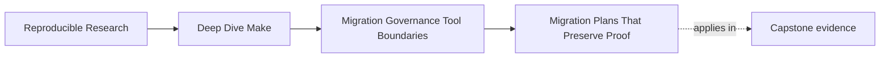
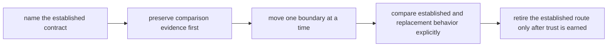
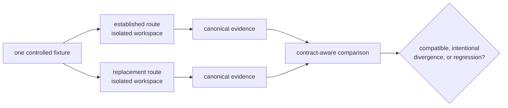

# Migration Plans That Preserve Proof

<!-- page-maps:start -->
## Page Maps




<!-- page-maps:end -->

This page is about changing an existing build without stepping into the most common trap:
rewriting faster than you can still prove what worked before and what works now.

Migration is not a synonym for replacement. It is a controlled sequence of boundary
moves.

## The migration mistake that wastes months

Teams often discover real build pain and jump straight to this conclusion:

> The safest path is to replace everything at once.

That is almost never the safest path.

A large rewrite can reduce visible clutter while destroying your ability to answer basic
questions:

- which behaviors were intentionally preserved
- which established failures were actually fixed
- which incidents are new regressions
- which proof steps still exist and which ones quietly disappeared

That is not migration discipline. That is a loss of memory.

## The sentence to keep

When you plan a build migration, ask:

> What is the smallest change that improves one boundary while preserving the evidence
> needed to trust the result?

That question keeps the sequence honest.

## Proof is part of the system, not a migration luxury

In Module 10, "proof" means the concrete ways you verify that the build still tells the
truth.

Typical proof surfaces include:

- convergence checks
- serial-versus-parallel comparison
- `make -n` sanity checks
- `--trace` explanation surfaces
- artifact manifests, checksums, or audit outputs
- selftests around target meaning and output ownership

If your migration deletes those and promises to rebuild them later, you are not
preserving proof. You are borrowing confidence against future work.

## Separate four kinds of behavior before comparing routes

A migration cannot preserve “everything” because current behavior contains different
kinds of facts:

| Behavior kind | Example | Migration treatment |
| --- | --- | --- |
| contract | archive contains the documented report and manifest | preserve or change through an explicit contract decision |
| implementation detail | helper uses `tar` through a shell script | free to change if the contract and evidence remain |
| defect | parallel packaging exposes a partial archive | document and prove removal; do not preserve |
| unknown | archive member order differs across machines | investigate before declaring compatible or defective |

Write this classification before the replacement route exists. Otherwise, teams often
call every observed difference a regression or, equally dangerously, dismiss every
difference as an implementation detail.

## Start by naming the current contract

Before planning a migration step, write down:

- what the current route is supposed to produce
- who consumes it
- what evidence you have today that it still works

A migration plan with no current contract usually drifts into aesthetics:

- "clean this up"
- "modernize the scripts"
- "split this into layers"

Those may become good moves later. They are not a plan yet.

## A stable migration order

Most safe migrations follow this shape:

1. review the current build and classify the main risks
2. preserve or improve the proof harness before major structural edits
3. narrow public target meanings
4. isolate one boundary or subsystem at a time
5. compare established and replacement behavior with explicit evidence
6. retire the established route only after the replacement route has earned trust

This order may feel slow. It is slower than wishful thinking and faster than repeated
regression hunts.

## Preserve the review questions before changing the implementation

Imagine an inherited build where `release` is unreliable. A reckless migration says:

- replace the packaging scripts
- rename targets
- move outputs
- update CI
- trust manual testing

A safer migration begins differently:

- define what `release` is currently supposed to mean
- preserve one way to inspect its current behavior
- separate packaging proof from deployment side effects
- add a comparison route for established and replacement outputs

The key idea is simple: keep the diagnostic questions alive while you change the
implementation.

## Move one truth boundary at a time

A build usually has several boundaries mixed together:

- compile boundary
- generated-file boundary
- package boundary
- install boundary
- deployment or orchestration boundary

Trying to move all of them in one change makes review almost impossible.

Suppose a team wants to improve packaging and deployment. A disciplined migration says:

1. first make the package boundary explicit
2. prove archive identity and contents cleanly
3. only then decide whether deployment still belongs in Make

That is much safer than “replace release with a different pipeline.”

## Design a proof bridge, not just two successful commands

A proof bridge states one claim and gives both routes the same challenge:

| Claim | Shared fixture | Normalization | Acceptance |
| --- | --- | --- | --- |
| artifact contents agree | fixed report inputs | sorted archive member list | same required paths, no unexpected paths |
| artifact identity agrees | fixed inputs and environment contract | canonical archive settings | identical checksum |
| incremental behavior remains truthful | relevant and irrelevant mutations | target-level trace summary | same warranted rebuild closure |
| failure safety improves | producer failure injection | final-path and candidate inspection | replacement preserves old artifact or absence |
| parallel result agrees | clean isolated workspaces | semantic manifest | `-j1` and `-j8` agree |

Do not let two routes write the same output directory during comparison. Give each an
isolated workspace so one cannot borrow or overwrite the other's results.



## Use one migration table per boundary move

For one step, fill in:

| Part | What to record |
| --- | --- |
| current contract | what the established route is supposed to produce or guarantee |
| current evidence | how you inspect the established route today |
| defect class | what is broken: truth, contract, parallel safety, environment, or boundary |
| intended change | what one boundary move will happen next |
| preserved proof | what command or artifact still lets you compare established and replacement behavior |
| accepted divergence | which approved contract changes should differ, and who approved them |
| rollback trigger | which observation requires callers to return to the established route |
| retirement condition | what must be true before the established route can disappear |

This format keeps migration plans from collapsing into vague verbs like "streamline" and
"refactor."

## Keep comparison routes boring and specific

One of the best migration habits is to add responsibility-named comparison targets.

For example:

```make
.PHONY: compare-package-contract

compare-package-contract: dist-shell-packager dist-graph-packager
	@diff -u \
	  artifacts/package-contract/shell-packager.manifest \
	  artifacts/package-contract/graph-packager.manifest
```

Or:

```make
.PHONY: compare-build-selection

compare-build-selection:
	@$(MAKE) --trace -f Makefile.shell-packager all \
	  > artifacts/build-selection/shell-packager.trace 2>&1
	@$(MAKE) --trace -f Makefile.graph-packager all \
	  > artifacts/build-selection/graph-packager.trace 2>&1
	@./scripts/compare-build-selection.sh \
	  artifacts/build-selection/shell-packager.trace \
	  artifacts/build-selection/graph-packager.trace
```

These routes are not glamorous. They are valuable because they stop migration
discussions from becoming intuition contests.

Raw trace diffing is rarely sufficient: paths, line numbers, and recipe text may differ
legitimately. The comparison script should extract the contract-relevant target
selection, or the migration packet should explain why raw text equality is required.

## Record intentional divergence explicitly

Replacement routes sometimes should differ. Record those differences before approval:

| Surface | Established behavior | Replacement behavior | Decision | Evidence owner |
| --- | --- | --- | --- | --- |
| archive order | host-dependent | canonical lexical order | intentional correction | release maintainer |
| checksum sidecar | absent | required | contract addition | package consumer owner |
| remote upload | packaging target performs it | receiver performs it after handoff | ownership move | release operations |

An unrecorded difference is unresolved, not automatically acceptable. An intentional
divergence needs a named contract decision and a test that locks in the intended result.

## Make rollback executable

“We can revert if needed” is not a rollback plan. State:

- which callers can select the established route
- which artifact or configuration controls that selection
- which evidence triggers rollback
- who owns the decision
- what data or remote state must be reconciled first

For a local package boundary, rollback may mean restoring CI to a named
`dist-shell-packager` target while preserving the failed replacement evidence. For a
remote publication boundary, rollback may be impossible after acceptance; recovery then
belongs to the receiver's state model. Do not use source rollback language to hide an
irreversible external side effect.

## Hybrid boundaries are often the honest answer

Many safe migrations are hybrids for a while.

Examples:

- Make still owns local build graph truth, but a script now owns manifest generation
- Make still drives compile and test, but release metadata is produced by a dedicated
  tool
- Make still orchestrates repository-local work, while deployment moves to a workflow
  system with its own state model

A hybrid is not a sign of weakness. It is often a sign the team is respecting
boundaries instead of pretending one tool should own everything immediately.

The question is not whether the system becomes hybrid. The question is whether the
handoff is explicit and testable.

## Do not remove observability to make the migration look cleaner

Teams sometimes hide useful evidence during migration because it feels short-lived or
messy:

- trace targets disappear
- dumps stop being generated
- selftests get skipped “until the replacement design settles”
- established audit commands are deleted before replacements exist

That is exactly backwards.

Migration is when you need observability the most. Bounded comparison routes are better
than silent confidence.

## Use explicit retirement gates

The established route may be removed only when every applicable gate has evidence:

| Gate | Evidence |
| --- | --- |
| caller migration | repository and external caller inventory has no remaining established-route consumers |
| contract compatibility | required outputs and metadata pass the proof bridge |
| accepted divergence | every intended difference has an owner and regression check |
| pressure behavior | convergence, parallel agreement, and failure safety pass |
| operational handoff | receiver acceptance and retry ownership are documented |
| rollback decision | rollback window is closed or recovery ownership replaces it |
| documentation | supported targets and incident routes describe the replacement owner |

A date is not a retirement gate. “It has been running for two weeks” may contribute
operational evidence, but it does not prove callers, contracts, or failure routes.

## Review drill

Before approving a migration step, answer these three questions in writing:

1. what exact behavior is changing?
2. what proof will show the change is safe?
3. what established route or contract remains in place until trust is earned?

If you cannot answer the third question, the step is probably too large.

## Capstone connection

Use the capstone or an inherited Make system to practice one real sequence:

- name the current contract of one painful target
- keep one command or artifact that exposes current behavior
- move one boundary only
- compare established and replacement behavior explicitly
- state the retirement gates before removing the established route

That is the discipline the rest of Module 10 depends on.

## Exit check

Leave this lesson only when you can do all of these:

- explain why migration is a sequence of boundary moves rather than a synonym for
  replacement
- identify one proof surface that must survive a first migration step
- distinguish contract, implementation detail, defect, and unknown behavior
- describe the retirement gates that must pass before an established route disappears
