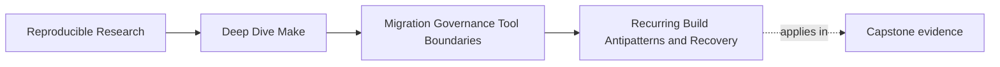

# Recurring Build Antipatterns and Recovery

<!-- page-maps:start -->
## Page Maps



```mermaid
flowchart LR
  smell["spot the repeated smell"] --> class["name the form of truth loss or ownership drift"]
  class --> smallest["choose the smallest honest recovery move"]
  smallest --> protect["keep proof alive during the repair"]
  protect --> prevent["write the rule that stops the smell returning"]
```
<!-- page-maps:end -->

This page collects the patterns that keep returning even after teams say they already
know better.

The goal is not to mock bad Makefiles. The goal is to recognize familiar damage early
enough to stop it from spreading.

## Why antipatterns matter this late in the course

By Module 10, you already know many isolated facts:

- honest prerequisites matter
- parallel safety matters
- target meaning matters
- release boundaries matter
- observability matters

The problem in real repositories is usually not missing isolated facts. The problem is
that the same bad combinations keep reappearing under new names.

That is why this page is about patterns, not trivia.

## The sentence to keep

When you spot a suspicious build habit, ask:

> What repeated form of truth loss or ownership drift am I looking at, and what is the
> smallest honest recovery path?

That question turns vague discomfort into action.

## Antipattern 1: phony ordering instead of real edges

This is one of the oldest mistakes:

```make
.PHONY: prepare compile

all: prepare compile

prepare:
	@mkdir -p build

compile:
	@cc -o build/app src/main.c
```

This looks harmless. The deeper problem is that `compile` does not actually say what it
needs.

Signals:

- a target works only because a phony step happened first
- `-j` exposes missing directories or missing generated inputs
- downstream targets rely on ritual order instead of real prerequisites

Smallest honest recovery:

- make directory creation an order-only prerequisite where appropriate
- make generated inputs first-class graph nodes
- remove phony sequencing once real edges exist

Phony targets are not evil. Using them to hide real data or publication dependencies is.

## Antipattern 2: multi-writer outputs hidden behind convenience

This appears in many forms:

- two targets both rewrite `build/app`
- a packaging target rebuilds product outputs
- a helper script refreshes generated files during unrelated commands

Teams often describe this as "convenient" because it avoids repeated commands. What it
really does is erase output ownership.

Signals:

- outputs change when running unrelated targets
- incremental behavior becomes hard to trust
- release incidents are hard to reproduce

Smallest honest recovery:

- assign one writer to each trusted output
- split generation from packaging or publishing
- make convenience targets compose truthful targets instead of rewriting artifacts

Single-writer discipline is not style. It is a survival rule.

## Antipattern 3: opaque orchestration hiding the graph

Some inherited builds are not recursive in the strict GNU Make sense, but they still act
like it:

- shell scripts call `make` in several places
- one target delegates to directory-local mini systems without visible edges
- wrapper scripts choose routes dynamically based on host state

Signals:

- nobody can describe the real graph from the top level
- `--trace` helps less than expected because the interesting work happens elsewhere
- CI failures depend on where the wrapper script happened to branch

Smallest honest recovery:

- keep the top-level contract small and explicit
- expose subsystem boundaries deliberately
- model shared outputs and inputs at the layer where they can be reviewed
- stop hiding major orchestration decisions in shell branching

The point is not "never call another tool." The point is "do not bury the ownership
model."

## Antipattern 4: stamps and manifests with no clear meaning

Stamps and manifests can be excellent tools. They can also become places teams dump
uncertainty.

Warning signs:

- a stamp exists because "Make needed it somehow"
- the stamp is touched every run
- nobody can explain what semantic boundary it proves
- consumers depend on the stamp while the real output shape remains unclear

Example:

```make
build/generated.stamp:
	@./scripts/codegen.sh
	@touch $@
```

The review question is:

- what single fact does this stamp prove?

If the answer is "sort of many things," the stamp is under-specified.

Smallest honest recovery:

- define the boundary fact in one sentence
- make the stamp or manifest represent only that fact
- keep consumers depending on real published outputs where direct edges are clearer

## Antipattern 5: release or install routes that do too much

This pattern survives because it often "works" during demos:

```make
release:
	@./scripts/build.sh
	@./scripts/test.sh
	@./scripts/package.sh
	@./scripts/install.sh
```

The issue is not that each sub-step exists. The issue is that the target meaning is too
broad to review.

Signals:

- one command mutates many different boundaries
- failures are described as generic "release issues"
- reruns are risky because side effects already happened

Smallest honest recovery:

- separate validation, packaging, install, and deployment meanings
- keep publication boundaries inspectable
- make dangerous side effects opt-in and explicit

When a target means everything, it usually means nothing clearly.

## Antipattern 6: performance fixes that erase truth

This one often appears late, after the team has already suffered:

- checks are skipped because they are slow
- caches are added without modeling the cache boundary
- rebuilds are reduced by ignoring semantic inputs
- trace or audit routes are removed to reduce noise

Signals:

- the build is faster but less explainable
- stale outputs become harder to detect
- incidents take longer because evidence disappeared

Smallest honest recovery:

- measure where the real cost lives first
- remove waste, not obligations
- add bounded observability routes instead of deleting evidence surfaces
- keep truth-preserving comparisons during optimization work

Speed is valuable. Truth is more valuable.

## Keep proof alive while you recover

Antipattern repair goes wrong when the team fixes the smell and deletes the evidence that
would prove the repair worked.

Keep at least one reviewable proof route alive while you change the graph:

| If the smell touches... | Keep this proof route alive |
| --- | --- |
| generated outputs | a comparison route between old and new generated files |
| package or publish steps | a dry-run or staging route that exposes exactly what would ship |
| orchestration wrappers | a traced route that shows the chosen execution path |
| performance shortcuts | a slower but trustworthy audit path that still models full truth |

If you cannot name the proof route, you are not ready to change the build yet.

## Use one recovery rubric

When you detect an antipattern, classify the first move:

| Antipattern smell | First recovery move |
| --- | --- |
| ritual order dependence | expose a real edge or order-only prerequisite |
| multi-writer output | assign one owner and remove hidden rewrites |
| opaque orchestration | surface the actual boundary and contract |
| meaningless stamp | define the represented fact before keeping the file |
| overgrown release target | split target meanings and side effects |
| truth-erasing optimization | restore evidence and semantic inputs first |

This keeps the fix proportional to the finding.

## Run a diagnosis pass before you touch the file

Before editing, write four short answers:

1. what output, contract, or published state is currently being blurred?
2. who should own that boundary when the repair is complete?
3. what is the smallest change that makes the boundary more truthful?
4. which proof route will tell you whether the repair actually helped?

That short diagnosis stops you from reaching for a heroic rewrite when the real problem is
one hidden edge or one mixed-responsibility target.

## Familiarity does not make an antipattern legitimate

Some patterns survive simply because teams have seen them for years:

- one giant `release` target
- a helper script that "just knows" what to rebuild
- top-level targets that rewrite shared files as a convenience
- cleanup routes that also reset caches or developer state

Longevity does not make those healthy. It usually makes them expensive.

Module 10 asks you to say that clearly.

## Review drill

For any suspicious build habit, ask:

1. which repeated smell is this?
2. what kind of truth loss or ownership drift does it cause?
3. what is the smallest honest recovery step?
4. what proof route must stay alive during the repair?

## Exit check

You are ready to move on when you can:

- name the antipattern without describing the whole repository history
- explain the specific truth loss or ownership drift it causes
- propose one bounded repair step instead of a vague cleanup campaign
- preserve at least one proof route while the change is happening
5. what governance rule would stop it from returning?

If those answers are fuzzy, you have recognized the smell but not yet designed the
recovery.

## Capstone connection

Use the capstone or an inherited Make system to practice:

- naming one repeated antipattern clearly
- listing the observable signals that confirm it
- choosing the smallest repair that restores truth or ownership clarity
- naming the rule that would prevent the same shape from reappearing

That turns Module 10 from pattern recognition into maintenance discipline.

## Exit check

Leave this lesson only when you can do all of these:

- explain one recurring build antipattern in terms of truth loss or ownership drift
- identify the smallest honest recovery move for it
- describe one rule or proof surface that would help stop it from coming back
