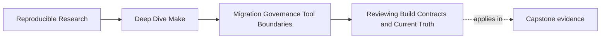
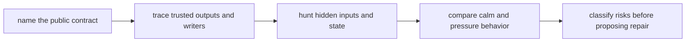

# Reviewing Build Contracts and Current Truth

<!-- page-maps:start -->
## Page Maps




<!-- page-maps:end -->

This page is about the first pass over an inherited build: not how to rewrite it, but
how to understand what it currently promises, what it currently breaks, and what
evidence separates those two things.

The rest of Module 10 depends on this discipline. A migration plan is only as good as
the review that shaped it.

## The first mistake to avoid

Most bad build reviews begin with sentences like these:

- "this Makefile is ugly"
- "we should modernize it"
- "there are too many variables"
- "I would never structure it this way"

Those may or may not be true. They are still weak starting points.

An inherited build is not a style puzzle. It is a contract surface. Before you talk
about beauty, you need to know:

- which targets people rely on
- which outputs the build claims to publish
- which inputs actually control those outputs
- which routes are safe only by accident
- which failures come from truth loss rather than mere inconvenience

That is the difference between criticism and review.

## The sentence to keep

When you open a legacy Make build, ask:

> What does this build currently promise, what evidence supports that promise, and where
> does the promise break under pressure?

That one sentence keeps the review honest.

## Start with public behavior, not file layout

A common beginner move is to start by mapping the file tree:

- top-level `Makefile`
- a few included `.mk` files
- perhaps a `scripts/` directory
- maybe some generated outputs and temp files

That map matters later. It is not the first thing that matters.

The first thing that matters is public behavior. Ask:

- what targets does a developer run on purpose
- what targets does CI call
- what targets are documented in the README or helper scripts
- what files or directories are considered trusted outputs
- what commands are used to inspect, clean, publish, or verify the build

Those are the entry points into the system. If you do not know them, you do not yet
know what the build is for.

## A practical first-review order

For a first review, use this order:

1. list the public targets and what each one is supposed to mean
2. list the trusted outputs and who writes them
3. list the obvious sources of hidden state
4. compare serial and parallel behavior
5. classify the top risks before proposing repairs

That order works because it turns a vague build into a legible product surface.

## Name the public target contract

Take the top-level target surface and write it down in plain language.

Example:

| Target | Likely promise | Questions to ask |
| --- | --- | --- |
| `all` | build the default artifact set | what artifacts count as complete? |
| `test` | run ordinary validation | does it depend on hidden setup or side effects? |
| `clean` | remove generated outputs | does it delete source-like or cache-like inputs too? |
| `release` | produce publishable outputs | does it also test, install, or mutate unrelated state? |

This table is already more useful than saying "the Makefile is complicated."

Look for contract drift:

- targets with vague names such as `verify-stuff`
- CI depending on helper targets never meant to be public
- one target doing build, test, cleanup, and packaging in one shell ritual
- names that imply one promise but perform another

If the target contract is muddy, the review should say so explicitly.

## Trace who owns each trusted output

The next review question is simple:

> For each trusted output, who writes it exactly once?

This is where many inherited systems begin to fail.

Suppose you find this:

```make
all: build/app build/version.txt

build/app:
	@./scripts/build-app.sh

package:
	@./scripts/build-app.sh
	@tar -czf dist/app.tar.gz build/app build/version.txt
```

The issue is not "this uses a script." The issue is output ownership drift:

- `build/app` is written from more than one route
- packaging rebuilds product state as a side effect
- the graph no longer tells the truth about publication

That is a real finding. It predicts flaky releases, confusing reruns, and bad incident
triage later.

## Hunt hidden state on purpose

Strong reviews ask what the build is quietly depending on.

Common hidden-state sources include:

- environment variables that change recipe meaning
- undeclared tools or config files
- generated files that are read but never modeled
- shell commands that append to shared logs or status files
- directory scans whose result order is unstable

For example:

```make
report.txt:
	@./scripts/render-report.sh $(MODE) > $@
```

The review question is not "does `MODE` exist?" It is:

- where is `MODE` defined?
- what happens when it changes?
- is that change part of the declared build meaning?
- does the current graph know that `report.txt` depends on it?

If the answer is no, you have found a semantic input the graph does not model.

## Compare calm conditions to pressure conditions

A legacy build often looks fine when run only one way:

```sh
make all
```

The review should always ask what happens under pressure:

```sh
make -n all
make --trace all
make -j1 all
make -j8 all
```

Those commands answer different questions:

- `-n` shows intended actions without external mutation
- `--trace` shows why targets are considered
- `-j1` gives a serial baseline
- `-j8` exposes concurrency assumptions and shared-state damage

Many "legacy quirks" are really one of these:

- the build only works serially
- the build only works on a warm machine
- the build only works because prior outputs are already present
- the build only works because accidental order hides a graph defect

A review that never applies pressure is incomplete.

## Classify findings before suggesting fixes

Do not jump straight from evidence to edits. First classify the finding.

A practical rubric is:

| Finding class | What it means |
| --- | --- |
| graph truth risk | the graph hides a real dependency, writer, or publication event |
| contract drift | target names or output promises no longer match behavior |
| environment risk | the build depends on host state or undeclared tools |
| parallel-safety risk | correctness depends on serial execution or shared mutation |
| observability risk | the build is too opaque to diagnose safely |
| boundary risk | Make owns a concern it cannot model honestly |

This matters because each class suggests a different repair path.

For example:

- hidden input: likely a graph-truth repair
- release target doing too much: contract repair
- one script maintaining remote state: boundary repair

Without classification, reviews turn into giant wish lists.

## One-page review packet

At the end of a first pass, you should be able to hand another maintainer a packet with:

- public target meanings
- trusted outputs and their writers
- hidden inputs or stateful behavior
- one calm-versus-pressure comparison
- top risk classes in clear language

If your review cannot fit into that shape, it is probably still too impressionistic.

## Review drill

For any inherited build, ask:

1. what is public here?
2. what trusted outputs exist and who writes them?
3. which hidden input or shared state changes meaning without being modeled?
4. what breaks under pressure?
5. which finding class should each problem be assigned to?

If those answers are still fuzzy, you are not ready to plan a migration yet.

## Capstone connection

Use the capstone or any inherited Make repository to practice this sequence:

- list public targets and trusted outputs
- run dry-run, trace, and serial/parallel comparisons
- name one hidden input
- classify the top two or three risks before recommending any redesign

That is how you keep review work grounded in observable truth instead of intuition.

## Exit check

Leave this lesson only when you can do all of these:

- explain why a build review must start from public behavior rather than taste
- identify one trusted output and one hidden input from a real build
- classify one real finding as graph truth, contract, environment, parallel, observability,
  or boundary risk
