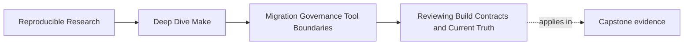
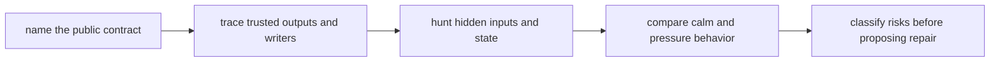

# Reviewing Build Contracts and Current Truth

<!-- page-maps:start -->
## Page Maps




<!-- page-maps:end -->

This page is about the first pass over an inherited build: not how to rewrite it, but
how to understand what it currently promises, what it currently breaks, and what
evidence separates those two things.

The rest of Module 10 depends on this discipline. A migration plan is only as good as
the review that shaped it.

## The first mistake to avoid

Most bad build reviews begin with sentences like these:

- "this Makefile is ugly"
- "we should modernize it"
- "there are too many variables"
- "I would never structure it this way"

Those may or may not be true. They are still weak starting points.

An inherited build is not a style puzzle. It is a contract surface. Before you talk
about beauty, you need to know:

- which targets people rely on
- which outputs the build claims to publish
- which inputs actually control those outputs
- which routes are safe only by accident
- which failures come from truth loss rather than mere inconvenience

That is the difference between criticism and review.

## Set a safe review boundary

An inherited target may upload, delete, install, or contact production. Discovery must
not accidentally invoke it.

Classify review actions before running them:

| Review action | Default safety | What it can establish |
| --- | --- | --- |
| read Makefiles, scripts, CI, and docs | read-only | declared callers, commands, and named outputs |
| `make -pn` | normally read-only, but parse-time `$(shell ...)` can still execute | expanded database and rule selection clues |
| `make -n target` | does not run recipes, but still parses Makefiles | planned recipe text and prerequisite traversal |
| `make --trace target` | executes recipes unless target is already current | causal rebuild evidence only in an isolated fixture |
| `make -j1` / `make -j8` | executes the graph | pressure behavior only in a disposable workspace |
| `make publish`, `deploy`, or `install` | potentially external or destructive | never a discovery command without a controlled receiver |

`-n` and `-p` are not perfect sandboxes because Make expands functions while parsing.
Inspect unfamiliar `$(shell ...)`, included files, and recursive invocations first. A
review that mutates an external system has already crossed from observation into
operation.

## The sentence to keep

When you open a legacy Make build, ask:

> What does this build currently promise, what evidence supports that promise, and where
> does the promise break under pressure?

That one sentence keeps the review honest.

## Start with public behavior, not file layout

A common beginner move is to start by mapping the file tree:

- top-level `Makefile`
- a few included `.mk` files
- perhaps a `scripts/` directory
- maybe some generated outputs and temp files

That map matters later. It is not the first thing that matters.

The first thing that matters is public behavior. Ask:

- what targets does a developer run on purpose
- what targets does CI call
- what targets are documented in the README or helper scripts
- what files or directories are considered trusted outputs
- what commands are used to inspect, clean, publish, or verify the build

Those are the entry points into the system. If you do not know them, you do not yet
know what the build is for.

## Build the caller inventory from the outside inward

Publicness is evidence about use, not a label inferred from `.PHONY`. Search consumers
before accepting the Makefile author's intended boundary:

```sh
rg -n --glob '*.yml' --glob '*.yaml' --glob '*.sh' \
  'make|gmake|\\$\\(MAKE\\)' .
rg -n --glob 'README*' --glob 'docs/**' \
  'make (all|test|selftest|dist|release|publish)( |$)' .
```

Record every observed call:

| Caller | Target | Invocation assumptions | Contract status |
| --- | --- | --- | --- |
| developer guide | `all` | repository root, local tools | intentional public target |
| CI workflow | `prepare-release` | generated credentials and warm cache | accidental public dependency |
| release script | `publish` | prior package exists | public name with unstated precondition |

A target can be accidental yet still contractual. Removing it without migrating callers
breaks real behavior. Conversely, a target listed in `help` but used nowhere may be a
proposed interface rather than an established one. Keep those cases distinct.

## A practical first-review order

For a first review, use this order:

1. list the public targets and what each one is supposed to mean
2. list the trusted outputs and who writes them
3. list the obvious sources of hidden state
4. compare serial and parallel behavior
5. classify the top risks before proposing repairs

That order works because it turns a vague build into a legible product surface.

For each item, record observation separately from inference:

| Field | Example |
| --- | --- |
| observation | CI invokes `make prepare-release` on every release branch |
| inference | the helper has become an accidental public target |
| confidence | high: a current caller is visible |
| missing evidence | whether any external caller invokes it outside CI |

This discipline prevents a plausible reading from hardening into “current truth” without
support.

## Name the public target contract

Take the top-level target surface and write it down in plain language.

Example:

| Target | Likely promise | Questions to ask |
| --- | --- | --- |
| `all` | build the default artifact set | what artifacts count as complete? |
| `test` | run ordinary validation | does it depend on hidden setup or side effects? |
| `clean` | remove generated outputs | does it delete source-like or cache-like inputs too? |
| `release` | produce publishable outputs | does it also test, install, or mutate unrelated state? |

This table is already more useful than saying "the Makefile is complicated."

Look for contract drift:

- targets with vague names such as `verify-stuff`
- CI depending on helper targets never meant to be public
- one target doing build, test, cleanup, and packaging in one shell ritual
- names that imply one promise but perform another

If the target contract is muddy, the review should say so explicitly.

## Trace who owns each trusted output

The next review question is simple:

> For each trusted output, who writes it exactly once?

This is where many inherited systems begin to fail.

Suppose you find this:

```make
all: build/app build/version.txt

build/app:
	@./scripts/build-app.sh

package:
	@./scripts/build-app.sh
	@tar -czf dist/app.tar.gz build/app build/version.txt
```

The issue is not "this uses a script." The issue is output ownership drift:

- `build/app` is written from more than one route
- packaging rebuilds product state as a side effect
- the graph no longer tells the truth about publication

That is a real finding. It predicts flaky releases, confusing reruns, and bad incident
triage later.

### Trace writers, readers, and publication points

For each trusted path, search the Make database, recipes, and called scripts:

```sh
make -pn > artifacts/make-database.txt
rg -n 'dist/report\\.tar\\.gz|build/report\\.html' \
  Makefile mk scripts artifacts/make-database.txt
```

Then fill an ownership ledger:

| Trusted path | Declared target | Actual writers | Readers | Publication method | Finding |
| --- | --- | --- | --- | --- | --- |
| `build/report.html` | yes | analysis rule and packaging script | bundle rule | direct write | multi-writer |
| `dist/report.tar.gz` | yes | package script | uploader | direct write | partial-publication risk |
| remote release record | no local target | publication service | release reviewers | remote mutation | receiver-owned truth |

Do not count a convenience target as the writer if its recipe merely requests another
target. Name the rule or system that performs the state change. Also locate the commit
point: a same-directory rename, archive close, service acceptance, or some weaker direct
write.

## Hunt hidden state on purpose

Strong reviews ask what the build is quietly depending on.

Common hidden-state sources include:

- environment variables that change recipe meaning
- undeclared tools or config files
- generated files that are read but never modeled
- shell commands that append to shared logs or status files
- directory scans whose result order is unstable

For example:

```make
report.txt:
	@./scripts/render-report.sh $(MODE) > $@
```

The review question is not "does `MODE` exist?" It is:

- where is `MODE` defined?
- what happens when it changes?
- is that change part of the declared build meaning?
- does the current graph know that `report.txt` depends on it?

If the answer is no, you have found a semantic input the graph does not model.

Use a hidden-state challenge table instead of a generic list:

| Suspected state | Controlled change | Expected affected outputs | Current graph evidence |
| --- | --- | --- | --- |
| `MODE` environment value | `MODE=draft` to `MODE=release` | `report.html`, bundle | none visible |
| tool selection | change `PYTHON` command | generated metadata | variable affects recipe only |
| warm generated file | remove it in isolated copy | downstream archive | no producer found |
| shared status log | compare `-j1` and `-j8` | log contents only | multiple appenders |

The controlled change turns suspicion into a falsifiable review claim. Do not challenge
credentials, production state, or expensive external services in an ordinary build
review.

## Compare calm conditions to pressure conditions

A legacy build often looks fine when run only one way:

```sh
make all
```

The review should always ask what happens under pressure:

```sh
make -n all
make --trace all
make -j1 all
make -j8 all
```

Those commands answer different questions:

- `-n` shows intended actions without external mutation
- `--trace` shows why targets are considered
- `-j1` gives a serial baseline
- `-j8` exposes concurrency assumptions and shared-state damage

Many "legacy quirks" are really one of these:

- the build only works serially
- the build only works on a warm machine
- the build only works because prior outputs are already present
- the build only works because accidental order hides a graph defect

A review that never applies pressure is incomplete.

Run pressure checks in an isolated copy and compare semantic results, not merely command
success:

| Challenge | Acceptance | Rejection |
| --- | --- | --- |
| clean then unchanged rerun | first request builds declared outputs | second request runs no artifact recipe |
| `-j1` versus `-j8` | normalized manifests and checksums agree | no abandoned candidates or shared-log corruption |
| relevant input mutation | exact dependent closure rebuilds | unrelated outputs retain identity |
| forced producer failure | command fails and old artifact or absence remains | no partial final path appears |

If serial and parallel archives contain identical files but embed different mtimes, say
what normalization or reproducibility contract applies. “Both commands exited zero” is
not agreement.

## Classify findings before suggesting fixes

Do not jump straight from evidence to edits. First classify the finding.

A practical rubric is:

| Finding class | What it means |
| --- | --- |
| graph truth risk | the graph hides a real dependency, writer, or publication event |
| contract drift | target names or output promises no longer match behavior |
| environment risk | the build depends on host state or undeclared tools |
| parallel-safety risk | correctness depends on serial execution or shared mutation |
| observability risk | the build is too opaque to diagnose safely |
| boundary risk | Make owns a concern it cannot model honestly |

This matters because each class suggests a different repair path.

For example:

- hidden input: likely a graph-truth repair
- release target doing too much: contract repair
- one script maintaining remote state: boundary repair

Without classification, reviews turn into giant wish lists.

Add impact and urgency only after classification:

| Finding | Class | Consequence if unchanged | Urgency |
| --- | --- | --- | --- |
| header input absent from object edges | graph truth | stale executable accepted | immediate correctness repair |
| CI calls internal helper | contract drift | helper cannot evolve safely | migration before helper removal |
| publisher retries hidden inside shell loop | boundary risk | duplicate or unknown remote state | handoff redesign before automation grows |
| include file mixes macros and release policy | architecture debt | review cost and ownership ambiguity | planned restructuring |

Not every awkward structure deserves immediate change. A review earns trust by saying
which findings are correctness defects, compatibility obligations, operational hazards,
or maintainability debt.

## Write one complete finding

A useful finding contains evidence, consequence, and bounded recommendation:

```mermaid
flowchart LR
  observation["observable fact"] --> inference["bounded interpretation"]
  inference --> class["risk class"]
  class --> consequence["credible consequence"]
  consequence --> repair["smallest responsible repair"]
  repair --> proof["preserved proof and disproof route"]
```

```text
Finding: `publish` is both a local package writer and a remote-state trigger.
Evidence: its recipe invokes `package-report.sh` before `upload-report.sh`; `dist` also
writes the same archive.
Class: multi-writer output plus boundary risk.
Consequence: a publication retry can silently rebuild a different handoff object.
Recommendation: make one `dist/report-bundle.tar.gz` rule the sole local writer, attach a
manifest and checksum, and let the receiver own remote retries.
Preserved proof: package-layout manifest, archive checksum, and receiver acceptance record.
Unknown: external callers of the current `publish` target have not yet been inventoried.
```

That is reviewable even by someone who disagrees with the recommendation. It makes the
evidence and uncertainty visible.

## Separate absence of evidence from evidence of absence

These statements are not equivalent:

- “I found no second writer.”
- “The ownership check proved there is exactly one writer.”

Repository search can miss generated recipes, recursive Makefiles, shell indirection, or
external systems. Mark incomplete searches as incomplete. Raise confidence by combining:

- caller and writer search
- expanded Make database inspection
- trace evidence in an isolated fixture
- mutation and failure challenges
- maintainer or operational records

The packet should state its review boundary: paths inspected, targets exercised, external
systems excluded, and assumptions still open.

## One-page review packet

At the end of a first pass, you should be able to hand another maintainer a packet with:

- public target meanings
- trusted outputs and their writers
- hidden inputs or stateful behavior
- one calm-versus-pressure comparison
- top risk classes in clear language
- confidence and missing evidence for consequential findings
- a review-boundary statement naming what was not executed or inspected

If your review cannot fit into that shape, it is probably still too impressionistic.

## Review drill

For any inherited build, ask:

1. what is public here?
2. what trusted outputs exist and who writes them?
3. which hidden input or shared state changes meaning without being modeled?
4. what breaks under pressure?
5. which finding class should each problem be assigned to?
6. what evidence would disprove your strongest finding?

If those answers are still fuzzy, you are not ready to plan a migration yet.

## Capstone connection

Use the capstone or any inherited Make repository to practice this sequence:

- list public targets and trusted outputs
- run dry-run, trace, and serial/parallel comparisons
- name one hidden input
- classify the top two or three risks before recommending any redesign

That is how you keep review work grounded in observable truth instead of intuition.

## Exit check

Leave this lesson only when you can do all of these:

- explain why a build review must start from public behavior rather than taste
- identify one trusted output and one hidden input from a real build
- classify one real finding as graph truth, contract, environment, parallel, observability,
  or boundary risk
- distinguish an observation, an inference, and an unverified assumption
- state which review commands are safe for the inherited repository and which require an
  isolated fixture
