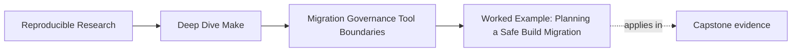
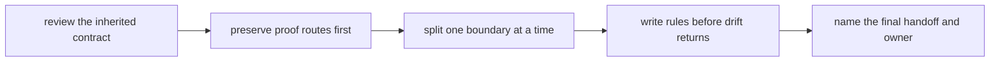
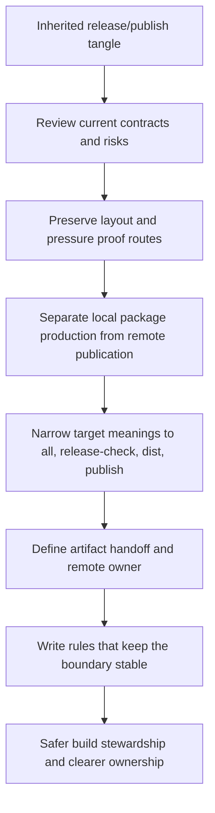

# Worked Example: Planning a Safe Build Migration

<!-- page-maps:start -->
## Page Maps




<!-- page-maps:end -->

This example follows one inherited Make-based build from first review to a migration plan
that improves the system without deleting the evidence needed to trust it.

The point is not to produce the cleverest rewrite. The point is to show how a maintainer
can move a fragile build toward a clearer ownership model while keeping rollback honest.

## The repository you inherited

Assume you join a research team that relies on these commands:

- `make all` builds report outputs and figures
- `make release` builds a bundle for distribution
- `make publish` uploads that bundle to a shared location
- CI calls a mixture of public targets and established helpers
- only one long-time maintainer can explain the whole route confidently

The build usually works. It also causes repeated friction:

1. `release` sometimes changes files that `all` did not touch
2. parallel runs occasionally leave partial contents in `dist/`
3. CI calls `prepare-release` directly because it became a habit
4. `publish` mixes local packaging with remote upload state
5. nobody can tell whether the long-term answer is "fix Make" or "replace it"

That is a realistic Module 10 problem because the build is not catastrophically broken. It
is only untrustworthy enough to slow every future change.

## Capture a stewardship packet before touching the file

Before writing a migration plan, you create one packet with five sections:

| Section | Question it answers |
| --- | --- |
| public targets | what promises do current callers think they are using? |
| trusted outputs | which files or side effects are treated as real deliverables? |
| proof routes | how can current behavior be observed and compared? |
| ownership gaps | where are multiple writers or vague remote responsibilities hiding? |
| first safe move | what smallest boundary change would improve truth without deleting proof? |

This packet is small enough to build in one sitting and strong enough to guide later
review.

## The inherited build sketch

The current shape looks like this:

```make
.PHONY: all release publish prepare-release

all:
	@./scripts/render-analysis.sh

prepare-release:
	@./scripts/render-analysis.sh
	@./scripts/generate-metadata.sh

release:
	@./scripts/render-analysis.sh
	@./scripts/generate-metadata.sh
	@./scripts/package-report.sh

publish:
	@./scripts/render-analysis.sh
	@./scripts/generate-metadata.sh
	@./scripts/package-report.sh
	@./scripts/upload-report.sh
```

Nothing here is absurd. That is why it is a good teaching example. Weak inherited builds
often survive because the bad parts are spread across convenience rather than obvious
syntax errors.

The sketch is not safe to run against a real publisher. The review uses source
inspection, dry runs, and an isolated receiver fixture until the remote boundary is
understood.

## Audit current contracts before proposing redesign

You start with a first-pass review.

### Public target findings

| Target | Current apparent meaning | Review finding |
| --- | --- | --- |
| `all` | build normal analysis outputs | plausible contract, but outputs are hidden behind one script |
| `prepare-release` | helper for release preparation | accidental semi-public target because CI calls it directly |
| `release` | prepare everything needed for distribution | mixes generation, metadata refresh, and packaging |
| `publish` | upload the release | actually rebuilds, repackages, and uploads in one route |

### Trusted-output findings

| Output or side effect | Why callers trust it | Problem |
| --- | --- | --- |
| `build/report.html` | expected analysis result | rewritten from several routes |
| metadata file | assumed part of release truth | generated without a clear published contract |
| `dist/` contents | treated as distributable release | partial and non-atomic under pressure |
| remote upload | treated as successful release completion | hidden behind the same target that rebuilds artifacts |

### Pressure findings

You run or plan to run:

```sh
make -n release
make --trace release
make -j1 release
make -j8 release
```

Those commands reveal:

- `release` and `publish` rerun the same generation work
- `-j8` can expose partial bundle contents
- shell wrappers hide which outputs are really being published

The review conclusion is:

> the build has contract drift, multi-writer output behavior, and a blurred boundary
> between local artifact production and remote publication.

That sentence is already more useful than "this Makefile is messy."

The packet separates observations from conclusions:

| Observation | Inference | Confidence or gap |
| --- | --- | --- |
| four targets invoke `render-analysis.sh` | report output may have multiple writers | confirm script outputs and generated rules |
| `publish` invokes packaging before upload | remote retry can rebuild the handoff object | high from recipe text |
| CI invokes `prepare-release` | helper is an accidental public dependency | high for repository CI; external callers unknown |
| `-j8 release` exposes partial `dist/` files | publication boundary is not failure-safe | reproduce in isolated workspace |

This prevents plausible source reading from being presented as proven runtime behavior.

## Preserve proof before splitting boundaries

The next move is not structural cleanup. It is proof preservation.

You write or sketch three durable comparison routes:

```make
.PHONY: package-layout package-serial package-parallel

package-layout:
	@mkdir -p artifacts/package-contract
	@find dist -type f -print | LC_ALL=C sort \
	  > artifacts/package-contract/member-paths.txt

package-serial:
	@./scripts/capture-package-contract.sh \
	  --jobs 1 \
	  --workspace artifacts/package-contract/serial-workspace \
	  --manifest artifacts/package-contract/serial.manifest

package-parallel:
	@./scripts/capture-package-contract.sh \
	  --jobs 8 \
	  --workspace artifacts/package-contract/parallel-workspace \
	  --manifest artifacts/package-contract/parallel.manifest
```

These routes answer three questions:

- what files currently define the release boundary?
- does serial behavior match parallel behavior?
- which artifacts must remain comparable while the migration is happening?

You are not promising to preserve every current behavior. Partial publication under `-j8`
is a defect, not a contract. What you are preserving is the ability to compare
established and replacement behavior honestly.

The established route and replacement route must use separate workspaces. Otherwise the
second run may reuse outputs from the first and turn a comparison into a warm-cache test.
The manifest comparison will ignore workspace paths but retain member paths, sizes, and
content digests. `capture-package-contract.sh` owns the disposable workspace setup and
must copy declared inputs rather than untracked build products.

## Select the local and remote ownership split

A weak migration plan would try to rewrite the whole build. A strong one makes one
responsibility more truthful first.

You choose this first move:

> separate local package production from remote publication.

Why this move first:

- it resolves the biggest boundary blur
- it reduces the number of side effects under one target name
- it creates a cleaner place to preserve and compare evidence
- it does not require immediate replacement of every script

You do **not** start by redesigning the entire graph or replacing Make. The first move is
small enough to review and roll back.

## Define reviewable migration units

You turn the plan into bounded, responsibility-named units:

| Responsibility unit | Change | Proof kept alive | Rollback point |
| --- | --- | --- | --- |
| contract characterization | document current `release` and `publish` contracts | current dry-run, trace, and layout outputs | established routes remain callable |
| package ownership | create a truthful local package target | serial/parallel comparison and layout manifest | callers can still use established `release` |
| metadata ownership | make metadata generation publish a declared file | direct inspection of metadata output | established route remains available for comparison |
| receiver handoff | make `publish` consume an already built artifact | artifact plus checksum prove handoff object | receiver fixture can be disconnected without changing packaging |
| caller migration | retire accidental helper entrypoints | CI caller inventory and public-target contract | helper remains until callers use supported targets |

This table matters because it stops the migration from turning into a vague campaign.

## Narrow the target meanings

Before you perfect the implementation, you repair the public language.

You redefine the supported surface conceptually as:

- `all`: build the normal analysis outputs
- `release-check`: run validations required before packaging
- `dist`: produce the release artifact and sidecar evidence
- `publish`: hand an already built artifact to the remote publication route

This is a contract repair before it is a code repair.

Immediate benefits:

- `prepare-release` no longer masquerades as a semi-public contract
- `publish` stops pretending to own local package production
- maintainers can talk about local artifact truth separately from remote publication truth

## Implement the repaired local boundary

After the package, metadata, and handoff units, the build is closer to this:

```make
SHELL := /bin/sh
.SHELLFLAGS := -eu -c

PYTHON ?= python3
ARTIFACTS_DIR ?= artifacts
RECEIPT_DIR ?= $(ARTIFACTS_DIR)/publication-receipts

.PHONY: all release-check dist verify-dist publish

all: build/report.html build/figures.done

release-check: all
	@./scripts/validate-report.sh

dist: dist/report-bundle.tar.gz dist/report-bundle.tar.gz.sha256

dist/metadata.json: build/report.html scripts/generate-metadata.sh | dist/
	@candidate=$@.candidate.$$$$; \
	./scripts/generate-metadata.sh > "$$candidate" && \
	mv -f "$$candidate" $@ || { rm -f "$$candidate"; exit 1; }

dist/report-bundle.tar.gz: build/report.html build/figures.done dist/metadata.json \
                          scripts/package-report.sh | dist/
	@candidate=$@.candidate.$$$$; \
	./scripts/package-report.sh "$$candidate" && \
	mv -f "$$candidate" $@ || { rm -f "$$candidate"; exit 1; }

dist/report-bundle.tar.gz.sha256: dist/report-bundle.tar.gz scripts/write-sha256.py
	@candidate=$@.candidate.$$$$; \
	$(PYTHON) scripts/write-sha256.py --input $< --output "$$candidate" && \
	mv -f "$$candidate" $@ || { rm -f "$$candidate"; exit 1; }

verify-dist: dist
	@$(PYTHON) scripts/verify-package.py \
	  --bundle dist/report-bundle.tar.gz \
	  --checksum dist/report-bundle.tar.gz.sha256 \
	  --metadata dist/metadata.json

publish: verify-dist | $(RECEIPT_DIR)/
	@$(PYTHON) scripts/submit-release.py \
	  --bundle dist/report-bundle.tar.gz \
	  --checksum dist/report-bundle.tar.gz.sha256 \
	  --receipt-dir $(RECEIPT_DIR)

dist/ $(RECEIPT_DIR)/:
	@mkdir -p $@
```

This is still not a perfect final system. It is much easier to review because:

- `dist` now means local artifact production
- `publish` depends on an already built handoff object
- metadata has a declared output
- upload is no longer pretending to be the same thing as package construction
- verification rejects a bad handoff before remote submission
- the receiver client stores acceptance evidence outside the trusted source tree

That is the real migration win.

The helper scripts are still part of the contract and require review:

- `package-report.sh` must produce deterministic archive content at the requested
  candidate path
- `write-sha256.py` must hash the bytes that will be submitted
- `verify-package.py` must reject missing, unexpected, or mismatched evidence
- `submit-release.py` must derive an idempotency key from immutable release identity,
  query unknown outcomes, and preserve the receiver's receipt

Moving logic into a script does not move ownership automatically. The table says which
script enforces which boundary.

## Make the receiver handoff explicit

Now that the local boundary is clearer, you define the handoff to the remote owner.

| Handoff question | Example answer |
| --- | --- |
| what is handed over? | `dist/report-bundle.tar.gz` |
| what evidence travels with it? | checksum file and metadata manifest |
| who owns it before handoff? | Make-driven local package production |
| who owns it after handoff? | remote publication service |
| what counts as sender failure? | package or checksum was not produced correctly |
| what counts as receiver failure? | upload, approval, or remote publication failed |

This split matters because it lets incident review say whether the failure was local build
truth or remote publication truth.

Add the recovery contract:

| Situation | Owner | Required behavior |
| --- | --- | --- |
| checksum verification fails | local package boundary | do not submit |
| receiver rejects request | receiver/client boundary | preserve rejection reason tied to digest |
| response is lost after possible acceptance | receiver | query idempotency key before retry |
| accepted processing later fails | receiver | expose final failure through receipt query |
| local caller reruns `publish` | receiver/client boundary | submit or retrieve the same immutable request |

`publish` remains a convenience entrypoint. A zero exit means the client obtained an
authenticated acceptance record. It does not mean Make became the authority for remote
publication state.

## Compare behavior and record intended differences

The migration packet now contains:

| Claim | Established evidence | Replacement evidence | Decision |
| --- | --- | --- | --- |
| report content preserved | normalized report digest | normalized report digest | must agree |
| package membership preserved | sorted member manifest | sorted member manifest | required members agree |
| partial archive behavior | partial file visible on failure | prior valid artifact or absence preserved | intentional defect removal |
| checksum evidence | absent | SHA-256 sidecar required | intentional contract addition |
| remote retry | rebuilds then uploads | fixed digest plus receiver idempotency | intentional ownership correction |

This table prevents “different” from being treated as either automatically wrong or
automatically acceptable.

## Challenge the replacement boundary

Run the local challenges before any real submission:

1. build `dist` twice and prove the second request converges
2. compare `-j1` and `-j8` package manifests in isolated workspaces
3. change report input and prove the bundle and checksum change
4. change an unrelated note and prove the bundle remains current
5. force metadata and archive producer failures and inspect final paths and candidates
6. make the receiver fixture reject a checksum
7. make the receiver fixture accept and drop the connection, then recover by idempotency
   key without producing a second remote record

Keep commands, exit statuses, manifests, and receipts. A prose assertion that the
replacement is safer is not the proof bridge.

## Write governance before drift returns

The repaired surface will rot quickly if you stop after the implementation.

You add rules such as:

- public targets are `all`, `release-check`, `dist`, `publish`, `clean`, and `help`
- CI may call only public targets
- added include files require a one-sentence responsibility statement
- proof routes such as layout comparison and serial/parallel release checks cannot be
  removed without a replacement
- `publish` may not regain local packaging side effects

Notice how specific the last rule is. Governance works best when it protects the exact
boundary that was hard to win during migration.

The corresponding rejection check makes `submit-release.py` fail if the artifact or
checksum is missing; a caller cannot use publication as an implicit build route.

## Classify inherited defects for future reviews

Once the repaired surface exists, you can name the inherited problems clearly:

1. multi-writer outputs
   `render-analysis.sh` ran under several targets
2. overgrown release contract
   `release` and `publish` each meant too many things
3. opaque orchestration
   wrappers hid which outputs were actually being published
4. accidental public target
   `prepare-release` became a CI dependency without deliberate promotion
5. boundary confusion
   local package truth and remote publication truth were merged under one command

The next maintainer can now recognize these patterns earlier instead of rediscovering them
under pressure.

## Decide long-term tool ownership

The final question is whether Make should keep owning the whole route.

The answer is hybrid:

- Make should keep owning local analysis outputs, bundle construction, and artifact
  evidence
- the remote publication system should own authentication, approval, and remote state
- `publish` may remain a convenience entrypoint, but it should not pretend to define
  remote truth

That is stronger than both simplistic alternatives:

- "keep everything in Make"
- "replace Make entirely"

The module does not want a fashionable answer. It wants an honest one.

## Apply retirement gates

The established `release` and accidental `prepare-release` routes remain until:

- all repository and known external callers use supported targets
- package membership and required content pass the proof bridge
- intentional differences have named decision owners and regression checks
- convergence, parallel agreement, and failure safety pass
- receiver retry and receipt behavior pass the controlled fixture
- documentation and incident routes identify local and remote owners

Only then does deletion reduce complexity without deleting knowledge.

## The migration path in one diagram



## What the learner should reuse from this example

Do not copy the target names mechanically. Reuse the reasoning route:

- review current contracts and outputs
- preserve proof before changing the graph
- choose one narrow boundary move
- write rollback triggers into the plan
- define the handoff object and unknown-outcome owner
- add governance before established drift patterns return

That reasoning route is what makes the example safe, not the particular repository.

## Run the repository proof surfaces

From `programs/reproducible-research/deep-dive-make`, the capstone provides concrete
evidence related to this example:

```sh
gmake capstone-contract-audit
gmake capstone-architecture-contract-audit
gmake capstone-release-check
gmake capstone-selftest
```

Read the generated evidence under the repository `artifacts/` tree. The commands prove
the capstone's contracts; they do not prove the hypothetical inherited repository. Their
purpose here is to show the form of reviewable contract, ownership, release, and
convergence evidence.

## Exit check

You have absorbed the example when you can:

- explain why the first move was boundary clarification rather than full replacement
- name the proof routes that had to survive the migration
- separate local package truth from remote publication truth
- state the handoff contract between Make and the external owner
- explain how an unknown receiver outcome is recovered without rebuilding the artifact
- name every retirement gate and the evidence that satisfies it
