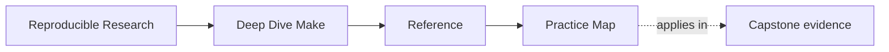

# Practice Map

<!-- page-maps:start -->
## Page Maps

<!-- page-maps:end -->

Use this page when you want the shortest route from a Deep Dive Make module to a local
exercise, proof loop, and capstone follow-up.

## Module practice surfaces

| Module | Exercises 1-5 establish | Exercises 6-10 integrate | Best capstone follow-up |
| --- | --- | --- | --- |
| 01 | targets, prerequisites, convergence | depfiles, deletion recovery, and a tiny project | inspect the capstone `Makefile` after local convergence is clear |
| 02 | parallel graph reasoning | pressure runs, failure classification, and repair | inspect repros and object discovery surfaces |
| 03 | determinism and debugging | negative tests, evidence capture, and selftest design | compare with `capstone/tests/run.sh` |
| 04 | precedence and semantics | include remakes, ambiguity diagnosis, and semantic incidents | inspect public target surfaces and diagnostics |
| 05 | portability and hidden inputs | tool audits, jobserver behavior, and environment convergence | inspect contract and stamp boundaries |
| 06 | generated targets and publication | deletion recovery, failure injection, and complete pipelines | inspect scripts and modeled inputs together |
| 07 | public APIs and include layers | caller audits, macro inspection, and repository growth | inspect the `mk/*.mk` ownership split |
| 08 | artifact and install contracts | reproducible archives, checksum failure, and release rehearsal | inspect package and attestation boundaries |
| 09 | cost layers and incident evidence | repeated baselines, rebuild causality, and response packets | compare with capstone incident evidence |
| 10 | review and migration reasoning | characterization, governance tests, and stewardship portfolio | use the capstone as the final stewardship specimen |

## Reusable proof loops

- truth loop: `make --trace all`, `make all`, `make -q all`
- concurrency loop: compare clean serial and parallel builds
- diagnostics loop: `make -n <target>`, `make --trace <target>`, `make -p`
- public-target loop: `make help`, then the smallest documented target for the current claim

## The 100-exercise ledger

Track every exercise with four fields: command or artifact, observation, explanation, and
remaining question. A module is not complete because its page was read. It is complete
when all ten entries contain evidence you can explain without the answer page open.
