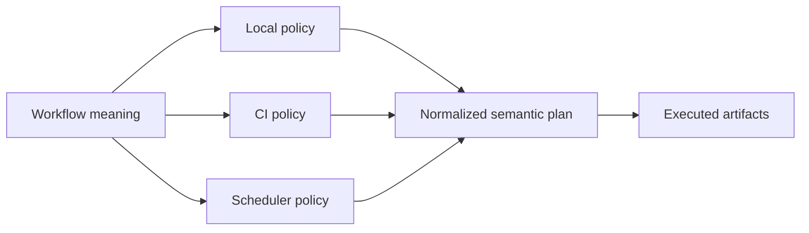
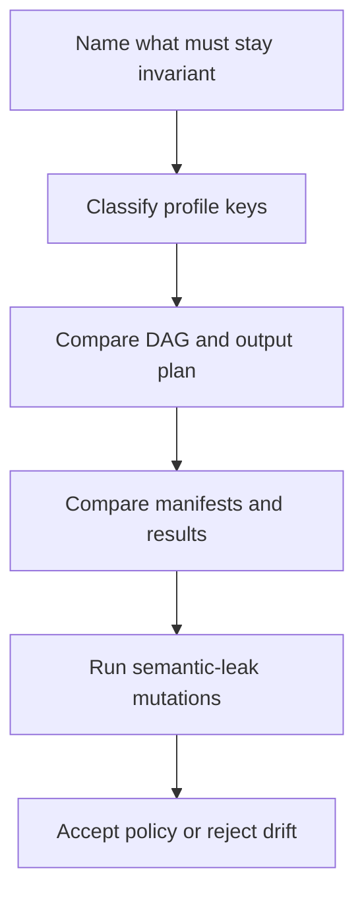

# Context Invariance Audit Guide

<!-- page-maps:start -->
## Guide Maps




<!-- page-maps:end -->

Use this audit when a repository claims that local, CI, and scheduler-oriented profiles
change execution policy without changing workflow meaning. The audit answers a narrower
question than "do all profiles run?":

> Do policy differences preserve the same samples, jobs, dependency edges, trusted paths,
> and executed artifact meaning?

The specimen includes three policy-preserving profiles and two deliberately leaking
profiles. Every profile is valid Snakemake configuration. Every profile can execute
successfully. The audit exists because successful execution alone cannot distinguish
policy from semantic drift.

## Run the audit

From the capstone directory:

```bash
make context-invariance-audit
```

The bundle is written below the repository's `artifacts/` directory:

```text
artifacts/audit/reproducible-research/deep-dive-snakemake/context-invariance/
```

Read the bundle in this order:

1. `route.txt`
2. `CONTEXT_INVARIANCE_AUDIT_GUIDE.md`
3. `summary.tsv`
4. the five profile files under `specimen/profiles/`
5. `report.json`
6. profile-specific summary and D3 DAG traces
7. profile-specific dry-run and execution traces
8. executed manifests and results under `workspace/runs/`

Do not begin by diffing complete Snakemake logs. First decide what must stay invariant,
then use the traces to test that claim.

## Understand the specimen

The specimen processes two samples:

```yaml
samples:
  - alpha
  - beta
publish_root: publish/stable
```

For each sample, `normalize` writes an uppercase result. `publish_manifest` records both
result paths under one trusted manifest:

```text
sample	artifact
alpha	results/alpha.txt
beta	results/beta.txt
```

The semantic contract is intentionally small:

- both samples are in scope
- both `normalize` jobs are planned
- the manifest path is `publish/stable/manifest.tsv`
- the manifest names both results
- each result contains the same normalized data regardless of context

That small contract makes policy and semantic differences easier to see.

## Read the preserving profiles

The local, CI, and scheduler profiles vary only operating-policy keys:

| Key | Local | CI | Scheduler | Why variation is allowed |
| --- | ---: | ---: | ---: | --- |
| `cores` | 2 | 1 | 8 | available execution capacity differs |
| `latency-wait` | 5 | 5 | 60 | filesystem visibility tolerance differs |
| `printshellcmds` | true | false | true | command visibility is observability policy |
| `show-failed-logs` | true | true | true | failure evidence remains visible |

These values can affect scheduling, waiting, and terminal output. They are not allowed to
change the sample set, rule graph, output paths, or artifact content.

The audit classifies keys before comparing plans. A preserving profile fails if it
contains:

- `config`
- `configfile`
- `configfiles`
- an unknown key that the audit has not classified

This is deliberately conservative. An unknown profile key is not automatically dangerous,
but it is not automatically policy-only either. A reviewer must classify it before the
gate can trust it.

## Read the semantic plan

The audit asks Snakemake for two complementary planning surfaces.

`--summary` exposes:

- planned output paths
- the rule responsible for each path

`--d3dag` exposes:

- planned jobs
- wildcard-specific labels
- dependency edges

The audit normalizes these into one `semantic_plan` value. It removes job identifiers but
keeps rule names, wildcard labels, output paths, and graph edges.

This distinction matters:

| Evidence | Catches | Can miss |
| --- | --- | --- |
| profile diff | obvious semantic overrides | indirect effects on the plan |
| D3 DAG | missing jobs and changed dependencies | trusted path changes with the same topology |
| output summary | changed output paths | different bytes at an unchanged path |
| executed artifacts | changed manifest or result meaning | an unexecuted branch outside the specimen |

No one surface is sufficient. The audit requires all four.

## Understand what `PASS` means

The summary contains three findings:

| Finding | PASS means |
| --- | --- |
| `CONTEXT_POLICY_PRESERVED` | local, CI, and scheduler profiles contain only classified policy keys and produce identical plans, manifest paths, manifest content, and results |
| `TRUSTED_PATH_LEAK_REPRODUCED` | the path-leak profile visibly uses semantic config and changes the trusted manifest path while preserving sample results |
| `SAMPLE_SCOPE_LEAK_REPRODUCED` | the sample-leak profile visibly uses semantic config, removes `beta` from the plan and manifest, and preserves `alpha` |

The two leak findings are successful reproductions of defects. They do not approve those
profiles.

Always quote the finding with its result:

> `SAMPLE_SCOPE_LEAK_REPRODUCED` passed because the audit proved that a profile can execute
> successfully while silently removing `beta` from the workflow contract.

"The context audit passed" is too ambiguous for review.

## Inspect the trusted-path leak

The path-leak profile contains:

```yaml
config:
  publish_root: publish/context-specific
```

Its graph still contains:

- two `normalize` jobs
- one `publish_manifest` job
- one `all` target

Its sample results are byte-identical to the local run. Only the trusted manifest path
changes.

That is enough to fail context invariance. A downstream consumer should not need to know
which executor launched the workflow before it can locate the declared contract.

This counterexample teaches an important review habit:

> Same rules does not mean same workflow meaning.

If the audit compared only rule names or DAG topology, this leak would pass unnoticed.

## Inspect the sample-scope leak

The sample-leak profile contains:

```yaml
config:
  samples:
    - alpha
```

The trusted manifest path remains unchanged. The `alpha` result remains byte-identical.
The workflow still exits successfully.

What changes is the sample domain:

- `results/beta.txt` disappears from the output plan
- the `normalize` job for `beta` disappears from the D3 DAG
- the manifest no longer names `beta`

This counterexample teaches the complementary habit:

> Same final path does not mean same workflow meaning.

If the audit compared only the manifest location, this leak would pass unnoticed.

## Separate workflow resources from profile capacity

The specimen's `normalize` rule declares:

```python
threads: 2
resources:
    mem_mb=512,
    runtime=5,
```

These values describe the job's requested work shape. Profiles choose available capacity
and execution tolerance. A local profile with two cores and a scheduler profile with eight
cores may schedule work differently, but neither profile changes the rule's declared
memory or runtime meaning.

Use this ownership table:

| Surface | Owns | Must not own |
| --- | --- | --- |
| rule | per-job threads, memory, runtime, inputs, outputs | queue name, account, context-specific sample set |
| profile | available cores, executor mapping, latency, observability | analytical parameters, trusted path, sample membership |
| operator overlay | site account, partition, executor plugin settings | workflow contract |

The specimen does not submit to a real scheduler. It proves the workflow-facing boundary
that must remain stable before site-specific submission can be reviewed honestly.

## Use rejection tests

Run:

```bash
make context-invariance-selftest
```

The tests create disposable specimen copies and require rejection when:

- CI gains a context-specific publish root
- scheduler policy narrows the sample set
- the path-leak profile stops changing the trusted path
- the sample-leak profile stops removing `beta`
- the sample-leak profile substitutes a path leak for a scope leak
- stale evidence attempts to survive a later audit

These mutations answer a crucial gate-design question:

> What incorrect evidence does this gate know how to reject?

Without that answer, a green audit may only prove that its script ran.

## Write the review conclusion

A useful context review has five parts:

1. **Invariant:** name the sample, graph, path, and artifact facts that must stay true.
2. **Allowed variation:** name cores, latency, executor mapping, or observability settings.
3. **Evidence:** cite profile classifications, normalized plans, and executed artifacts.
4. **Rejection:** cite one mutation that the self-test rejects.
5. **Limit:** name what this audit does not prove.

Example:

> Local, CI, and scheduler profiles vary cores, latency tolerance, and shell-command
> visibility only. Their normalized D3 DAGs, output summaries, manifest paths, manifest
> content, and result bytes are identical. The self-test rejects both a profile-specific
> publish root and a narrowed sample set. The profiles therefore preserve the specimen's
> workflow meaning. This audit does not prove site-specific scheduler submission or
> scratch-promotion safety.

## Know the audit's limits

This audit does not prove:

- that a scheduler executor plugin is installed or correctly configured
- that an account, partition, or queue is appropriate
- that shared-filesystem latency is bounded by the chosen wait
- that retries are justified by a transient failure model
- that scratch data is validated and atomically promoted
- that container or Conda environments are equivalent across nodes
- that performance is comparable across contexts

Those are separate claims. Module 08 uses this audit to establish semantic invariance
first, then teaches how to review retries, storage, and executor mapping without confusing
them with workflow meaning.

## Independent practice

Copy the specimen into a disposable artifact workspace and add a third sample named
`gamma`. Update only `config/base.yaml` and add `data/gamma.txt`.

Then require:

- all three preserving profiles plan and execute `gamma`
- both semantic-leak findings retain their original meaning
- the sample-scope leak still removes only the sample its profile explicitly excludes
- the trusted-path leak still changes only the trusted path
- the summary and D3 DAG expose the new job in every preserving context

If you must edit a preserving profile to make `gamma` appear, workflow meaning has leaked
into execution policy.
