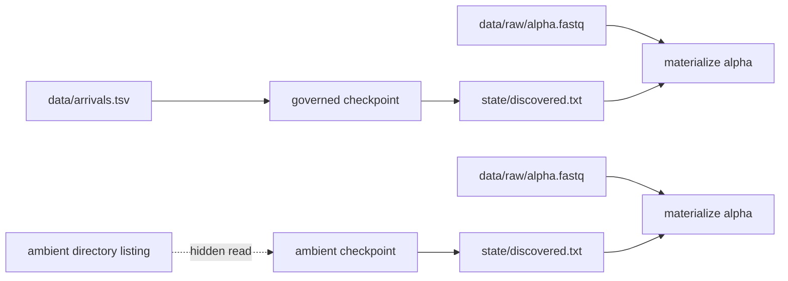
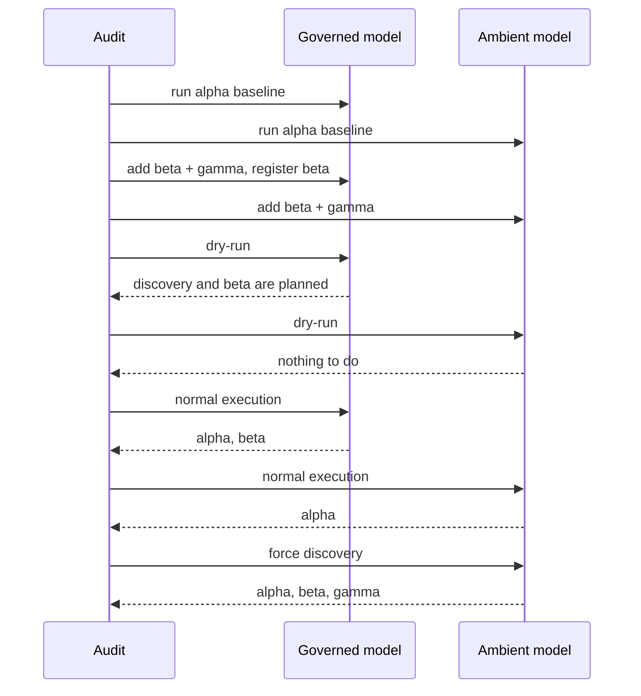

# Discovery Integrity Audit Guide

Use this audit when a workflow learns its sample set from files and you need to answer a
precise question:

> What declared change tells Snakemake that discovery must run again?

A checkpoint can alter a DAG after it runs. That fact does not make every future change
to the outside world visible to Snakemake. The audit isolates that distinction with two
tiny workflows, the same arrival experiment, and four execution receipts for each
workflow.

## The result you are trying to explain

Run:

```sh
make discovery-integrity-audit
```

The evidence bundle is written under the repository-level `artifacts/audit/` tree. Start
with:

1. `route.txt`
2. `summary.tsv`
3. the two `change-dryrun` traces
4. the two specimen `Snakefile` files
5. `report.json`
6. the forced-run traces

Do not begin with the forced runs. They answer what discovery *could* find when compelled
to run. The change dry-runs answer whether the workflow knew it *needed* to run.

## The two models

Both models begin with one raw file named `alpha.fastq`. Both checkpoints write a
manifest, and both downstream input functions turn that manifest into output targets.
Their only important difference is the checkpoint input contract.



The governed model declares `data/arrivals.tsv` as the checkpoint input. The ambient
model reads `data/raw/` inside its `run` block but declares no input.

That is not a style difference. It changes the invalidation graph.

## The arrival experiment

The audit performs the same sequence against clean copies of both models:

1. execute the baseline with only `alpha`;
2. add raw files for `beta` and `gamma`;
3. add only `beta` to the governed arrival registry;
4. ask Snakemake for a dry-run;
5. execute normally;
6. force the discovery checkpoint and execute again.



`gamma` matters. Its presence proves that the registry is an ownership boundary, not
merely a timestamp trigger. The governed model does not silently absorb every matching
file beside a registered arrival.

## Read the dry-runs before the outputs

For the governed model, the change dry-run should contain a `checkpoint discover` job.
The registry changed, so Snakemake has a declared causal path:

```text
arrival registry changed
    -> checkpoint is stale
    -> discovery manifest is rebuilt
    -> downstream target function is reevaluated
    -> beta output enters the DAG
```

For the ambient model, the change dry-run should say that there is nothing to do. The
directory contains new information, but no declared input changed. Snakemake is not
watching every read performed inside Python or shell code.

This is the critical review sentence:

> The ambient model contains discovery logic, but it does not contain a discovery
> invalidation contract.

## Interpret the normal and forced executions

The four sample lists in `summary.tsv` separate scope from capability:

| Model | Normal execution after arrivals | Forced reevaluation | Meaning |
| --- | --- | --- | --- |
| governed registry | `alpha,beta` | `alpha,beta` | the declared event reruns discovery, and registry membership bounds scope |
| ambient scan | `alpha` | `alpha,beta,gamma` | the code can find arrivals, but ordinary scheduling does not know when to invoke it |

A forced run is diagnostic evidence. It is not a repair. A production instruction that
says “remember to force the checkpoint whenever files might have arrived” transfers a
workflow invariant into human memory.

## What PASS means

The audit reports two PASS findings, but they do not endorse both designs.

`DECLARED_DISCOVERY_INVALIDATION_PRESERVED` means:

- the governed checkpoint visibly declares the registry;
- the baseline contains only `alpha`;
- changing the registry schedules discovery;
- normal execution adds registered `beta`;
- unregistered `gamma` remains out of scope.

`AMBIENT_DISCOVERY_STALENESS_REPRODUCED` means:

- the counterexample really has no checkpoint input;
- the baseline contains only `alpha`;
- ambient arrivals do not change the normal plan;
- normal execution remains stale;
- forced reevaluation proves the hidden scan could see all arrivals.

The second PASS means “the named failure was reproduced honestly.” Read `finding`
together with `result`.

## Why a checkpoint is still involved

If the registry already names every sample, you might ask why a checkpoint is needed.
In this specimen, the checkpoint exists to isolate reevaluation behavior. In a real
workflow, an upstream job might produce a registry of accepted samples only after
validating delivery metadata, decompressing an archive, or reading tool output.

Use a checkpoint only when an executed job reveals information needed to construct later
jobs. If a stable config file already contains the final sample list, ordinary input
functions are usually enough.

This yields a decision table:

| Situation | Suitable model |
| --- | --- |
| sample list is known before execution | config or a checked sample sheet |
| candidate arrivals are governed, but execution validates which are accepted | declared registry input followed by a checkpoint |
| a directory is scanned during workflow parsing | acceptable only when the directory snapshot is an explicit operational assumption |
| a directory is scanned inside a checkpoint with no declared invalidation event | incomplete contract |

## Connect the specimen to the capstone

The capstone uses `data/raw/arrivals.tsv` as the governed event. Its `path` column names
candidate FASTQ files relative to the registry's `data/raw/` directory. The checkpoint:

- declares the registry as an input;
- validates the registry structure;
- rejects duplicate, escaping, missing, and pattern-mismatched paths;
- derives stable sample identities;
- records the registry path and digest in `discovered_samples.json`;
- lets downstream input functions construct sample-specific jobs.

Adding a raw file by itself does not add a sample. Updating the governed registry does.
That boundary is deliberate: filesystem proximity is not consent to process data.

## Failure diagnosis

Use the first failing observation, not the last missing file.

| Observation | Likely contract defect | First inspection |
| --- | --- | --- |
| registry changed, dry-run says nothing to do | registry is not a checkpoint input | checkpoint `input:` block |
| discovery runs, but a registered sample is absent | parser, validation, or sample-name collision | discovery log and manifest |
| an unregistered file enters the DAG | discovery reads ambient directory membership | discovery implementation |
| dry-run schedules discovery forever | checkpoint output is unstable or its declared input is rewritten | timestamps, content stability, and producers |
| forced run sees files that normal execution misses | hidden invalidation dependency | checkpoint inputs and upstream event artifact |

## Test whether the gate is discriminating

Run:

```sh
make discovery-integrity-selftest
```

The self-test checks the accepted experiment, removes the registry input declaration,
and damages the ambient counterexample so forced reevaluation can no longer reveal new
arrivals. A trustworthy audit must fail when either causal distinction disappears.

## A bounded extension

Copy the governed specimen into an artifact workspace. Add a second registry column named
`delivery_id`, then change the checkpoint output to record both the sample and delivery.
Keep only the sample column responsible for downstream fanout.

Before running anything, predict:

- which file change invalidates discovery;
- whether changing only `delivery_id` should rebuild downstream sample outputs;
- where the delivery metadata should remain visible for review;
- what evidence would distinguish a metadata-only rebuild from a sample-domain change.

The point is not to maximize dynamism. It is to make the boundary between arrival
evidence, accepted membership, and downstream targets explainable.

## Review checklist

- [ ] I can point to the declared event that invalidates discovery.
- [ ] I read the normal dry-run before treating a forced run as evidence.
- [ ] I can distinguish files present on disk from files admitted to workflow scope.
- [ ] I can explain why the checkpoint is needed after execution rather than at parse time.
- [ ] I can name the artifact that records the discovered set.
- [ ] I can show that the audit fails when the invalidation edge is removed.
- [ ] I do not claim that a checkpoint automatically watches hidden filesystem state.
