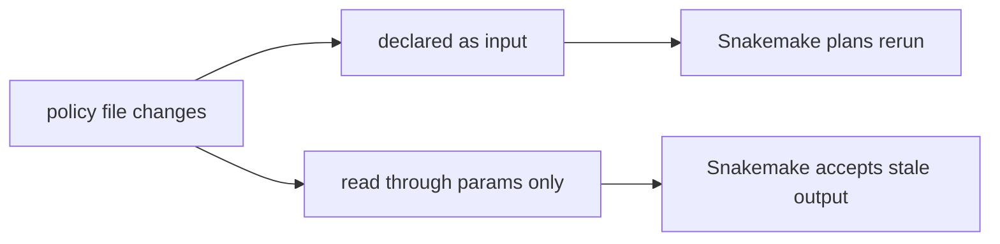
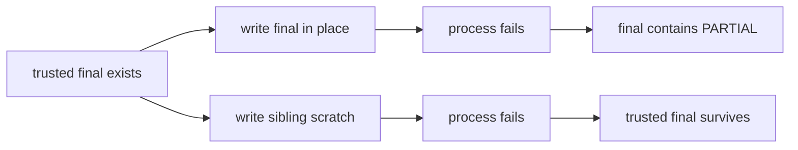

# File Contract Audit Guide

Use this audit when the question is whether a rule tells enough truth for Snakemake to
schedule necessary work and whether a failed writer can corrupt a final path.





## Run the bounded audit

From the capstone root:

```console
make file-contract-audit
```

The bundle is written under:

```text
artifacts/audit/reproducible-research/deep-dive-snakemake/file-contracts/
```

Read it in this order:

1. `route.txt`
2. `summary.tsv`
3. `specimen/Snakefile`
4. `report.json`
5. the named files under `evidence/`

The first two files orient the review. The specimen shows the only intentional
difference between the paired rules. The report connects each decision to checks. The
raw receipts let you challenge the classifier.

## The paired rule experiment

Both rules invoke the same renderer with the same source and policy files. The declared
rule names the policy under `input`; the hidden rule passes the path under `params`.

That distinction matters because `params` records a value used to construct a job. It
does not make the contents of the referenced file an input dependency. When
`policy/threshold.txt` changes:

| Rule | Policy represented as | Expected dry-run |
| --- | --- | --- |
| `declared_report` | declared input file | plan one rerun |
| `hidden_report` | parameter containing a path | report nothing to do |

The hidden rule is intentionally wrong. Its output still records threshold `10` while
the policy file says `20`. A quiet dry-run is therefore evidence of under-rebuild, not
evidence of correctness.

## Read PASS and decision separately

Each row has both a result and a decision:

- `PASS / ACCEPT` means the audit successfully observed safe behavior.
- `PASS / REJECT` means the audit successfully reproduced an unsafe behavior that should
  be rejected in a real workflow.
- `FAIL` means the specimen no longer demonstrates the intended causal contrast.

The expected decisions are:

| Finding | Expected decision | What it proves |
| --- | --- | --- |
| `BASELINE_CONVERGES` | `ACCEPT` | an immediate dry-run after successful construction plans no work |
| `DECLARED_POLICY_CHANGE_PLANS_RERUN` | `ACCEPT` | a declared influence reaches the planner |
| `DECLARED_POLICY_CHANGE_REBUILDS_CURRENT_VALUE` | `ACCEPT` | the planned rebuild executes and records the new policy value |
| `HIDDEN_POLICY_CHANGE_MISSES_RERUN` | `REJECT` | reading a file is not the same as declaring it |
| `IN_PLACE_FAILURE_POISONS_FINAL` | `REJECT` | a process can replace trusted contents before failing |
| `ATOMIC_FAILURE_PRESERVES_FINAL` | `ACCEPT` | failure before rename leaves the prior final intact |
| `ATOMIC_SUCCESS_PROMOTES_COMPLETE_OUTPUT` | `ACCEPT` | successful rename consumes scratch and publishes complete contents |

## Why the output stays stale

Snakemake cannot infer every file opened by arbitrary Python or shell code. Its DAG is
constructed from the contract in the Snakefile. The hidden rule gives the renderer a
policy path, but the planner sees only:

```text
data/source.txt -> results/hidden-report.txt
```

The real computation is:

```text
data/source.txt + policy/threshold.txt -> results/hidden-report.txt
```

The missing edge is the defect. Re-running harder, adding `--force`, or deleting the
output can rebuild once, but none of those actions repairs the contract.

## Why Snakemake cleanup is not atomic publication

After an ordinary command exits nonzero, Snakemake commonly removes declared outputs.
That cleanup is useful, but it occurs after the writer has already touched the final
path. It cannot cover every interruption:

- a machine can lose power before cleanup runs;
- a process can be killed outside the normal error path;
- a network filesystem can expose partial writes to readers;
- a writer can return zero after producing malformed content;
- a prior trusted final can be destroyed before the new attempt fails.

Atomic publication changes the writer’s boundary. The process writes a sibling scratch
path, validates it, and renames only after success. The audit preloads the final path
with `trusted`, forces failure before rename, and then checks both paths:

```text
atomic-final.txt      -> trusted
atomic-final.txt.tmp  -> complete
```

The remaining scratch file is cleanup work. It is not a published result.

## What the audit does not prove

The audit does not claim:

- every hidden input can be found automatically;
- a rename is atomic across different filesystems;
- complete text is semantically valid domain output;
- filesystem durability is guaranteed after power loss;
- Snakemake will preserve a prior final when a rule itself declares and rewrites that
  same path.

Those claims need different evidence. This route proves one dependency contrast and one
same-directory publication contrast.

## Review questions

Before accepting a similar rule, answer:

1. Which files can change the output bytes?
2. Which of those files appear under `input`?
3. Does the dry-run change after each declared influence changes?
4. Can a failed process expose partial data at the final path?
5. Are scratch and final paths on the same filesystem?
6. What validates scratch before promotion?

If any answer depends on “we usually rerun everything,” the workflow contract is still
incomplete.
