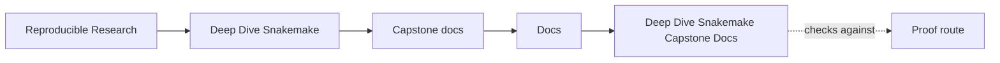
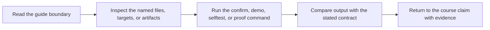

# Deep Dive Snakemake Capstone Docs

<!-- page-maps:start -->
## Guide Maps

<!-- page-maps:end -->

Use this shelf when the question is about the executable Snakemake capstone repository
itself: public file contracts, review bundles, repository architecture, profile drift, or
safe extension. These pages are not another first-contact route into the course. They are
the stable public documentation set for the reference repository that the course points
to.

## Use this shelf when

- you are already inside the capstone repository or one of its saved review bundles
- a course page sends you to a repository-facing document rather than to a lesson
- you need the repository explanation of a file contract, bundle route, or profile surface

## Do not use this shelf when

- you still need the concept introduced for the first time
- you need help choosing which course module or support page to read next
- you are browsing because the repository feels large instead of because the question is specific

## Choose the document by question

| If the question is... | Start here | Then use |
| --- | --- | --- |
| what does this repository promise and how should I enter it | [walkthrough-guide.md](walkthrough-guide.md) | [proof-guide.md](proof-guide.md) |
| which outputs are safe for downstream trust | [file-api.md](file-api.md) | [publish-review-guide.md](publish-review-guide.md) |
| what claim does a bundle or route actually prove | [proof-guide.md](proof-guide.md) | [tour.md](tour.md) |
| which repository layer owns this change | [architecture.md](architecture.md) | [extension-guide.md](extension-guide.md) |
| do declared inputs trigger reruns and failed writers preserve trusted finals | [file-contract-audit-guide.md](file-contract-audit-guide.md) | `make file-contract-audit` |
| how do local, CI, and scheduler policy differ | [profile-audit-guide.md](profile-audit-guide.md) | [proof-guide.md](proof-guide.md) |
| does a module expose config, paths, and policy at its caller boundary | [module-interface-audit-guide.md](module-interface-audit-guide.md) | `make module-interface-audit` |
| did a performance change remove work without removing guarantees | [performance-diagnostics-audit-guide.md](performance-diagnostics-audit-guide.md) | `make performance-diagnostics-audit` |
| does a scheduler profile preserve declared resources and workflow meaning | [scheduler-policy-audit-guide.md](scheduler-policy-audit-guide.md) | `make scheduler-policy-audit` |
| do local, CI, and scheduler contexts preserve the same workflow meaning | [context-invariance-audit-guide.md](context-invariance-audit-guide.md) | `make context-invariance-audit` |
| does discovery expose the intended modules without hidden coupling | [discovery-integrity-audit-guide.md](discovery-integrity-audit-guide.md) | `make discovery-integrity-audit` |
| does a published bundle preserve its downstream compatibility promises | [publish-compatibility-audit-guide.md](publish-compatibility-audit-guide.md) | `make publish-compatibility-audit` |
| does software identity participate honestly in rebuild decisions | [software-boundary-audit-guide.md](software-boundary-audit-guide.md) | `make software-boundary-audit` |
| what does this workflow produce and why does the domain matter | [domain-guide.md](domain-guide.md) | [walkthrough-guide.md](walkthrough-guide.md) |

## Public project-doc set

- [architecture.md](architecture.md) for repository layers, ownership, and review boundaries
- [domain-guide.md](domain-guide.md) for the capstone’s domain story and output meaning
- [extension-guide.md](extension-guide.md) for safe repository evolution
- [file-api.md](file-api.md) for the downstream-facing file contract
- [file-contract-audit-guide.md](file-contract-audit-guide.md) for convergence, hidden-input, and publication evidence
- [module-interface-audit-guide.md](module-interface-audit-guide.md) for reusable rule bindings and hidden coupling
- [performance-diagnostics-audit-guide.md](performance-diagnostics-audit-guide.md) for baseline, tuning, semantic-drift, and regression decisions
- [scheduler-policy-audit-guide.md](scheduler-policy-audit-guide.md) for recorded scheduler requests, rejection cases, and site-proof limits
- [context-invariance-audit-guide.md](context-invariance-audit-guide.md) for preserving meaning across execution contexts
- [discovery-integrity-audit-guide.md](discovery-integrity-audit-guide.md) for module discovery and hidden-coupling review
- [publish-compatibility-audit-guide.md](publish-compatibility-audit-guide.md) for downstream bundle compatibility
- [software-boundary-audit-guide.md](software-boundary-audit-guide.md) for implementation identity and rebuild causality
- [profile-audit-guide.md](profile-audit-guide.md) for execution-policy review
- [proof-guide.md](proof-guide.md) for claim-to-evidence routing
- [publish-review-guide.md](publish-review-guide.md) for downstream trust review
- [tour.md](tour.md) for the executed repository proof bundle
- [walkthrough-guide.md](walkthrough-guide.md) for the bounded first pass

## Naming crosswalk

These exported pages use lowercase generated names. Inside the capstone repository, the
source documents appear under `docs/` with uppercase filenames such as
`docs/file-api.md`.

## Good stopping point

Stop when you can name the single project doc that owns the current repository question.
If you are still opening several documents at once, the question is probably still too
broad.
