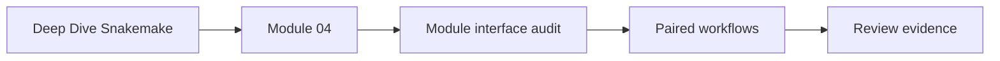
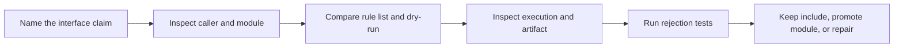
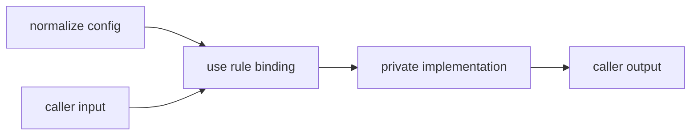

# Module Interface Audit Guide

<!-- page-maps:start -->
## Guide Maps




<!-- page-maps:end -->

Use this audit when a workflow boundary has been proposed as a reusable Snakemake module.
The audit answers a narrower question than “does the workflow run?”:

> Can the caller name the module's inputs, outputs, and policy without reading private
> module code?

The paired specimens deliberately produce successful artifacts. One preserves that
contract. The other reproduces hidden coupling.

## Run the audit

From the capstone directory:

```bash
make module-interface-audit
```

The bundle is written below the repository's `artifacts/` directory:

```text
artifacts/audit/reproducible-research/deep-dive-snakemake/module-interfaces/
```

Read it in this order:

1. `route.txt`
2. `MODULE_INTERFACE_AUDIT_GUIDE.md`
3. `summary.tsv`
4. `report.json`
5. the two caller `Snakefile` files under `specimens/`
6. the two module `Snakefile` files
7. paired list-rules, dry-run, and execution traces
8. generated artifacts under `workspace/`

Do not begin with the complete execution trace. Start with the contract and use traces to
test it.

## Understand what `PASS` means

The summary has two passing rows:

| Model | Finding | Meaning |
| --- | --- | --- |
| `explicit-contract` | `EXPLICIT_MODULE_CONTRACT_PRESERVED` | the caller owns input, output, and policy binding |
| `hidden-coupling` | `HIDDEN_MODULE_COUPLING_REPRODUCED` | the module successfully reads policy the caller does not name |

The second row is a successful reproduction of a defect. It does not approve the hidden
design.

Always quote the finding with the result:

> `hidden-coupling` passed because the audit reproduced broad config access and a private
> policy read.

“The module audit passed” is too ambiguous to support review.

## Begin with the explicit caller

The control caller narrows the configuration supplied to the module:

```python
module normalize:
    snakefile: "module/Snakefile"
    config: config["normalize"]
```

It then names the imported rule and binds the contract:

```python
use rule normalize from normalize as normalize_sample with:
    input:
        source="data/sample.txt"
    output:
        artifact="build/sample.txt"
    params:
        prefix=config["normalize"]["prefix"]
```

At this call site, a reviewer can answer:

- which rule is imported
- which local rule name enters the graph
- which source the caller supplies
- which artifact the caller promises
- which policy value changes artifact meaning

The module owns the transformation. The caller owns its local binding.



## Read the module as an implementation template

The explicit module declares placeholder values:

```python
rule normalize:
    input:
        source="unbound.txt"
    output:
        artifact="unbound.txt"
    params:
        prefix="UNBOUND"
```

The caller replaces those values through `use rule ... with`. The placeholders make the
implementation executable as a rule template without pretending that its paths are the
caller's public interface.

The module also publishes through a candidate path and rename. That is a separate
contract:

- interface ownership says who chooses paths and policy
- publication ownership says when the artifact becomes visible

A good module needs both. Explicit parameters do not compensate for partial publication.

## Compare the hidden-coupling caller

The counterexample supplies the entire top-level config:

```python
module normalize:
    snakefile: "module/Snakefile"
    config: config
```

Its call site binds only input and output. The module privately reads:

```python
params:
    prefix=config["private"]["prefix"]
```

The artifact records `inherited`, but the call site never says that private policy affects
the artifact. A caller must open the module implementation and search its config reads
before it can explain output meaning.

That is hidden coupling even though:

- the module declaration is valid
- the rule imports successfully
- the dry-run is correct
- execution exits zero
- the artifact has the expected bytes

## Why the visible DAG is insufficient

Both models list the same rules:

```text
all
normalize_sample
```

Both dry-runs plan one `normalize_sample` job followed by `all`. The rule graph answers
which jobs depend on which artifacts. It does not, by itself, prove who owns policy
selection.

Use this evidence table:

| Evidence | Question it answers | Question it cannot answer alone |
| --- | --- | --- |
| `--list-rules` | which imported rules are visible | whether caller bindings are complete |
| dry-run | which jobs and files are planned | whether config scope is narrow |
| execution trace | which commands ran | whether private policy should have been caller-owned |
| artifact content | what meaning was published | whether that meaning was visible at the interface |
| source observations | where paths and policy are selected | whether runtime behavior matches the declaration |

The audit combines all five because no single surface proves the complete interface.

## Read `report.json` by claim

For `explicit-contract`, require these observations together:

- `narrow_module_config` is true
- `broad_module_config` is false
- caller input, output, and policy bindings are true
- `module_reads_private_policy` is false
- listed rules are `all` and `normalize_sample`
- the artifact contains `reviewed` and `sample payload`
- no candidate publication residue remains

For `hidden-coupling`, the promised defect requires:

- `broad_module_config` is true
- `narrow_module_config` is false
- caller input and output bindings are true
- caller policy binding is false
- `module_reads_private_policy` is true
- the artifact contains `inherited` and `sample payload`

If the counterexample stops exhibiting those facts, its row must fail. Otherwise the
audit could claim it tested hidden coupling without actually doing so.

## Use rejection tests before trusting the gate

Run:

```bash
make module-interface-selftest
```

The tests alter disposable copies and require rejection when:

- the explicit caller passes broad config
- the explicit caller hard-codes policy instead of binding it from its interface config
- the explicit caller changes the promised output binding
- the hidden model exposes policy at the call site
- the hidden module stops reading private policy
- stale workspace output attempts to contaminate a later run

The stale-workspace case is accepted only after the audit removes stale state and rebuilds
the expected artifact.

## Decide include versus module

Use an include when:

- the rules belong to one repository-owned graph
- the split clarifies ownership but does not create a reusable caller contract
- the rules reasonably depend on shared workflow configuration and helpers

Promote a module when:

- another caller genuinely needs the rule bundle
- input, output, parameter, and software assumptions can be named at the boundary
- the caller can bind local paths without editing module internals
- private implementation can change without surprising callers

Repair or reject the module when:

- the full top-level config is passed for convenience
- private module code chooses consumer-visible paths or policy
- callers must inspect implementation files to understand output meaning
- imported rules bring unrelated public surfaces into the graph

## Write the review conclusion

A useful conclusion has four parts:

1. **Claim:** what the module interface promises.
2. **Observation:** which caller, source, plan, and artifact evidence was inspected.
3. **Conclusion:** whether the boundary is explicit enough to reuse.
4. **Limit:** what the audit does not prove.

Example:

> The `normalize_sample` caller binds source, artifact, and prefix while passing only the
> `normalize` config subtree. The rule list and dry-run preserve the intended two-rule
> graph, execution publishes atomically, and the artifact records the caller-selected
> prefix. The boundary is suitable for reuse in this repository. This audit does not prove
> compatibility with an independently versioned remote module.

## Know the audit's limits

This audit does not prove:

- semantic version compatibility across remote module releases
- container or Conda environment reproducibility
- schema compatibility for a complex public artifact
- performance equivalence across executors
- whether the abstraction is worth its maintenance cost

Those are separate claims. Do not make this gate heavier until one of those claims becomes
part of the review.

## Independent practice

Copy the explicit specimen into a disposable artifact workspace and add a second caller
named `normalize_control`. Give it a different input, output, and prefix.

Keep the module implementation unchanged. Then require:

- both caller bindings are visible
- both jobs appear in the dry-run
- each artifact records its own caller-selected prefix
- no module code reads caller-private config

If you must edit the module to add the second caller, the interface is not yet reusable.
