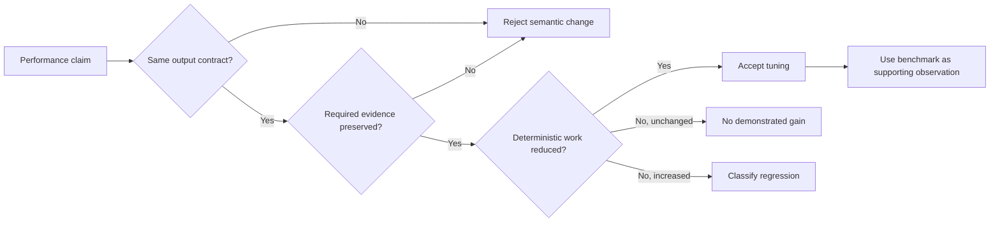
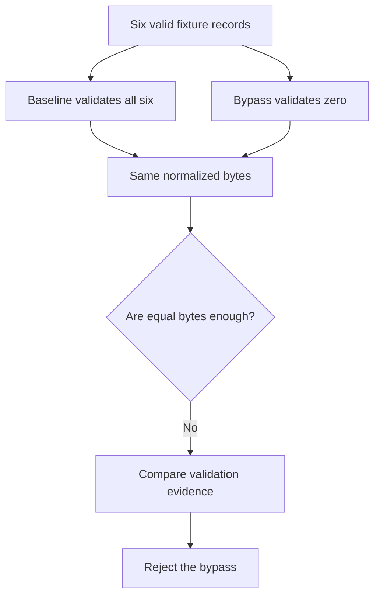

# Performance Diagnostics Audit Guide

Use this audit when someone claims that a Snakemake workflow became faster,
cheaper, or more reliable. The audit does not ask only whether elapsed time went
down. It asks whether the same contract survived, which work disappeared, and
whether required evidence disappeared with it.

The specimen is deliberately small enough to inspect without an instructor. It
normalizes six records, validates their shape, and writes:

- `results/normalized.tsv`, the result a downstream consumer would read;
- `evidence/metrics.json`, deterministic counters describing performed work;
- `benchmarks/normalize.tsv`, Snakemake's observation of runtime and resources;
- command traces for the dry-run and complete execution.

The audit executes four configurations against the same input. The cases are
not four possible answers to one benchmark contest. They represent four
different review decisions.

| Configuration | Intended lesson | Expected decision |
| --- | --- | --- |
| `baseline` | Establish the contract and measured reference | `REFERENCE` |
| `honest-tuning` | Reduce setup cycles while preserving validation and output | `ACCEPT` |
| `validation-bypass` | Produce equal bytes after removing a guarantee | `REJECT` |
| `repeated-scan` | Preserve bytes and validation while repeating hidden work | `REGRESSION` |

## Run the audit

From `capstone/`, use the governed Python and Snakemake executables:

```bash
python scripts/audit_performance_diagnostics.py \
  --specimen repro/performance-diagnostics \
  --workspace ../../../../artifacts/audit/reproducible-research/deep-dive-snakemake/performance-diagnostics/workspace \
  --output ../../../../artifacts/audit/reproducible-research/deep-dive-snakemake/performance-diagnostics/report.json \
  --snakemake ../../../../artifacts/venv/reproducible-research/deep-dive-snakemake/capstone/bin/snakemake
```

The repository Make target introduced for this route is the shorter supported
entrypoint:

```bash
gmake performance-diagnostics-audit
```

Success prints the report path. It does not mean that all four configurations
are approved. It means the audit correctly classified the reference, accepted
change, rejected change, and regression.

## Read decisions before timings

Start with `summary.tsv`:

```text
finding                                  result  decision
BASELINE_COST_OBSERVED                   PASS    REFERENCE
HONEST_TUNING_ACCEPTED                   PASS    ACCEPT
VALIDATION_BYPASS_REJECTED               PASS    REJECT
REPEATED_SCAN_REGRESSION_IDENTIFIED      PASS    REGRESSION
```

`PASS` answers, "Did this teaching case prove what it claims to prove?"
`decision` answers, "What should a reviewer do with the represented change?"
A rejected case should therefore have `PASS` and `REJECT` on the same row. If
you read `PASS` as approval, you will approve the exact semantic drift the
specimen exists to expose.



This order is intentional. Timing cannot repair a broken contract. Equal output
bytes cannot prove that validation happened. A benchmark cannot identify which
work disappeared unless another evidence surface names that work.

## Establish the baseline contract

Open these source files together:

- `repro/performance-diagnostics/data/records.tsv`;
- `repro/performance-diagnostics/config/baseline.yaml`;
- `repro/performance-diagnostics/Snakefile`;
- `repro/performance-diagnostics/scripts/process_records.py`.

The baseline uses a chunk size of one, one scan pass, and validation. Six input
records therefore produce:

| Counter | Baseline value | Meaning |
| --- | ---: | --- |
| `input_records` | 6 | Records admitted to processing |
| `output_records` | 6 | Records represented in the result |
| `validation_checks` | 6 | Records checked before trust |
| `setup_cycles` | 6 | Fixed setup cost paid once per chunk |
| `scan_passes` | 1 | Complete passes over the records |
| `records_scanned` | 6 | Record visits attributable to scanning |
| `deterministic_cost_units` | 34 | Stable comparison measure for this specimen |

The cost units are not a universal performance formula. They make the specimen's
known work visible without depending on the host machine. The benchmark remains
important because it proves that Snakemake measured the executed rule, but the
benchmark is expected to vary between runs.

## Review the honest tuning

`config/honest-tuning.yaml` changes the chunk size from one to three. Six records
now require two setup cycles rather than six. It does not change:

- the input or output record count;
- the normalized result bytes;
- the number of validation checks;
- the number of scan passes.

The deterministic cost falls from 34 units to 14. This is an attributable
improvement: the reviewer can point to the removed setup cycles. The report also
records benchmark seconds for both runs, but a temporarily busy machine cannot
invalidate the preserved contract or invent the removed setup work.

The accepted claim is narrow:

> Grouping records into larger chunks removed four setup cycles while preserving
> the normalized artifact, six validation checks, and one scan pass.

It is not:

> The tuned configuration is always a fixed percentage faster on every host.

## Reject the validation bypass

`config/validation-bypass.yaml` uses the same chunking as the honest tuning but
sets `validate: false`. The provided records are valid, so the output bytes still
match the baseline. That equality is the trap.

The evidence reports zero validation checks. A downstream result happens to look
the same because the fixture contains no malformed records. The workflow's
guarantee has nevertheless changed from "records were validated" to "these
particular records passed through without a visible problem."



To see why the distinction matters, add an uppercase record identifier or a
non-numeric value in a disposable copy of the specimen. The validated cases fail
at the boundary. The bypass admits the malformed record. Do not modify the
governed specimen when reviewing the generated audit.

## Identify the repeated-scan regression

`config/repeated-scan.yaml` preserves:

- chunk size three;
- validation of all six records;
- the exact normalized result.

It changes one scan pass to three. The output alone cannot expose that
regression. The deterministic counters do:

- `scan_passes` rises from 1 to 3;
- `records_scanned` rises from 6 to 18;
- cost units rise from 14 to 22.

The correct comparison is the honest tuning, not the original baseline. The
regression retains the chunking gain, so it may still look faster than the
baseline on some machines. That does not make it acceptable. It is slower than
the relevant current design because it repeats work without adding evidence or
meaning.

## Trace a finding to its evidence

The generated bundle keeps four evidence layers:

1. `summary.tsv` gives the compact classification.
2. `report.json` gives every boolean check and observation.
3. `workspace/commands/<configuration>/` records dry-run and execution streams.
4. `workspace/runs/<configuration>/` preserves results, metrics, benchmarks, and
   copied source configuration.

Use the smallest layer that answers the question. A reviewer checking whether
validation survived can read the finding checks and metrics. A reviewer
investigating a command failure needs the command streams. A reviewer disputing
the output contract should compare result hashes and then the result text.

## Interpret benchmark data honestly

Snakemake's benchmark table measures the rule process. It can answer questions
about observed seconds, memory, I/O, and load for that execution. It cannot, by
itself, prove:

- that output meaning stayed constant;
- that validation still occurred;
- that the host had comparable contention;
- that scheduler wait time or remote staging was included;
- that a one-run difference will persist at production scale.

For this reason, the audit requires a positive benchmark observation but does
not require a particular timing ratio. The acceptance gate uses deterministic
work and contract evidence. In a real performance study, repeat runs, state the
host and data scale, summarize the distribution, and keep the same semantic
gate.

## Test whether the audit can be fooled

Run:

```bash
gmake performance-diagnostics-selftest
```

The self-test copies the specimen into isolated directories and checks that the
audit rejects these dishonest substitutions:

- the honest tuning disables validation;
- the honest tuning stops reducing setup work;
- the bypass claims to remove validation but still performs it;
- the regression stops repeating scans;
- the bypass changes result bytes;
- stale evidence survives into a later audit.

A passing baseline alone shows that the happy path works. These mutations show
that the gate notices the differences it claims to govern.

## State the proof boundary

This audit proves a review method using a controlled local workload. It does not
prove cluster scaling, remote filesystem throughput, production data
distributions, scheduler latency, or a universal cost model. Its durable lesson
is the comparison order:

1. preserve the artifact contract;
2. preserve required evidence;
3. attribute removed or added work;
4. use timing as a measured observation;
5. classify the change as reference, acceptance, rejection, or regression.

When the claim expands beyond that boundary, collect evidence at the relevant
scale rather than stretching this bundle past what it measured.
