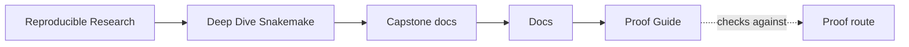
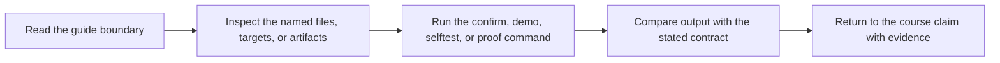

# Proof Guide

<!-- page-maps:start -->
## Guide Maps

<!-- page-maps:end -->

Use this guide when you know the question you want answered and need the shortest honest
route from that question to evidence. Most review work does not need the strongest route
first.

## Start from the claim

| Claim | Smallest honest route | Read these first |
| --- | --- | --- |
| fresh-machine setup is explicit and repeatable | `make bootstrap-confirm` | `Makefile`, `environment.yaml`, toolchain output under `artifacts/venv/` |
| rule contracts are visible before execution | `make walkthrough` | `Snakefile`, `workflow/rules/*.smk`, `list-rules.txt`, `dryrun.txt` |
| checkpoint discovery responds to a declared membership change | `make discovery-integrity-audit` | paired checkpoint models, change dry-runs, normal and forced executions, [Discovery Integrity Audit Guide](discovery-integrity-audit-guide.md) |
| discovery evidence rejects undeclared invalidation and fake counterexamples | `make discovery-integrity-selftest` | three acceptance and causal mutation tests |
| declared influences rerun and failed publication preserves trusted finals | `make file-contract-audit` | paired rules, dry-run receipts, filesystem evidence, [File Contract Audit Guide](file-contract-audit-guide.md) |
| file-contract evidence rejects hidden inputs and in-place poison | `make file-contract-selftest` | seven causal mutation tests |
| the published boundary is stable and reviewable | `make verify-report` | [File API](file-api.md), `verify.json`, `manifest.json`, `provenance.json` |
| profile differences stay operational instead of semantic | `make profile-audit` | `profiles/*/config.yaml`, dry-run comparisons, [Profile Audit Guide](profile-audit-guide.md) |
| module callers own config scope, paths, and artifact policy | `make module-interface-audit` | [Module Interface Audit Guide](module-interface-audit-guide.md), paired callers, report, and traces |
| module evidence rejects broad or incomplete contracts | `make module-interface-selftest` | seven acceptance, rejection, and isolation tests |
| tuning removes attributable work without weakening the contract | `make performance-diagnostics-audit` | [Performance Diagnostics Audit Guide](performance-diagnostics-audit-guide.md), four isolated runs, report, and metrics |
| performance evidence rejects guarantee loss and fake comparisons | `make performance-diagnostics-selftest` | seven acceptance, rejection, regression, and isolation tests |
| scheduler translation preserves declared resources and semantics | `make scheduler-policy-audit` | dry-run, accepted receipt, three rejection receipts, and report |
| scheduler-policy evidence responds to unsafe mutations | `make scheduler-policy-selftest` | seven mapping, rejection, and isolation tests |
| the workflow stays deterministic across core counts | `make selftest` | `tests/selftest.sh`, published summaries under `publish/v1/` |
| executed evidence can be reviewed in one place | `make tour` | `run.txt`, `summary.txt`, published artifacts, [TOUR.md](tour.md) |
| one sanctioned multi-bundle proof route exists | `make proof` | `tour`, `verify-report`, profile, module-interface, context-invariance, performance-diagnostics, and scheduler-policy bundles |
| the full repository contract still survives clean-room pressure | `make confirm` | `Makefile`, `tests/`, `publish/v1/`, profile surfaces |

## Route selection rules

- choose `walkthrough` for first contact
- choose `verify-report` for publish-boundary trust
- choose `file-contract-audit` for convergence, hidden-input, and atomic-publication questions
- choose `discovery-integrity-audit` for sample-membership, checkpoint-invalidation, and ambient-scan questions
- choose `discovery-integrity-selftest` when the question is whether discovery evidence reacts to a broken contract
- choose `profile-audit` for policy and executor questions
- choose `module-interface-audit` for `module` and `use rule` ownership questions
- choose `module-interface-selftest` when the question is whether that gate rejects dishonesty
- choose `performance-diagnostics-audit` for baseline, tuning, validation-loss, and regression questions
- choose `performance-diagnostics-selftest` when the question is whether the performance gate rejects dishonest evidence
- choose `scheduler-policy-audit` for declared-resource translation and semantic-profile boundary questions
- choose `scheduler-policy-selftest` when the question is whether unsafe mappings are rejected causally
- choose `selftest` for determinism questions
- choose `tour` for executed evidence
- choose `proof` only when one review question now spans several bundles
- choose `confirm` when stewardship review needs the strongest supported route

## Good reading order

1. `README.md`
2. [Domain Guide](domain-guide.md)
3. `Snakefile`
4. `workflow/rules/common.smk`
5. `workflow/rules/publish.smk`
6. [File API](file-api.md)

That route keeps contract and published trust ahead of implementation detail.
