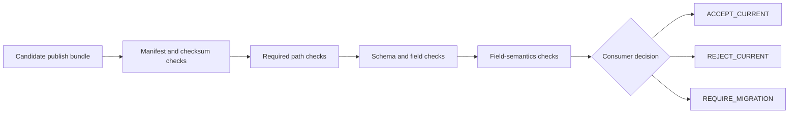
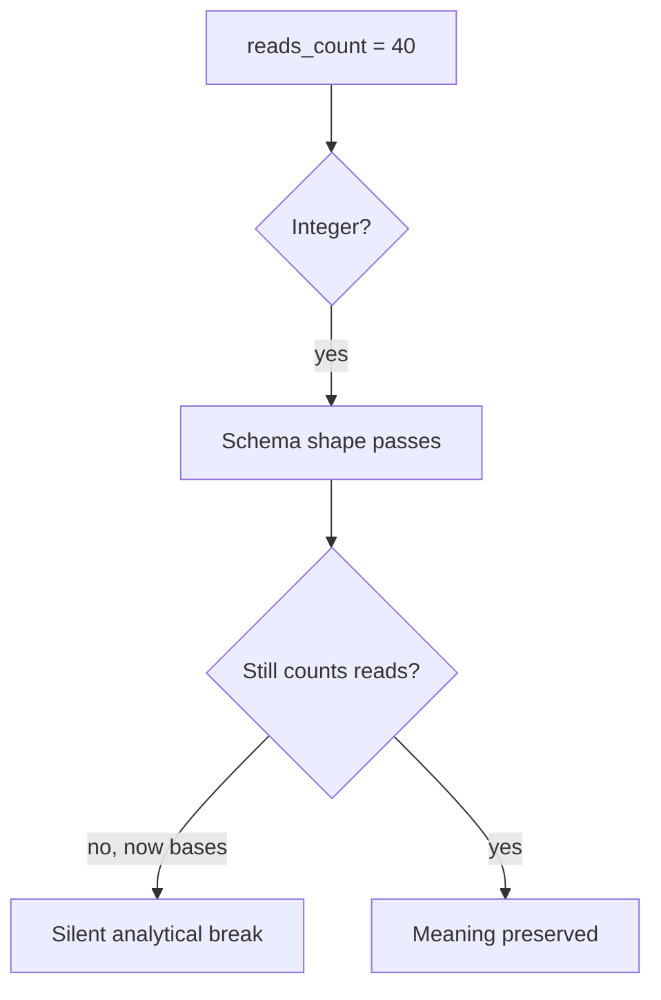

# Publish Compatibility Audit Guide

Use this audit when a published bundle changes and the review question is:

> Can the current consumer still interpret the new bundle correctly?

Successful workflow execution cannot answer that question. A candidate can be valid JSON,
have a matching checksum, and still break a consumer by removing a field, renaming a path,
or changing the meaning of an unchanged integer.

## Run the focused audit

```sh
make publish-compatibility-audit
```

The target writes a review bundle under the repository `artifacts/audit/` tree. Start
with:

1. `route.txt`;
2. `specimens/consumer-v1.json`;
3. `summary.tsv`;
4. the named case definitions;
5. materialized bundles under `workspace/`;
6. `report.json`.

Read the consumer before the producer cases. Compatibility is a relationship with a
declared consumer, not a quality a file possesses by itself.

## What the current consumer promises to read

The v1 consumer requires:

- publish path `summary.json`;
- publish version `v1`;
- artifact schema version `1`;
- string field `sample_id`;
- integer field `reads_count`;
- `reads_count` meaning “number of sequencing reads” with unit `reads`;
- manifest integrity for every listed file.

It allows additional fields. That policy is why the additive case can remain compatible.
A closed consumer could reasonably reject unknown fields; its contract would classify the
same producer change differently.



Integrity is checked first because a consumer should not reason about semantics from bytes
that differ from the inventory it was given.

## The seven cases

| Case | Candidate change | Expected decision |
| --- | --- | --- |
| baseline | unchanged v1 summary | `ACCEPT_CURRENT` |
| additive field | optional `qc_status` added | `ACCEPT_CURRENT` |
| required-field removal | `reads_count` removed | `REJECT_CURRENT` |
| path rename | `summary.json` becomes `metrics.json` within v1 | `REJECT_CURRENT` |
| semantic drift | `reads_count` now counts bases but remains an integer | `REJECT_CURRENT` |
| integrity corruption | artifact bytes change after the manifest is written | `REJECT_CURRENT` |
| versioned migration | v2 publishes `metrics.json` with `read_bases` | `REQUIRE_MIGRATION` |

The cases isolate different failure classes. Do not reduce them to “schema passed” or
“schema failed.”

## Why the additive case is compatible

The candidate retains:

```json
{
  "sample_id": "alpha",
  "reads_count": 10
}
```

and adds:

```json
{
  "qc_status": "pass"
}
```

The current consumer declares `allow_additional_fields: true`, so it can keep reading the
required projection. Acceptance depends on that explicit tolerance.

If a downstream parser rejects unknown properties, the producer must either coordinate
the change, change the consumer, or publish under a new negotiated contract. “Adding a
field is always backward compatible” is too broad.

## Why semantic drift needs its own case

Both of these values are valid integers:

```json
{"reads_count": 10}
{"reads_count": 40}
```

The first means reads. The drifted candidate says the field means nucleotide bases. Type
validation succeeds, yet a consumer comparing read counts will silently misinterpret the
number.



Compatibility review therefore needs field meaning and units, not only names and types.

## Why checksum failure is not schema drift

The integrity case writes a valid artifact and manifest, then changes the artifact bytes.
Its JSON can remain parseable and its fields can remain compatible. The consumer rejects
it because the delivered bytes no longer match the inventory.

Keep these conclusions separate:

- schema compatibility asks whether a consumer can interpret the structure;
- semantic compatibility asks whether interpreted values retain their meaning;
- integrity asks whether delivered bytes are the inventoried bytes.

A bundle must satisfy all three before it is trustworthy.

## Why the versioned migration is not current compatibility

The v2 case intentionally changes:

- `publish/v1/summary.json` to `publish/v2/metrics.json`;
- artifact schema `1` to `2`;
- `reads_count` to `read_bases`;
- unit `reads` to `bases`.

The v1 consumer rejects it. The v2 consumer accepts it. The audit reports
`REQUIRE_MIGRATION`, not `ACCEPT_CURRENT`.

This is a successful versioning decision only because:

- the breaking change is isolated under v2;
- a v2 consumer contract exists;
- the old consumer does not silently accept new meaning;
- migration work is explicit.

Versioning creates a place for incompatibility. It does not migrate consumers by itself.

## Read `summary.tsv`

The compact report includes:

- case;
- audit result;
- compatibility decision;
- current-consumer compatibility;
- next-consumer compatibility;
- the first current-consumer failure.

`PASS` means the audit classified the named case as intended. It does not mean every
candidate is safe. For example:

```text
semantic-drift  PASS  REJECT_CURRENT
```

means the audit successfully rejected semantic drift.

## Inspect exact failures

Use `report.json` when the compact row is insufficient. Typical failures include:

```text
required publish paths are missing: ['summary.json']
record 0 is missing required field reads_count
field semantics changed for reads_count
checksum mismatch: summary.json
publish version must be v1, observed v2
```

Quote the failure that supports the decision. Avoid saying only “the compatibility audit
failed,” because the overall audit should pass while individual unsafe candidates are
rejected.

## Test whether the audit is discriminating

Run:

```sh
make publish-compatibility-selftest
```

The self-test:

- verifies direct consumer acceptance and rejection behavior;
- removes required data from the additive case;
- removes the semantic difference from the semantic counterexample;
- removes corruption from the integrity counterexample;
- weakens the current consumer’s required fields.

Each mutation must make the audit fail. Otherwise a producer could gain a green report by
weakening the fixture or the consumer contract.

## Apply the method to a real change

For a proposed publish change:

1. save the current consumer contract as executable expectations;
2. materialize the candidate bundle in isolation;
3. verify manifest paths and hashes;
4. run the current consumer against the candidate;
5. compare field meanings and units explicitly;
6. classify the result as current-compatible, rejected, or migration-required;
7. add a new consumer fixture before accepting a versioned break;
8. preserve the report with the release review.

Do not infer compatibility from a producer-side diff alone. A renamed path may look
trivial in workflow code and be a complete outage for a file-based consumer.

## Decision table

| Observation | Decision | Producer action |
| --- | --- | --- |
| current consumer accepts and required meaning is unchanged | accept within current version | retain consumer regression test |
| current consumer rejects an accidental change | reject candidate | restore contract or coordinate a versioned migration |
| current consumer accepts but field meaning changed | reject candidate | treat as semantic break despite structural acceptance |
| current consumer rejects, new declared consumer accepts under new version | require migration | publish migration guide and overlap policy |
| checksum mismatch | reject delivery | rebuild or redeliver from trusted bytes |

## Limits of this audit

The audit demonstrates:

- path, version, required-field, type, semantic, and checksum checks;
- explicit additive-field tolerance;
- a versioned consumer transition;
- causal failure when fixtures are weakened.

It does not prove:

- every real downstream consumer is represented;
- JSON number ranges or domain constraints are complete;
- the publishing process is atomic;
- privacy or authorization policy is correct;
- v1 and v2 will remain available for an adequate overlap period.

Expand the consumer fixtures when the public claim expands.

## Review checklist

- [ ] I read the consumer contract before the producer diff.
- [ ] Required paths, versions, fields, types, meanings, and units are explicit.
- [ ] Additional-field tolerance is declared rather than assumed.
- [ ] Integrity, schema, and semantic failures remain distinguishable.
- [ ] A same-version path rename is rejected.
- [ ] A semantic change cannot hide behind an unchanged type.
- [ ] Breaking change acceptance requires a new consumer contract.
- [ ] Versioning is paired with migration evidence.
- [ ] Unsafe cases report PASS only when their rejection is correctly reproduced.
- [ ] Causal self-tests prevent weakening the consumer or counterexamples.
