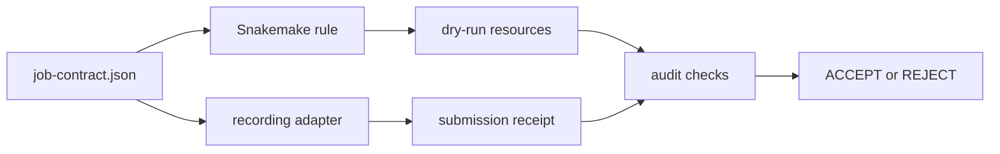
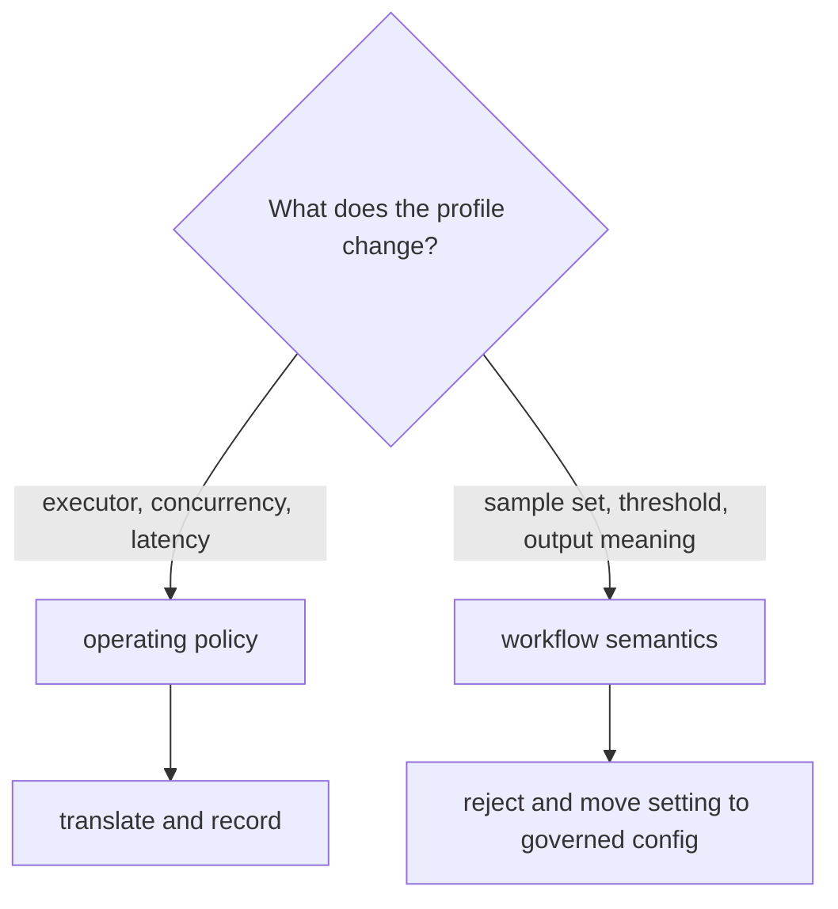

# Scheduler Policy Audit Guide

This audit teaches one narrow operational claim:

> a scheduler profile may translate declared resources into a submission request,
> but it must not invent missing resources, under-provision the declaration, or
> change workflow meaning.

The specimen records the request instead of contacting a scheduler. That boundary
is deliberate. A learner can review resource translation on any machine, while a
site administrator remains responsible for proving that a real executor,
scheduler, queue, account, and filesystem behave as expected.

## Run the audit

From the capstone directory:

```console
gmake scheduler-policy-audit
```

The command writes its bundle under:

```text
artifacts/audit/reproducible-research/deep-dive-snakemake/scheduler-policy/
```

Read these files in order:

1. `summary.tsv` for the four review decisions.
2. `report.json` for the checks behind each decision.
3. `workspace/dry-run/stdout.txt` for Snakemake's declared resources.
4. `workspace/profiles/accepted/receipt.json` for the recorded `sbatch` request.
5. the three rejected receipts for the reason each policy was denied.
6. `specimen/` to connect each result to the source contract and profile.

## The evidence chain



The job contract owns workflow meaning and required resources. The Snakefile and
adapter both read that contract. This avoids a weak demonstration in which the
rule requests one amount while a separately maintained example command requests
another.

The accepted receipt must preserve:

| Contract field | Snakemake evidence | Recorded scheduler argument |
| --- | --- | --- |
| `threads: 4` | rule job resources | `--cpus-per-task=4` |
| `mem_mb: 8000` | `mem_mb=8000` | `--mem=8000M` |
| `runtime: 30` | `runtime=30` | `--time=30` |
| `job_name` | rule identity | `--job-name=summarize_records` |

The receipt also contains `"executed": false`. Removing that fact would make the
bundle ambiguous: a reviewer could no longer tell whether this was safe local
rendering or a real scheduler interaction.

## Read PASS and decision separately

Every baseline finding should have `result=PASS`, including rejection findings.
Here, PASS means the audit observed the intended condition. The decision says
whether the profile is acceptable:

| Finding | Expected decision | Why |
| --- | --- | --- |
| `SCHEDULER_MAPPING_RECORDED` | `ACCEPT` | all required resources are preserved |
| `MISSING_MEMORY_REJECTED` | `REJECT` | the adapter cannot submit an unbounded memory request |
| `UNDERPROVISIONING_REJECTED` | `REJECT` | the scheduler request is smaller than the rule declaration |
| `SEMANTIC_PROFILE_LEAK_REJECTED` | `REJECT` | the profile tries to change `minimum_score` |

A rejected case with `result=FAIL` does not mean "more rejected." It means the
specimen failed to demonstrate the promised rejection.

## Why the semantic leak matters

The accepted profile changes operating context: it selects a scheduler and maps
resources. The semantic-leak profile tries to change `minimum_score`, which
changes which records belong in the output.



Moving a scientific or business threshold into a cluster profile makes results
depend on where the workflow runs. That is not portability. It is hidden semantic
forking.

## What this audit does not prove

The recording adapter does not prove:

- that `sbatch` is installed;
- that the named account or partition exists;
- that a scheduler accepts the command;
- that the job receives the requested memory or wall time;
- that worker nodes can read inputs and publish outputs;
- that retries, cancellation, or preemption work at a particular site.

Those claims need an integration test at the deployment site. Keep its evidence
separate: scheduler job ID, scheduler state transitions, worker logs, exit status,
and output verification.

## Rehearse the rejection paths

Run:

```console
gmake scheduler-policy-selftest
```

The tests mutate each policy case. They prove that:

- stale receipts are removed before a rerun;
- changing declared threads breaks the accepted mapping;
- a missing-memory case is not considered proven when memory is restored;
- an under-provisioning case is not considered proven at full memory;
- a semantic-leak case is not considered proven when the override is removed;
- the receipt always says that no scheduler was contacted.

This matters because a bundle of four static JSON files could pass by coincidence.
The selftest shows that the audit responds to the intended cause.

## Review checklist

- [ ] The dry-run and receipt derive from the same job contract.
- [ ] Required resources appear in both the rule evidence and scheduler request.
- [ ] The accepted request never asks for less than the declaration.
- [ ] Profile configuration contains no workflow-semantic override.
- [ ] The receipt records `executed: false`.
- [ ] Rejection reasons name the violated boundary.
- [ ] Real scheduler claims are deferred to a site integration route.
- [ ] The selftest demonstrates that each check is discriminating.

## Review conclusion

A defensible conclusion is:

> The local audit proves deterministic translation from rule resources to a
> reviewable Slurm request and rejects three unsafe policy variants. It does not
> claim that a real Slurm deployment accepted or executed the request.

That sentence is narrower than "the cluster profile works." It is also more
useful because a reviewer can identify exactly which evidence is present and
which evidence must come from the deployment environment.
