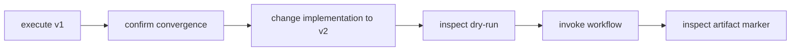
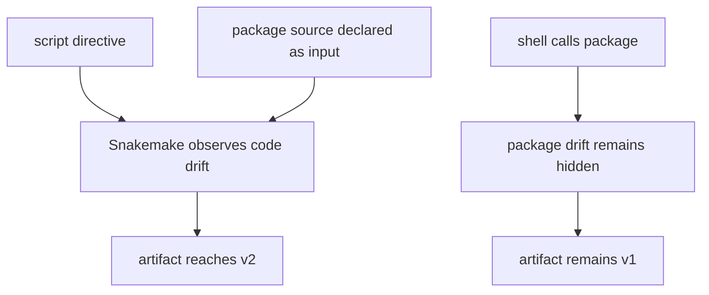

# Software Boundary Audit Guide

Use this audit when a rule executes Python and the review question is:

> Will Snakemake notice when the implementation changes, or can an existing artifact stay
> accepted after its software has drifted?

The audit compares three executable models. All begin from a converged workflow, change
only implementation source, run a dry-run, and then invoke Snakemake again.



## Run the audit

From the capstone directory:

```bash
gmake software-boundary-audit
gmake software-boundary-selftest
```

The evidence bundle is written under:

```text
artifacts/audit/reproducible-research/deep-dive-snakemake/software-boundaries/
```

Read it in this order:

1. `route.txt`
2. this guide
3. `summary.tsv`
4. the three copied specimens
5. each model's baseline and changed dry-run traces
6. `report.json`
7. the executed artifacts in `workspace/`

## Compare the three source contracts

### Script directive

The first rule uses:

```python
script:
    "workflow/scripts/render.py"
```

Snakemake knows that the script belongs to the rule's implementation. After its marker
changes, the changed dry-run plans `render` and the subsequent execution writes the v2
marker.

### Hidden package source

The second rule uses a stable shell command:

```python
shell:
    """
    PYTHONPATH=src python -m software_specimen.render ...
    """
```

The package source changes, but the command string and declared files do not. Snakemake
does not infer every Python module imported by an arbitrary shell command. The dry-run
reports no `render` job, the next invocation does no work, and the artifact remains at v1.

This row must be read as a successful reproduction of a rejected design.

### Declared package source

The third rule keeps the package command and adds the relevant source file to `input`:

```python
input:
    source="data/source.txt",
    implementation="src/software_specimen/render.py"
```

After that file changes, the dry-run plans `render` through an ordinary file dependency
and execution writes the v2 marker.



## Interpret result, decision, and finding together

| Model | Expected row | Meaning |
| --- | --- | --- |
| `script-directive` | `PASS / ACCEPT / SCRIPT_DIRECTIVE_DRIFT_PLANS_RERUN` | the directive exposes its implementation to Snakemake's rerun reasoning |
| `hidden-package-source` | `PASS / REJECT / HIDDEN_PACKAGE_DRIFT_MISSES_RERUN` | the audit successfully reproduced a stale artifact after hidden source drift |
| `declared-package-source` | `PASS / ACCEPT / DECLARED_PACKAGE_SOURCE_PLANS_RERUN` | an explicit source input makes the selected implementation observable |

Never shorten the second row to “the package model passed.” Its `PASS` describes the
experiment; its `REJECT` describes the design decision.

## What the repair does and does not mean

Declaring one source file is suitable for this bounded specimen. A real package can load:

- several local modules
- installed dependencies
- compiled libraries
- data bundled with the package
- plugins discovered at runtime

Listing every transitive source file under `input` rarely scales. Production alternatives
include:

- build an immutable package or container image and record its digest
- lock the environment and make the lock identity part of the execution contract
- version a source bundle and declare that bundle
- rebuild published artifacts from a known revision as a release policy

The architecture lesson is not “put all Python files under `input`.” It is:

> Choose a software identity that Snakemake or the surrounding release process can
> observe, then prove that changing the identity invalidates prior artifacts.

## Distinguish environment declarations from locks

The capstone's `workflow/envs/python.yaml` pins Python to the 3.11 line. That is a useful
compatibility declaration, but it is not an exact lock of package builds and transitive
dependencies.

The `pyproject.toml` constrains the supported Snakemake range for the repository toolchain.
It does not install the capstone package into each rule environment, and it does not
identify an exact solved environment.

The provenance artifact records resolved runtime details after execution. Provenance can
explain what ran; it cannot make a previously vague environment reproducible.

| Surface | Question answered |
| --- | --- |
| environment declaration | what runtime family may solve? |
| exact lock or image digest | which resolved software identity should run? |
| provenance receipt | what runtime did this execution observe? |
| drift experiment | does changing software identity invalidate prior artifacts? |

## Claim boundary

This audit proves one contrast for Snakemake 9 behavior under the supported capstone
toolchain:

- `script:` source changes are observed
- package source hidden behind an unchanged shell command is not observed
- the selected package source becomes observable when declared as an input

It does not prove:

- every file imported by a real package is covered by one declaration
- environment solving is deterministic
- a container image is trustworthy
- source drift changes scientific meaning
- an executor uses the same operating-system libraries

Those claims require additional inventory, lock, image, provenance, or cross-context
evidence.

## Review questions

Before accepting a software boundary, answer:

1. Which source, package, lock, or image identity determines the output?
2. Where is that identity visible to Snakemake or the release process?
3. What happens to an existing artifact when the identity changes?
4. Does the runtime declaration select a family or an exact resolution?
5. Which provenance fields confirm the runtime actually used?
6. Which deliberate drift experiment would reject a stale artifact?
