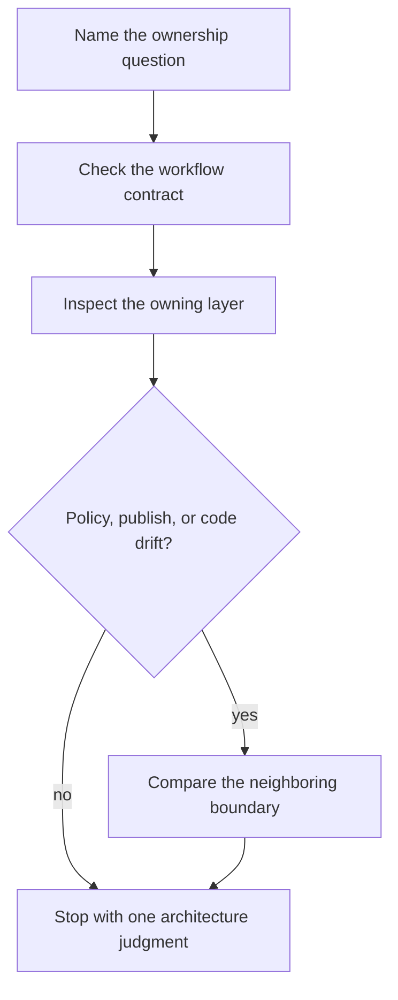

# Capstone Architecture Guide

Use this page when the question is about workflow ownership rather than about a single
run command. The Snakemake capstone stays reviewable only if workflow meaning, discovery
evidence, operating policy, publish trust, and implementation code remain separate.

## Architecture reading route

## Boundary map

| Boundary | First files to inspect | What that boundary owns |
| --- | --- | --- |
| workflow contract | `capstone/Snakefile` and `capstone/workflow/contracts/FILE_API.md` | the public file-level meaning of the workflow |
| rule implementation | `capstone/workflow/rules/` and `capstone/workflow/scripts/` | rule behavior, script boundaries, and workflow mechanics |
| dynamic discovery evidence | `capstone/publish/v1/discovered_samples.json` | durable evidence for what discovery found |
| operating policy | `capstone/profiles/local/`, `capstone/profiles/ci/`, and `capstone/profiles/slurm/` | executor and resource settings that should not redefine workflow meaning |
| publish boundary | `capstone/publish/v1/` | the smaller downstream-facing output surface another person may trust |
| package code | `capstone/src/capstone/` | reusable Python behavior that supports the workflow |

## Read the repository in this order

1. Start with `Snakefile` and `FILE_API.md`.
2. Read rule files before profile files.
3. Read published discovery evidence before making claims about dynamic behavior.
4. Read profiles only when the question is about operating context or policy drift.

## What a strong architecture judgment sounds like

A strong architecture judgment usually sounds like one of these:

- this behavior belongs in a rule file because it changes workflow meaning
- this behavior belongs in profile policy because it changes execution context only
- this behavior belongs in helper code because the rule contract stays visible without it
- this behavior does not belong in the publish surface because downstream trust would become blurry

## What this guide should prevent

- confusing executor policy with workflow semantics
- treating dynamic discovery as trustworthy without durable evidence
- reading package code before the rule contracts are visible

## Policy-audit route

Use this route when the question is specifically about local, CI, and scheduler policy:

1. Compare `capstone/profiles/local/config.yaml`, `capstone/profiles/ci/config.yaml`,
   and `capstone/profiles/slurm/config.yaml`.
2. Name which differences are operating policy and which would count as semantic drift.
3. Cross-check `capstone/Snakefile` and `capstone/workflow/contracts/FILE_API.md` before
   concluding that workflow meaning changed.

## Good stopping point

Stop when you can name the owning layer, the neighboring boundary it must not swallow,
and one concrete reason that split keeps the repository reviewable.
