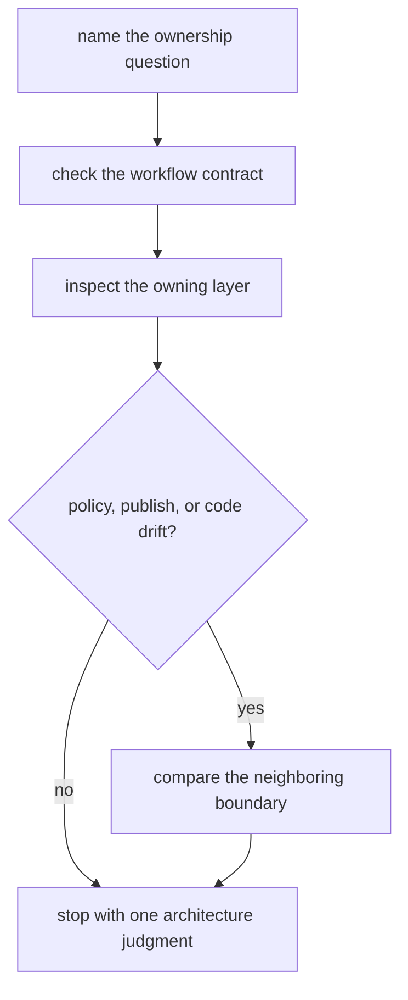

# Capstone Architecture Guide

Use this page when the question is about workflow ownership rather than about a single
run command. The Snakemake capstone stays reviewable only if workflow meaning, discovery
evidence, operating policy, publish trust, and implementation code remain separate.

This page is for architecture judgment, not for folder admiration.

## The question this page should help you answer

The right architecture question is usually not:

> Does this repository look tidy?

It is:

> Which layer should own this behavior so that workflow meaning, policy, publish trust,
> and helper logic stay reviewable?

That is why this guide starts with contracts and ownership boundaries rather than with
tree shape alone.

## How to use this page

Work in this order:

1. name the ownership question in one sentence
2. inspect the workflow contract first
3. inspect the layer that appears to own the behavior
4. compare the neighboring boundary only if drift is plausible
5. stop with one architecture judgment

If the question still sounds like "the repository feels complicated," reduce it before
you continue.

## Architecture reading route

## Start by separating ownership from convenience

Beginners often judge architecture by how clean the folders look.

That is not enough.

A repository can look organized while still hiding meaning in the wrong layer.

The goal is not only to create neat directories. The goal is to make it obvious:

- where workflow meaning lives
- where discovery evidence is recorded
- where operating policy begins and ends
- where publish trust is defined
- where helper code supports rather than swallows the workflow

## Boundary map

| Boundary | First files to inspect | What that boundary owns |
| --- | --- | --- |
| workflow contract | `capstone/Snakefile` and `capstone/workflow/contracts/FILE_API.md` | the public file-level meaning of the workflow |
| rule implementation | `capstone/workflow/rules/` and `capstone/workflow/scripts/` | rule behavior, helper boundaries, and workflow mechanics |
| dynamic discovery evidence | `capstone/workflow/rules/preprocess.smk` and `capstone/publish/v1/discovered_samples.json` | durable evidence for what discovery found |
| operating policy | `capstone/profiles/local/`, `capstone/profiles/ci/`, and `capstone/profiles/slurm/` | executor and resource settings that should not redefine workflow meaning |
| publish boundary | `capstone/publish/v1/` and `capstone/workflow/contracts/FILE_API.md` | the smaller downstream-facing output surface another person may trust |
| package code | `capstone/src/capstone/` | reusable Python behavior that supports rather than replaces the workflow contract |

## Read the repository in the right order

When the architecture question is still open, use this order:

1. start with `Snakefile`
2. read `FILE_API.md`
3. read rule files before profiles
4. read published discovery evidence before making claims about dynamic behavior
5. read profiles only when the question is about operating context or policy drift
6. read package code only after the visible rule contract is already clear

That order keeps workflow meaning ahead of policy and helper detail.

## What strong architecture judgments sound like

Strong architecture judgments usually sound like one of these:

- this behavior belongs in a rule file because it changes workflow meaning
- this behavior belongs in profile policy because it changes execution context only
- this behavior belongs in helper code because the rule contract stays visible without it
- this behavior does not belong in the publish surface because downstream trust would
  become blurrier
- this module split clarifies ownership instead of scattering the same meaning

If the judgment still sounds like "this structure feels cleaner," it is not sharp enough
yet.

## One honest architecture decision

Suppose the learner asks:

> Should this new behavior live in a profile, a rule file, or helper code?

The honest route is:

1. check whether the behavior changes workflow meaning
2. if yes, keep it out of profiles
3. then decide whether the visible rule contract stays clear enough for rule-local logic
   or whether helper code owns the detail better

That is a real architecture judgment. It is stronger than choosing the prettier file.

## Policy-audit route

Use this route when the question is specifically about local, CI, and scheduler policy:

1. compare `capstone/profiles/local/config.yaml`, `capstone/profiles/ci/config.yaml`,
   and `capstone/profiles/slurm/config.yaml`
2. name which differences are operating policy and which would count as semantic drift
3. cross-check `capstone/Snakefile` and `capstone/workflow/contracts/FILE_API.md` before
   concluding that workflow meaning changed

This keeps context review from turning into infrastructure folklore.

## What this guide should prevent

- confusing executor policy with workflow semantics
- treating dynamic discovery as trustworthy without durable evidence
- reading package code before the rule contracts are visible
- praising modularity when ownership is still blurry
- treating publish directories as if they owned the contract language themselves

## Good stopping point

Stop when you can name:

- the owning layer
- the neighboring boundary it must not swallow
- one concrete reason that split keeps the repository reviewable

If you still cannot do that, the architecture question is still too broad.
