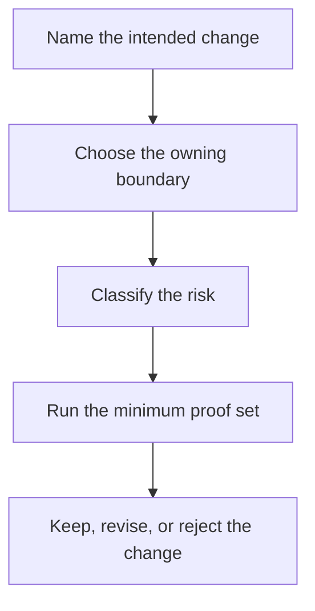

# Capstone Extension Guide

Use this guide when changing the Snakemake capstone after the course is already in use.
The goal is not to forbid growth. The goal is to keep new work from weakening the rule
contracts, policy boundaries, publish surface, and review evidence the course depends on.

## Extension route

## Boundaries that must stay legible

These boundaries should remain explicit:

- rule contracts versus helper implementation code
- dynamic discovery versus hidden side effects
- operating policy versus workflow meaning
- internal execution state versus `publish/v1/`

## Usually safe kinds of change

These changes are usually safe when reviewed carefully:

- adding a new internal rule with explicit inputs, outputs, and logs
- enriching the publish bundle without breaking existing promoted files
- extending profiles while keeping their meaning operational rather than semantic
- strengthening walkthrough, tour, or verification evidence

## Changes that need stronger review

These changes need stronger review:

- changing the meaning of an existing published artifact
- adding a checkpoint that hides moving targets instead of recording them
- moving analytical meaning into profile or executor-specific settings
- adding repository structure that buries the visible rule graph under indirection

Use [Capstone File Guide](capstone-file-guide.md) when the main question is where a
change belongs. Use [Capstone Review Worksheet](capstone-review-worksheet.md) when the
question is whether the current repository can still defend the change honestly.

## Minimum proof after a change

After any meaningful capstone change, rerun:

1. `make PROGRAM=reproducible-research/deep-dive-snakemake capstone-walkthrough`
2. `make PROGRAM=reproducible-research/deep-dive-snakemake capstone-wf-dryrun`
3. `make PROGRAM=reproducible-research/deep-dive-snakemake capstone-verify-report`
4. `make PROGRAM=reproducible-research/deep-dive-snakemake capstone-tour`

If any of those results become harder to explain, the repository likely got worse even if
it still runs.

## Good extension questions

Ask these before accepting the change:

- which boundary now owns the new behavior
- which existing proof route would fail if the change were dishonest
- whether the publish surface became wider, blurrier, or semantically different
- whether another maintainer could review the change without oral history

## Best companion pages

- [Capstone Architecture Guide](capstone-architecture-guide.md)
- [Capstone File Guide](capstone-file-guide.md)
- [Capstone Review Worksheet](capstone-review-worksheet.md)
- [Proof Matrix](../guides/proof-matrix.md)
