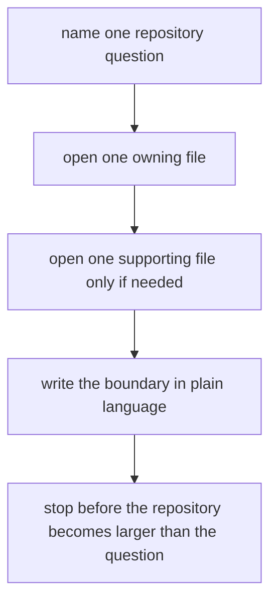

# Capstone File Guide

Use this page when you know the repository is the right surface but do not yet know
which file owns the answer. The goal is to shorten the path from question to owning file
so repository reading becomes deliberate instead of exploratory wandering.

This page is for ownership-first reading.

## The question this page should help you answer

The useful question is not:

> Which files seem related?

It is:

> Which file owns the answer, and which second file would clarify the contract if I still
> need support?

That difference is what keeps repository reading educational instead of exhausting.

## How to use this page

Work in this order:

1. name the repository question in one sentence
2. open the first owning file
3. open one supporting file only if needed
4. write the boundary in plain language
5. stop before the repository becomes larger than the question

If you need a third or fourth surface immediately, the question usually belongs in the
architecture guide or review worksheet instead.

## File-reading route

## Start by looking for ownership, not just relevance

Beginners often open files that are related to the question but do not actually own it.

Common mistakes:

- opening profiles before the workflow contract is clear
- opening helper code before the visible rule contract is legible
- opening `publish/v1/` before knowing how files are promoted into it
- opening tests before knowing which behavior they are defending

This guide is stricter. It tries to send you to the file that owns the boundary first.

## Start with the file that owns the question

| If the question is about... | Open this file first | Then open |
| --- | --- | --- |
| how the repository is assembled at the top level | `capstone/Snakefile` | `capstone/workflow/rules/common.smk` |
| how the workflow discovers and fans out sample work | `capstone/workflow/rules/preprocess.smk` | `capstone/publish/v1/discovered_samples.json` after execution |
| how publish artifacts are assembled and promoted | `capstone/workflow/rules/publish.smk` | `capstone/workflow/contracts/FILE_API.md` |
| how summary and report surfaces are produced | `capstone/workflow/rules/summarize_report.smk` | `capstone/publish/v1/summary.json` |
| what downstream users are allowed to trust | `capstone/workflow/contracts/FILE_API.md` | [Capstone Review Worksheet](capstone-review-worksheet.md) |
| where local, CI, and SLURM policy differ | `capstone/profiles/local/config.yaml` | `capstone/profiles/ci/config.yaml` and `capstone/profiles/slurm/config.yaml` |
| what reader-facing proof routes exist | `capstone/Makefile` | [Command Guide](command-guide.md) |
| where helper logic lives outside the rule files | `capstone/workflow/scripts/provenance.py` or `capstone/src/capstone/` | `capstone/environment.yaml` or `capstone/workflow/envs/` |
| how the repository is defended | `capstone/tests/` | [Capstone Review Worksheet](capstone-review-worksheet.md) |

## Read the table well

- The first file should answer the ownership question.
- The second file should clarify the contract, not widen the whole repository.
- If two files still do not settle the question, switch to
  [Capstone Review Worksheet](capstone-review-worksheet.md) or
  [Capstone Architecture Guide](capstone-architecture-guide.md) instead of opening
  directories at random.

## One honest file-reading decision

Suppose your question is:

> What downstream users are actually allowed to trust?

The honest first file is `capstone/workflow/contracts/FILE_API.md`, not `publish/v1/`
itself.

The reason is educational: the file API owns the contract language, while the publish
directory contains the promoted artifacts that must satisfy that contract.

## Directory responsibilities

| Path | What belongs there |
| --- | --- |
| `capstone/Snakefile` | top-level assembly and workflow entry |
| `capstone/workflow/rules/` | rule families with visible workflow meaning |
| `capstone/workflow/modules/` | reusable workflow boundaries with explicit interfaces |
| `capstone/workflow/contracts/` | published file-level contracts |
| `capstone/workflow/scripts/` | helper code that belongs beside orchestration |
| `capstone/src/capstone/` | reusable Python implementation code |
| `capstone/profiles/` | operating-policy differences across execution contexts |
| `capstone/tests/` | unit and workflow-level proof surfaces |
| `capstone/publish/v1/` | downstream-facing publish boundary |

## Good first reading order

If this is your first serious repository pass, use this sequence:

1. `capstone/Snakefile`
2. `capstone/workflow/rules/common.smk`
3. `capstone/workflow/rules/preprocess.smk`
4. `capstone/workflow/rules/summarize_report.smk`
5. `capstone/workflow/rules/publish.smk`
6. `capstone/workflow/contracts/FILE_API.md`
7. `capstone/Makefile`
8. one profile file
9. one test surface

That order keeps workflow meaning first, publish trust second, policy third, and proof
surfaces last.

## Wrong reading orders

Avoid these:

- opening helper Python code before reading the visible rule contract
- starting with `publish/v1/` before you know how the repository promotes files into it
- reading profiles before you know which workflow behavior must remain invariant
- using folder names as a substitute for ownership

If you are still navigating by directory names alone, the repository has not become
legible yet.

## Architecture review route

Use this section when the question is not only "which file owns this?" but also:

> Does the repository architecture still keep workflow meaning, policy, and publish
> trust in the right places?

Recommended route:

1. read [Capstone Guide](index.md)
2. compare this page with [Capstone Architecture Guide](capstone-architecture-guide.md)
3. inspect the matching files in the order named above
4. use [Proof Matrix](../guides/proof-matrix.md) to pick the strongest command that the
   boundary actually needs

What the architecture should prove:

- workflow meaning is still visible in `Snakefile` and `workflow/rules/`
- helper code has not swallowed the visible rule graph
- profiles and config stay operational rather than analytical
- the publish boundary remains smaller and clearer than the full repository state

Best moments to use it:

- after Module 04, when repository growth and interface boundaries become central
- after Module 07, when the full repository architecture becomes part of the lesson
- after Module 10, when reviewing the capstone as a long-lived workflow product

## Good stopping point

Stop when you can name:

- the owning file
- the one supporting file that clarified the contract
- the boundary in plain language

If you still cannot do that, your question belongs in a broader review page instead.
