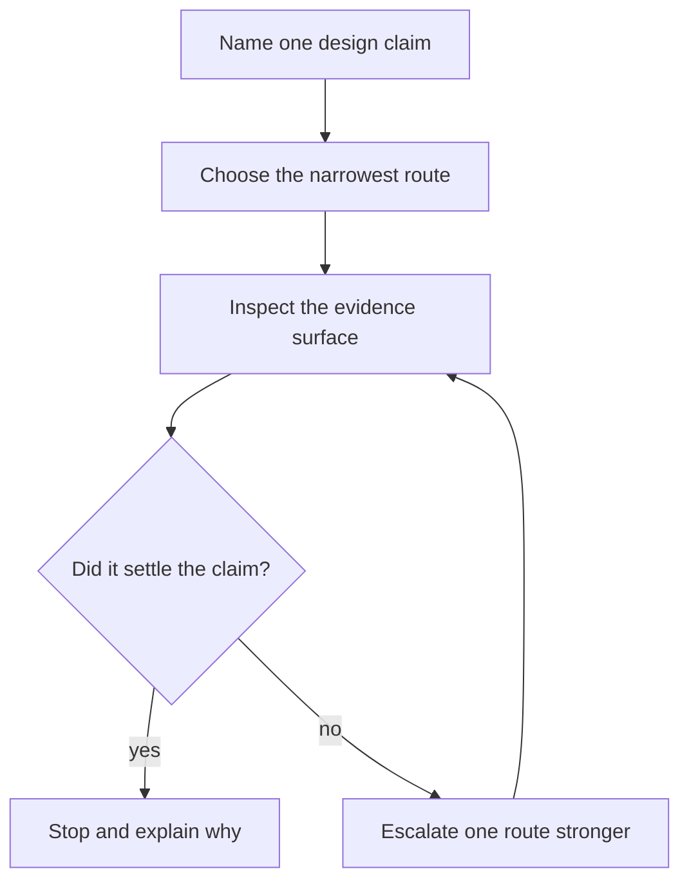

# Capstone Proof Guide

Use this page when a module makes a Snakemake design claim and you want the shortest
honest route to the capstone evidence that supports it.

## How to use this page

Use this guide after you can state the design claim plainly.

Read it in this order:

1. name the claim
2. choose the narrowest route in the table
3. inspect the evidence bundle it was meant to produce
4. escalate only if the unanswered part of the claim is real

This page is here to keep capstone proof proportional to the design question.

## Enter this guide at the right time

Use this guide once the module idea is already legible in its local exercise.

Before that point, prefer [Capstone Walkthrough](capstone-walkthrough.md) so the
repository stays smaller than the concept you are learning.

## Start by treating route strength as a design choice

Stronger proof is not always better proof.

It is better only when the claim itself is stronger.

For example:

- repository shape claims usually do not need a full stewardship route
- publish-boundary claims should start with publish-facing evidence
- execution-policy claims should start with policy-aware surfaces

## Proof route shape

## Start by proof need

| If you need to prove... | Start here | Escalate only if needed |
| --- | --- | --- |
| repository shape without execution | `make PROGRAM=reproducible-research/deep-dive-snakemake capstone-walkthrough` | `capstone-tour` |
| executed workflow behavior | `make PROGRAM=reproducible-research/deep-dive-snakemake capstone-tour` | `proof` |
| publish-boundary trust | `make PROGRAM=reproducible-research/deep-dive-snakemake capstone-verify-report` | `capstone-confirm` |
| execution-policy differences | [Capstone Architecture Guide](capstone-architecture-guide.md) | `proof` |
| steward-level confidence | `make PROGRAM=reproducible-research/deep-dive-snakemake proof` | `capstone-confirm` |

## Good proof habits

- Start with the claim, not with the heaviest available command.
- Check the evidence bundle the command was meant to produce.
- Escalate only when the unanswered part of the claim is real, not when uncertainty feels uncomfortable.

## One honest proof decision

Suppose the claim is:

> I need to know whether this capstone still makes dynamic discovery explicit.

The honest route is `capstone-tour`, because the claim is about executed discovery
evidence rather than final stewardship confirmation. Jumping straight to `capstone-confirm`
would answer a broader question than the one you asked.

## Worked examples

| Claim | Good first route | Why not stronger first |
| --- | --- | --- |
| "I need to see whether discovery is explicit." | `capstone-tour` | `capstone-confirm` adds weight before the discovery artifact question is even settled |
| "I need to review what downstream users may trust." | `capstone-verify-report` | a broader proof pass is worse than a publish-specific route for contract questions |
| "I need a maintainer-grade review route." | `proof` | `capstone-walkthrough` is too light once the question is explicitly stewardship-level |

## Bounded proof pass

1. Read [Capstone Guide](index.md).
2. Use [Proof Matrix](../guides/proof-matrix.md) to choose the narrowest command.
3. Run that command from the capstone or course root.
4. Record what the evidence proves before opening a stronger route.

## Good stopping point

Stop when you can say:

- which command gave the narrowest honest answer
- which evidence surface actually settled the claim
- why a broader route would be unnecessary unless the claim changed

If you cannot say those three things, repeat the bounded route before escalating.
