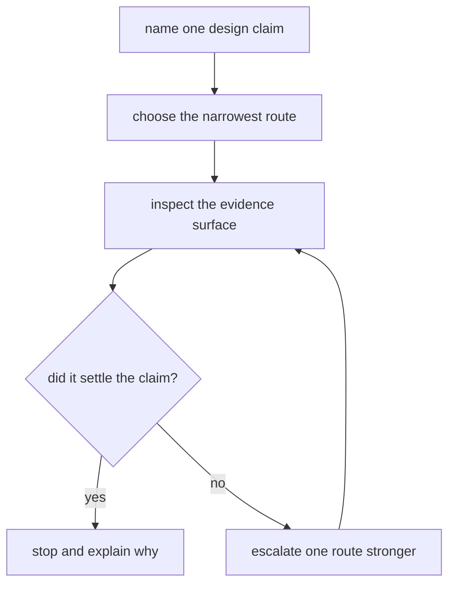

# Capstone Proof Guide

Use this page when a module makes a Snakemake design claim and you want the shortest
honest route to the capstone evidence that supports it. This guide is not for first
contact. It is for corroboration once the module idea already makes sense locally.

## The question this page answers

This guide answers:

> Which capstone proof route is proportionate to this design claim?

If the claim is still vague, sharpen the claim first. If the concept is still new, go
back to the module or walkthrough before using this page.

## How to use this guide

Work in this order:

1. name the design claim in plain language
2. choose the narrowest route in the table
3. inspect the evidence bundle that route was meant to produce
4. escalate only if the unanswered part of the claim is real

This page exists to keep capstone proof proportional to the design question.

## Enter this guide at the right time

Use this guide once the module idea is already legible in its local exercise.

Before that point, prefer [Capstone Walkthrough](capstone-walkthrough.md) so the
repository stays smaller than the concept you are trying to learn.

## Start by treating route strength as a design choice

Stronger proof is not always better proof.

It is better only when the claim itself is stronger.

For example:

- repository-shape claims usually do not need a full stewardship route
- publish-boundary claims should start with publish-facing evidence
- execution-policy claims should start with policy-aware surfaces

The route should match the claim, not your discomfort.

## The proof route shape

## Start by proof need

| If you need to prove... | Start here | Escalate only if needed |
| --- | --- | --- |
| repository shape without execution | `make PROGRAM=reproducible-research/deep-dive-snakemake capstone-walkthrough` | `capstone-tour` |
| executed workflow behavior | `make PROGRAM=reproducible-research/deep-dive-snakemake capstone-tour` | `proof` |
| publish-boundary trust | `make PROGRAM=reproducible-research/deep-dive-snakemake capstone-verify-report` | `capstone-confirm` |
| execution-policy invariance | `capstone-context-invariance-audit` | `capstone-context-invariance-selftest` |
| scheduler-policy translation | `capstone-scheduler-policy-audit` | `capstone-scheduler-policy-selftest` |
| performance-claim integrity | `capstone-performance-diagnostics-audit` | `capstone-performance-diagnostics-selftest` |
| real profile inventory | [Capstone Architecture Guide](capstone-architecture-guide.md) or `capstone-profile-audit` | `capstone-context-invariance-audit` |
| steward-level confidence | `make PROGRAM=reproducible-research/deep-dive-snakemake proof` | `capstone-confirm` |

## Good proof habits

- Start with the claim, not with the heaviest available command.
- Inspect the evidence bundle the command was meant to produce.
- Escalate only when the unanswered part of the claim is real.
- Stop once the claim is settled instead of continuing out of habit.

## Worked examples

| Claim | Good first route | Why not stronger first |
| --- | --- | --- |
| I need to see whether discovery is explicit. | `capstone-tour` | `capstone-confirm` adds stewardship weight before the discovery question is settled |
| I need to review what downstream users may trust. | `capstone-verify-report` | a broader proof pass is worse than a publish-specific route for contract questions |
| I need a maintainer-grade review route. | `proof` | `capstone-walkthrough` is too light once the question is explicitly stewardship-level |
| I need to prove local and CI retain one workflow meaning. | `capstone-context-invariance-audit` | a profile inventory alone cannot reject semantic drift |
| I need to prove scheduler arguments preserve rule resources. | `capstone-scheduler-policy-audit` | a command example cannot expose missing resources, under-provisioning, or semantic leaks |
| I need to prove a speedup did not remove validation or hide repeated work. | `capstone-performance-diagnostics-audit` | one timing comparison cannot distinguish acceptance, rejection, and regression |

## One honest proof decision

Suppose the claim is:

> I need to know whether this capstone still makes dynamic discovery explicit.

The honest route is `capstone-tour`, because the claim is about executed discovery
evidence rather than final stewardship confirmation. Jumping straight to
`capstone-confirm` would answer a broader question than the one you asked.

## A bounded proof pass

1. Read [Capstone Guide](index.md).
2. Use [Proof Matrix](../guides/proof-matrix.md) to choose the narrowest command.
3. Run that command from the capstone, program, or repository root.
4. Inspect the evidence bundle it created.
5. Record what the route proved before opening a stronger one.

## Good stopping point

Stop when you can say:

- which command gave the narrowest honest answer
- which evidence surface actually settled the claim
- why a broader route would be unnecessary unless the claim changed

If you cannot say those three things, repeat the bounded route before escalating.

## Companion pages

- [Proof Ladder](../guides/proof-ladder.md)
- [Proof Matrix](../guides/proof-matrix.md)
- [Command Guide](command-guide.md)
- [Capstone Review Worksheet](capstone-review-worksheet.md)
