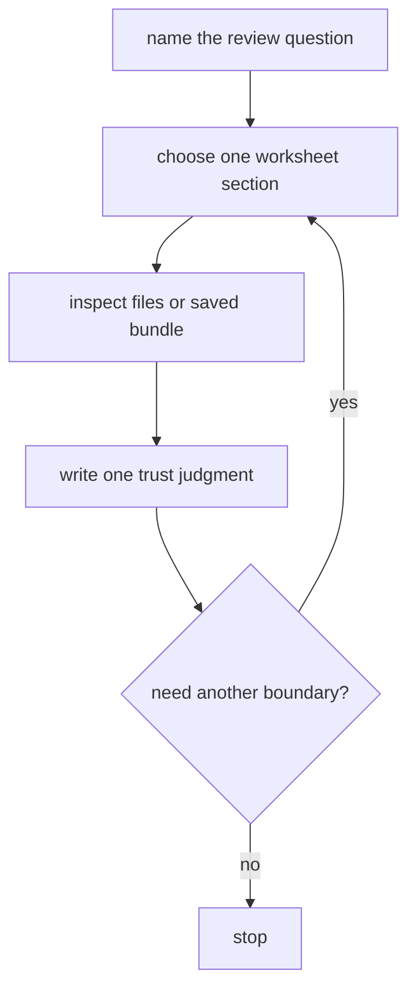

# Capstone Review Worksheet

Use this page when you want to review the capstone as an inherited workflow repository,
not just read it as course material. The goal is to leave with explicit judgments you
could defend in code review, maintenance planning, or a handoff.

This worksheet is for bounded review, not for turning every pass into a whole-repository
audit.

## How to use the worksheet

Use it in this order:

1. choose one kind of review
2. answer the section in your own words
3. name the file or saved bundle that supports the answer
4. record one trust judgment
5. widen only if the current evidence exposes another real boundary

If you cannot name the evidence, the judgment is still too soft.

## Start with one review question

This worksheet works best when you already know what kind of review you are doing:

- contract review
- workflow-truth review
- policy review
- publish review
- architecture review
- incident review

If you try to answer every section every time, the review becomes broad before it becomes
sharp.

## Review route

## Repository contract

Ask:

- what the repository claims to build and publish
- which files are public contracts and which are internal execution detail
- whether a new maintainer could discover the supported routes without oral explanation

Best evidence:

- `capstone/Snakefile`
- `capstone/Makefile`
- `capstone/workflow/contracts/FILE_API.md`
- [Capstone Guide](index.md)

**Strong outcome**

You can explain the repository promise without needing a live tour first.

## Workflow truth

Ask:

- where the real file contracts live
- where dynamic discovery becomes a durable artifact
- whether any important behavior still feels hidden or nondeterministic

Best evidence:

- `capstone/workflow/rules/preprocess.smk`
- `capstone/publish/v1/discovered_samples.json`
- walkthrough or tour bundle surfaces

**Strong outcome**

You can point to the artifact that keeps discovery reviewable after execution.

## Policy and operating context

Ask:

- which differences across local, CI, and SLURM are operational policy
- what would count as semantic drift rather than policy drift
- whether a profile change could silently alter the published meaning of the workflow

Best evidence:

- `capstone/profiles/local/config.yaml`
- `capstone/profiles/ci/config.yaml`
- `capstone/profiles/slurm/config.yaml`
- [Capstone Architecture Guide](capstone-architecture-guide.md)

**Strong outcome**

You can say which settings change cost or placement without changing what the workflow
means.

## Publish boundary

Ask:

- which outputs are safe for downstream trust
- which artifacts remain internal run state or supporting evidence
- whether the promoted contract is smaller and clearer than the whole repository

Best evidence:

- `capstone/publish/v1/`
- `capstone/workflow/contracts/FILE_API.md`
- verify-report bundle surfaces

**Strong outcome**

You can explain what a downstream user may trust without reading the whole repository.

## Architecture and ownership

Ask:

- whether the top-level `Snakefile` still explains the repository shape
- whether rule files, modules, scripts, and package code each have a readable job
- where you would place the next non-trivial change and why

Best evidence:

- `capstone/Snakefile`
- `capstone/workflow/rules/`
- `capstone/workflow/modules/`
- `capstone/workflow/scripts/`
- `capstone/src/capstone/`

**Strong outcome**

You can route the next change to one owning layer instead of to a vague part of the
tree.

## Incident review

Use this section when the question is about incident response, reproducibility under
pressure, or debugging with evidence instead of intuition.

Ask:

- whether the failure is about workflow semantics, execution policy, or downstream trust
- which command gives the most honest first evidence
- which files should remain unchanged until stronger proof exists

Recommended route:

1. read [Capstone Walkthrough](capstone-walkthrough.md)
2. use [Proof Matrix](../guides/proof-matrix.md) to choose the narrowest command for the
   current symptom
3. compare the result with [Capstone Architecture Guide](capstone-architecture-guide.md)
   if the problem spans multiple boundaries

**Strong outcome**

You can say what evidence comes before edits.

## Strong review outcomes

The worksheet is doing its job when you can end with one of these:

- trust as-is because the contract and evidence are explicit
- trust with one named follow-up because the risk is real but contained
- do not trust yet because one specific proof or ownership question is unresolved

If the result is only "this seems complicated," the review still needs sharper evidence.

## One honest review pass

Suppose your real question is:

> Could another maintainer explain what is public here without asking the original
> author?

The honest worksheet route is:

1. repository contract
2. publish boundary
3. strong review outcomes

You do not need to turn that into a full incident or stewardship review unless the
evidence exposes a broader problem.

## Record the result

Try to end with one short paragraph:

- the claim you reviewed
- the evidence you trusted
- the judgment you reached

If the conclusion is much longer, the review probably drifted away from one bounded
question.
