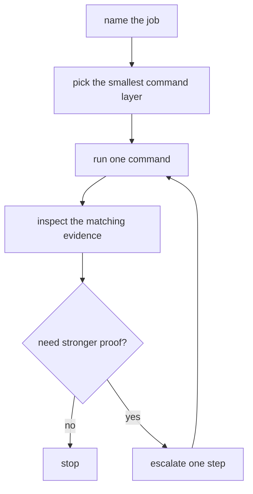

# Command Guide

Use this page when the main problem is command choice rather than concept choice. Deep
Dive Snakemake has three command layers so readers can stay at the smallest durable
surface instead of guessing where a target belongs.

The three layers are teaching boundaries, not just convenience aliases.

## The three command layers

Deep Dive Snakemake exposes commands from:

- the repository root
- the program directory
- the capstone directory

Those layers exist so you do not have to guess where a command belongs and so you do not
drop into the raw repository before you actually need to.

## How to use this page

Work in this order:

1. name the job you are trying to do
2. choose the smallest command layer that still answers it
3. run one command
4. inspect the matching evidence before escalating

If you are still choosing commands by which one sounds strongest, this page should slow
you down.

## Choose the layer before the command

## Start by treating command layers as teaching boundaries

The layers exist so learners can stay on the smallest honest surface:

- repository root when you need stable cross-program entry
- program directory when you need one-course focus
- capstone directory when you are already reading the workflow as a raw repository

Dropping to the capstone too early often makes the route larger than necessary.

## Choose the command layer

| If you need... | Use this layer | Why |
| --- | --- | --- |
| one stable entrypoint from the repository root | repository root | consistent commands across all programs |
| course-local commands while staying inside the program | `programs/reproducible-research/deep-dive-snakemake/` | a smaller surface than the repo root |
| the raw executable workflow repository | `capstone/` | direct access when you already need repository-level reading |

## A simple rule

Prefer the highest layer that still answers the current question honestly:

- use repository root for cross-program consistency
- use the program directory when you want one-course focus
- use the capstone directory when you are already reading the workflow as a repository

Do not drop to the raw capstone just because it feels more real. Smaller command surfaces
are often better for learning and review.

## Start by job, not by directory

| If the job is... | Honest first command | Do not start with |
| --- | --- | --- |
| first-pass capstone reading | `make PROGRAM=reproducible-research/deep-dive-snakemake capstone-walkthrough` | `make PROGRAM=reproducible-research/deep-dive-snakemake capstone-confirm` |
| one executed workflow review | `make PROGRAM=reproducible-research/deep-dive-snakemake capstone-tour` | `make PROGRAM=reproducible-research/deep-dive-snakemake proof` |
| publish-boundary verification | `make PROGRAM=reproducible-research/deep-dive-snakemake capstone-verify-report` | `make PROGRAM=reproducible-research/deep-dive-snakemake capstone-confirm` |
| execution-policy invariance | `make PROGRAM=reproducible-research/deep-dive-snakemake capstone-context-invariance-audit` | comparing profile YAML without plans or artifacts |
| performance-claim integrity | `make PROGRAM=reproducible-research/deep-dive-snakemake capstone-performance-diagnostics-audit` | comparing one timing pair without semantic gates |
| strongest final confirmation | `make PROGRAM=reproducible-research/deep-dive-snakemake capstone-confirm` | `make PROGRAM=reproducible-research/deep-dive-snakemake capstone-walkthrough` |

## One honest command decision

Suppose your real job is:

> I need one executed workflow story with saved evidence.

The honest command is `capstone-tour` from the highest layer that still feels natural for
your context.

It is not `proof`, because that command answers a broader stewardship question than the
job you just named.

## Common good choices

| Situation | Good first command | Why |
| --- | --- | --- |
| You need a bounded first read. | `capstone-walkthrough` | it keeps repository orientation smaller than execution proof |
| You want one executed workflow story. | `capstone-tour` | it gives real evidence without jumping to the strongest route |
| You care about downstream trust. | `capstone-verify-report` | publish review is narrower than whole-repository confirmation |
| You suspect local and CI are diverging semantically. | `capstone-context-invariance-audit` | the paired specimen proves both preservation and rejection |
| You need to distinguish honest tuning from lost validation or repeated work. | `capstone-performance-diagnostics-audit` | four isolated runs produce reference, acceptance, rejection, and regression evidence |
| You need the capstone's real profile files packaged together. | `capstone-profile-audit` | profile inventory is narrower than semantic equivalence proof |

## Repository-root commands

Use root-level commands when you want one entrypoint that works across programs.

- `make PROGRAM=reproducible-research/deep-dive-snakemake capstone-walkthrough`
- `make PROGRAM=reproducible-research/deep-dive-snakemake capstone-tour`
- `make PROGRAM=reproducible-research/deep-dive-snakemake proof`
- `make PROGRAM=reproducible-research/deep-dive-snakemake capstone-verify-report`
- `make PROGRAM=reproducible-research/deep-dive-snakemake capstone-confirm`

## Program-directory commands

Use `programs/reproducible-research/deep-dive-snakemake/` when you want the course-local
surface.

- `make capstone-walkthrough`
- `make capstone-tour`
- `make proof`
- `make capstone-profile-audit`
- `make capstone-context-invariance-audit`
- `make capstone-context-invariance-selftest`
- `make capstone-performance-diagnostics-audit`
- `make capstone-performance-diagnostics-selftest`
- `make capstone-confirm`

## Capstone-directory commands

Use `capstone/` when you want the raw reference workflow.

- `make walkthrough`
- `make verify`
- `make tour`
- `make verify-report`
- `make profile-audit`
- `make context-invariance-audit`
- `make context-invariance-selftest`
- `make performance-diagnostics-audit`
- `make performance-diagnostics-selftest`
- `make confirm`

## Good stopping point

Stop when you can explain:

- why the chosen layer was proportionate to the current job
- what evidence the command was supposed to produce
- why a lower layer or stronger command would be unnecessary right now
