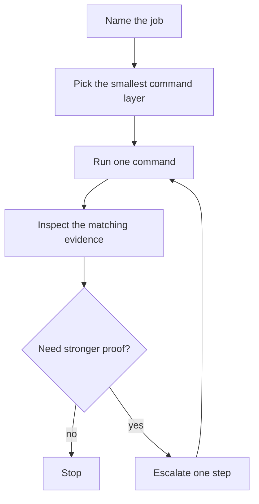

# Command Guide

Use this page when the main problem is command choice rather than concept choice. Deep
Dive Snakemake has three command layers so readers can stay at the smallest durable
surface instead of guessing where a target belongs.

Deep Dive Snakemake has three command layers: repository root, program directory, and
capstone directory. The layers exist so you do not have to guess where a command
belongs.

## Choose the layer before the command

## Choose the command layer

| If you need... | Use this layer | Why |
| --- | --- | --- |
| one stable entrypoint from the repository root | repository root | consistent commands across all programs |
| course-local commands while staying inside the program | `programs/reproducible-research/deep-dive-snakemake/` | a smaller surface than the repo root |
| the raw executable workflow repository | `capstone/` | direct access to the workflow itself |

## A simple rule

Prefer the highest layer that still answers the current question honestly:

- use repository root for cross-program consistency
- use the program directory when you want one-course focus
- use the capstone directory when you are already reading the workflow as a repository

Do not drop to the raw capstone just because it feels more "real." Smaller command
surfaces are often better for learning and review.

## Start by job, not by directory

| If the job is... | Start here | Do not start with |
| --- | --- | --- |
| first-pass capstone reading | `make PROGRAM=reproducible-research/deep-dive-snakemake capstone-walkthrough` | `make PROGRAM=reproducible-research/deep-dive-snakemake capstone-confirm` |
| executed workflow review | `make PROGRAM=reproducible-research/deep-dive-snakemake capstone-tour` | `make PROGRAM=reproducible-research/deep-dive-snakemake proof` |
| publish-boundary verification | `make PROGRAM=reproducible-research/deep-dive-snakemake capstone-verify-report` | `make PROGRAM=reproducible-research/deep-dive-snakemake capstone-confirm` |
| execution-policy comparison | `make PROGRAM=reproducible-research/deep-dive-snakemake capstone-profile-audit` | random `make PROGRAM=reproducible-research/deep-dive-snakemake ...` exploration |
| strongest final confirmation | `make PROGRAM=reproducible-research/deep-dive-snakemake capstone-confirm` | `make PROGRAM=reproducible-research/deep-dive-snakemake capstone-walkthrough` |

## Common good choices

| Situation | Good first command | Why |
| --- | --- | --- |
| You need a bounded first read. | `capstone-walkthrough` | it keeps repository orientation smaller than execution proof |
| You want one executed workflow story. | `capstone-tour` | it gives real evidence without jumping to the strongest route |
| You care about downstream trust. | `capstone-verify-report` | publish review is narrower than whole-repository confirmation |
| You suspect local and CI are diverging. | `capstone-profile-audit` | context drift should start at the policy surface |

## Repository root

Use root-level commands when you want one entrypoint that works across programs.

- `make PROGRAM=reproducible-research/deep-dive-snakemake capstone-walkthrough`
- `make PROGRAM=reproducible-research/deep-dive-snakemake capstone-tour`
- `make PROGRAM=reproducible-research/deep-dive-snakemake proof`
- `make PROGRAM=reproducible-research/deep-dive-snakemake capstone-verify-report`
- `make PROGRAM=reproducible-research/deep-dive-snakemake capstone-confirm`

## Program directory

Use `programs/reproducible-research/deep-dive-snakemake/` when you want the course-local
surface.

- `make capstone-walkthrough`
- `make capstone-tour`
- `make proof`
- `make capstone-profile-audit`
- `make capstone-confirm`

## Capstone directory

Use `capstone/` when you want the raw reference workflow.

- `make walkthrough`
- `make verify`
- `make tour`
- `make verify-report`
- `make profile-audit`
- `make confirm`

## Good stopping point

Stop when you can explain why the chosen command layer is proportionate to the current
question. If the layer still feels too large, step down one layer before opening more
targets.
