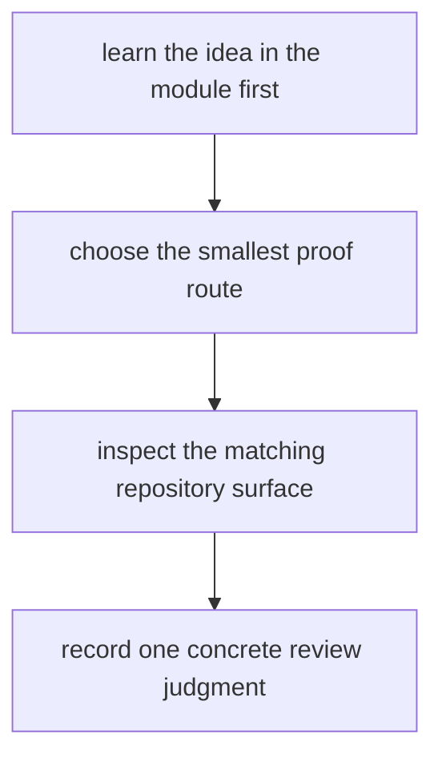

# Deep Dive Snakemake Capstone Guide

This capstone is the executable reference workflow for Deep Dive Snakemake. It keeps rule
contracts, dynamic discovery, operating policy, publish trust, and later stewardship
questions visible in one repository so the workflow can be reviewed as a real system
rather than as terminal folklore.

Use this guide once the local module idea is already clear. The capstone should
corroborate one workflow claim at a time, not become the first explanation of Snakemake.

## What this capstone is for

The capstone is not:

- a beginner tutorial
- a substitute for the modules
- a reason to browse the whole repository
- proof that gets better simply because it is larger

The capstone is for one narrower job:

> taking a module idea that is already legible in a small setting and seeing whether it
> stays honest inside a realistic repository

That distinction matters because learners often mistake:

- more files for deeper education
- more commands for stronger proof
- a larger repository for a better explanation

## How to use this guide

Work in this order:

1. decide whether the module idea is already clear locally
2. choose the smallest capstone route that matches that idea
3. inspect only the repository surfaces that answer the current question
4. stop with one review judgment before opening a stronger route

If the capstone starts feeling larger than the concept, the route is too broad or the
module idea is not clear enough yet.

## The capstone ladder

Keep this sequence in front of you:

If the capstone becomes your first exposure to a concept, the repository will feel larger
than the lesson. If the route is stronger than the question, you waste time and blur the
boundary you meant to inspect.

## What this capstone should help you do

By the time you use the capstone well, it should help you:

- enter a real workflow repository without losing the module idea you are testing
- choose the smallest honest proof route for the current claim
- compare public contracts against internal workflow state
- inspect operating, publish, and stewardship boundaries in one executable system
- leave the repository with one clearer review judgment rather than with more browsing

## Choose the right capstone route

| If your question is... | Best page |
| --- | --- |
| Which capstone surface matches the current module? | [Capstone Map](capstone-map.md) |
| Which files and commands matter first? | [Command Guide](command-guide.md) and [Capstone File Guide](capstone-file-guide.md) |
| Where do workflow, policy, publish, and stewardship ownership live? | [Capstone Architecture Guide](capstone-architecture-guide.md) |
| Which proof route is proportionate to this claim? | [Capstone Proof Guide](capstone-proof-guide.md) |
| How should I review the repository as a maintainer? | [Capstone Review Worksheet](capstone-review-worksheet.md) |
| Where should a new change land? | [Capstone Extension Guide](capstone-extension-guide.md) |

## Start by module range

| Module range | Best capstone focus |
| --- | --- |
| Modules 01-02 | file contracts, dynamic discovery, and deterministic workflow shape |
| Modules 03-04 | policy surfaces, execution boundaries, and repository interfaces |
| Modules 05-08 | software ownership, publish contracts, and operating-context drift |
| Modules 09-10 | incident evidence, migration pressure, and stewardship review |

## The first honest passes

| If you need... | From the repository root | From the capstone directory |
| --- | --- | --- |
| the first bounded pass | `make PROGRAM=reproducible-research/deep-dive-snakemake capstone-walkthrough` | `make walkthrough` |
| one executed workflow review | `make PROGRAM=reproducible-research/deep-dive-snakemake capstone-tour` | `make tour` |
| publish-trust review | `make PROGRAM=reproducible-research/deep-dive-snakemake capstone-verify-report` | `make verify-report` |
| operating-context invariance | `make PROGRAM=reproducible-research/deep-dive-snakemake capstone-context-invariance-audit` | `make context-invariance-audit` |
| real capstone profile inventory | `make PROGRAM=reproducible-research/deep-dive-snakemake capstone-profile-audit` | `make profile-audit` |

## One honest first capstone decision

Suppose you have just finished Module 06 and your real question is:

> what is actually safe for downstream users to trust?

The honest capstone move is not to run the strongest stewardship route. It is to enter
through the publish-facing surfaces:

1. [Capstone Review Worksheet](capstone-review-worksheet.md)
2. [Capstone File Guide](capstone-file-guide.md)
3. `make PROGRAM=reproducible-research/deep-dive-snakemake capstone-verify-report`

That keeps the route proportionate to the claim instead of turning a publish question
into a whole-repository audit.

## Guide set

- [Capstone Map](capstone-map.md)
- [Capstone Walkthrough](capstone-walkthrough.md)
- [Command Guide](command-guide.md)
- [Capstone File Guide](capstone-file-guide.md)
- [Capstone Architecture Guide](capstone-architecture-guide.md)
- [Capstone Proof Guide](capstone-proof-guide.md)
- [Capstone Review Worksheet](capstone-review-worksheet.md)
- [Capstone Extension Guide](capstone-extension-guide.md)
- [Glossary](glossary.md)

## Questions the capstone should help you answer

- Which files are public contracts and which are only internal coordination state?
- Where does discovery become a durable artifact instead of runtime folklore?
- Which settings belong to operating policy rather than workflow meaning?
- Which saved evidence bundle would matter most to another maintainer?
- Which ownership boundary should move next if the repository had to change?

## Good stopping point

Leave the capstone when you can answer all three:

- which module boundary you were testing
- which route gave the smallest honest answer
- what concrete review judgment you can now make
