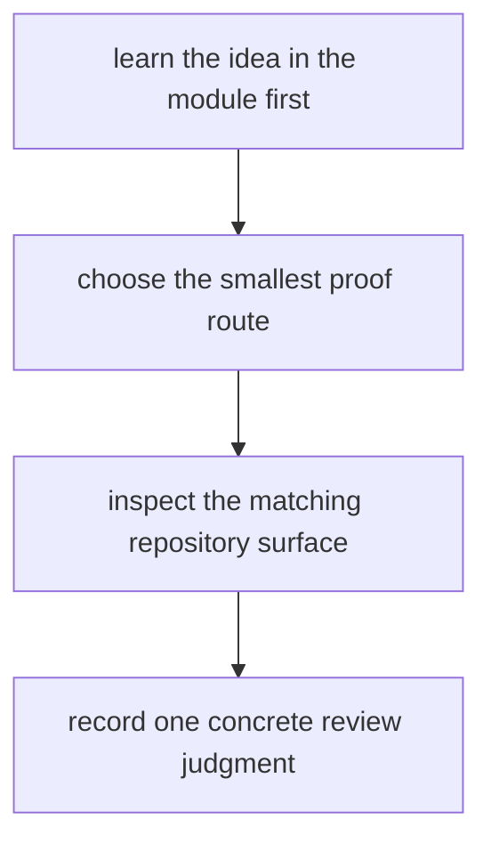

# Deep Dive Snakemake Capstone Guide

This capstone is the executable reference workflow for Deep Dive Snakemake. It keeps rule
contracts, dynamic discovery, operating policy, publish trust, and later stewardship
questions visible in one place so the workflow can be reviewed as a real repository
rather than as terminal folklore.

Use this guide once the local module idea is already clear. The capstone should
corroborate one workflow claim at a time, not become the first explanation of Snakemake.

## What this capstone must do for the learner

By the time you use the capstone well, it should help you do five things:

- enter a real workflow repository without losing the module idea you are testing
- choose the smallest honest proof route for the current question
- compare public contracts against internal workflow state
- inspect operating, publish, and stewardship boundaries in one executable system
- leave the repository with one clearer review judgment, not with more browsing

## The capstone ladder

Keep this order in front of you when you use the repository:

If the capstone becomes your first exposure to a concept, the repository will feel larger
than the lesson. If the route is stronger than the question, you waste time and blur the
boundary you meant to inspect.

## Choose the right capstone route

| If your question is... | Best page |
| --- | --- |
| Which capstone surface matches the current module? | [Capstone Map](capstone-map.md) |
| Which files and commands matter first? | [Command Guide](command-guide.md) and [Capstone File Guide](capstone-file-guide.md) |
| Where do workflow, policy, publish, and stewardship ownership live? | [Capstone Architecture Guide](capstone-architecture-guide.md) |
| Which proof route is honest for this claim? | [Capstone Proof Guide](capstone-proof-guide.md) |
| How should I review the repository as a maintainer? | [Capstone Review Worksheet](capstone-review-worksheet.md) |
| Where should a new change land? | [Capstone Extension Guide](capstone-extension-guide.md) |

## Start by module range

| Module range | Best capstone focus |
| --- | --- |
| Modules 01-02 | file contracts, dynamic discovery, and deterministic workflow shape |
| Modules 03-04 | policy surfaces, execution boundaries, and repository interfaces |
| Modules 05-08 | software ownership, publish contracts, and operating-context drift |
| Modules 09-10 | incident evidence, migration pressure, and stewardship review |

## The first honest passes

| If you need... | From the repository root | From the capstone directory |
| --- | --- | --- |
| the first bounded pass | `make PROGRAM=reproducible-research/deep-dive-snakemake capstone-walkthrough` | `make walkthrough` |
| executed workflow review | `make PROGRAM=reproducible-research/deep-dive-snakemake capstone-tour` | `make tour` |
| publish-trust review | `make PROGRAM=reproducible-research/deep-dive-snakemake capstone-verify-report` | `make verify-report` |
| operating-context review | `make PROGRAM=reproducible-research/deep-dive-snakemake capstone-profile-audit` | `make profile-audit` |

## Guide set

- [Capstone Map](capstone-map.md)
- [Capstone Walkthrough](capstone-walkthrough.md)
- [Command Guide](command-guide.md)
- [Capstone File Guide](capstone-file-guide.md)
- [Capstone Architecture Guide](capstone-architecture-guide.md)
- [Capstone Proof Guide](capstone-proof-guide.md)
- [Capstone Review Worksheet](capstone-review-worksheet.md)
- [Capstone Extension Guide](capstone-extension-guide.md)
- [Glossary](glossary.md)

## Questions the capstone should help you answer

- Which files are public contracts and which are only internal coordination state?
- Where does discovery become a durable artifact instead of runtime folklore?
- Which settings belong to operating policy rather than workflow meaning?
- Which saved evidence bundle would matter most to another maintainer?
- Which ownership boundary would move next if the repository had to change?

## Stop here when

- you know which module boundary you are testing
- you know the smallest capstone route that answers honestly
- you can leave with one concrete review judgment instead of more unfocused browsing
