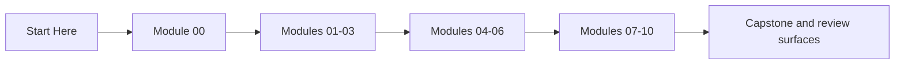

# Course Guide

Use this page when you want the big picture without losing the learner-first route. Deep
Dive Snakemake has several surfaces, but they are not equally useful at every stage.

The central rule is simple:

> learn the workflow idea in a small setting first, then use the capstone to confirm it in a larger repository.

## The four durable surfaces

Deep Dive Snakemake has four durable surfaces:

1. course home and orientation for entry and reading order
2. modules for the teaching arc itself
3. capstone pages for executable corroboration
4. reference pages for durable review and repair maps

The teaching arc contains ten learning days and one hundred exercises. Modules are the
course; guides and references help you navigate or diagnose them.

## The recommended reading order

That order matters because later skills depend on earlier clarity:

- dynamic workflows are weak without file-contract discipline
- publish trust is weak without explicit internal boundaries
- stewardship language is weak without working evidence

## Choose the right surface

| If you need... | Start here | Do not start with |
| --- | --- | --- |
| first entry into the course | [Start Here](start-here.md) | the capstone repository |
| the module sequence explained | [Module 00](../module-00-orientation/index.md) | incident or governance pages |
| one support page for urgency | [Pressure Routes](pressure-routes.md) | random browsing through `guides/` |
| workflow-versus-policy separation | [Topic Boundaries](../reference/topic-boundaries.md) | the strongest available command |
| module-to-repository routing | [Capstone Map](../capstone/capstone-map.md) | raw repository files |
| durable review maps | [Reference](../reference/index.md) | course-home prose |

## The teaching arc

| Arc | Modules | What becomes legible |
| --- | --- | --- |
| file-contract foundations | Modules 01-02 | truthful file contracts, deterministic discovery, and explicit checkpoints |
| policy and scaling boundaries | Modules 03-05 | profiles, scaling interfaces, helper-code boundaries, and honest software seams |
| publish and architecture surfaces | Modules 06-08 | downstream contracts, repository file APIs, and operating-context boundaries |
| incident and governance judgment | Modules 09-10 | observability, incident evidence, migration boundaries, and stewardship judgment |

## What belongs in each surface

| Surface | Use it for | Do not expect it to do |
| --- | --- | --- |
| orientation | getting ready, building study rhythm, seeing the whole arc | teaching advanced Snakemake features |
| modules | learning one day-sized concept deeply | proving everything about the capstone |
| capstone | seeing the idea survive a realistic repository | acting as first contact for a beginner |
| reference | reviewing, repairing, and checking boundaries | replacing the lesson sequence |

## Daily learning route

1. reproduce the smallest example and predict its behavior
2. read the core lessons while keeping the running question visible
3. work through the guided example without copying commands blindly
4. complete Exercises 1-5 before opening the answer page
5. complete Exercises 6-10 on a fresh or inherited workflow
6. use [Module Checkpoints](module-checkpoints.md) to decide whether to continue

If you cannot explain surprising output in terms of files, boundaries, and evidence,
reduce the example before entering the capstone.

## The support shelf by job

- Read [Boundary Review Prompts](../reference/boundary-review-prompts.md) when repository splits or module boundaries feel fuzzy.
- Read [Module Promise Map](module-promise-map.md) when module titles feel too compressed.
- Read [Module Checkpoints](module-checkpoints.md) when you need a visible exit bar.
- Read [Pressure Routes](pressure-routes.md) when the reading order is shaped by urgency.
- Read [Proof Matrix](proof-matrix.md) when you already know the claim and need the evidence surface.
- Read [Command Guide](../capstone/command-guide.md) when you know the route but not the command layer.
- Read [Capstone Guide](../capstone/index.md) when you need the capstone contract before opening repository files.

## Best defaults

Use these as your stable defaults unless the current pressure gives you a stronger reason:

1. enter with [Start Here](start-here.md)
2. anchor in [Module 00](../module-00-orientation/index.md)
3. read modules in order
4. keep [Proof Ladder](proof-ladder.md) nearby
5. enter the capstone through [Capstone Map](../capstone/capstone-map.md)

## A warning about skipping ahead

The course is intentionally cumulative. If you jump to a later module because it sounds
more advanced, you often borrow vocabulary without the model underneath it.

If a later module feels compelling, ask which earlier skill it depends on:

- executor policy depends on workflow semantics
- publish review depends on explicit internal surfaces
- incident response depends on stable proof routes
- migration judgment depends on all of the above

## Good stopping point

Stop when you can answer two questions clearly:

- which surface should answer the next question
- why the heavier surfaces would be premature right now
