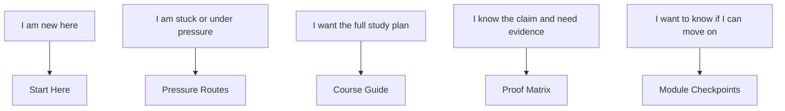

# Guides

Use this shelf when you need route choice, proof sizing, or capstone entry help rather
than another lesson page. The guides should send you back to learning quickly, not trap
you in course-admin prose.

## What this shelf is for

Use the guides shelf when you need help with one of these learner questions:

- where should I start
- which module or support page matches the pressure I have
- what proof route is proportionate here
- am I actually ready to move on

If you need the concept itself, go back to the module. These pages are for navigation,
not for replacing the lesson.

## Start with the guide that matches your situation

## Choose one lane

| If you need... | Start here | Then use |
| --- | --- | --- |
| the shortest honest entry | [Start Here](start-here.md) | [Course Guide](course-guide.md) |
| the full support-page map | [Course Guide](course-guide.md) | [Learning Contract](learning-contract.md) |
| a route shaped by urgency | [Pressure Routes](pressure-routes.md) | [Proof Ladder](proof-ladder.md) |
| module promises and exit bars | [Module Promise Map](module-promise-map.md) | [Module Checkpoints](module-checkpoints.md) |
| workflow split decisions | [Topic Boundaries](../reference/topic-boundaries.md) | [Boundary Review Prompts](../reference/boundary-review-prompts.md) |
| capstone entry | [Capstone Guide](../capstone/index.md) | [Capstone Map](../capstone/capstone-map.md) |

## Use the shelf by job

| Job | Best page |
| --- | --- |
| understand the module arc and support-page roles | [Course Guide](course-guide.md) |
| see the sequence justified | [Module Dependency Map](../reference/module-dependency-map.md) |
| rehearse the module-to-proof loop | [Practice Map](../reference/practice-map.md) |
| hold the stable review bar steady | [Review Checklist](../reference/review-checklist.md) |
| sharpen a keep, change, or reject boundary call | [Boundary Review Prompts](../reference/boundary-review-prompts.md) |
| keep workflow-versus-policy scope explicit | [Topic Boundaries](../reference/topic-boundaries.md) |
| route a claim to executable evidence | [Proof Matrix](proof-matrix.md) |
| choose the smallest honest proof route | [Proof Ladder](proof-ladder.md) |
| confirm the local environment before public commands | [Platform Setup](platform-setup.md) |

## Cross into the capstone deliberately

| If you need... | Best page |
| --- | --- |
| the capstone’s role in the course | [Capstone](../capstone/index.md) |
| the module-to-repository route | [Capstone Map](../capstone/capstone-map.md) |
| a bounded first pass through the repository | [Capstone Walkthrough](../capstone/capstone-walkthrough.md) |
| file responsibilities inside the repository | [Capstone File Guide](../capstone/capstone-file-guide.md) |
| ownership boundaries across workflow, policy, and publish surfaces | [Capstone Architecture Guide](../capstone/capstone-architecture-guide.md) |
| the shortest proof route for a concrete claim | [Capstone Proof Guide](../capstone/capstone-proof-guide.md) |
| steward-level workflow review | [Capstone Review Worksheet](../capstone/capstone-review-worksheet.md) |
| safe evolution | [Capstone Extension Guide](../capstone/capstone-extension-guide.md) |

## Good stopping point

Stop when you can name the single next page you need and the question it is supposed to
answer. If you are still opening whole shelves, go back to the table above and choose a
smaller lane.
