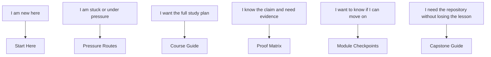

# Guides

Use this shelf when you need route choice, proof sizing, or capstone entry help rather
than another lesson page. The guides should send you back to learning quickly, not trap
you in course-administration prose.

This shelf exists to support the course, not to replace it.

## What this shelf is for

Use the guides shelf when you need help with one of these learner questions:

- where should I start
- which module or support page matches the pressure I have
- what proof route is proportionate here
- am I actually ready to move on
- how should I enter the capstone without widening the question too early

If you need the concept itself, go back to the module. These pages are for routing,
discipline, and support, not for replacing the lesson.

## How to use this shelf

Open the guides only after you can already name the kind of help you need.

Use them for one of five jobs:

1. choose an entry route
2. choose a support route under pressure
3. decide whether your current proof is too heavy or too light
4. decide whether you are actually ready to move on
5. enter the capstone without losing the module idea

If you cannot name the job yet, go back to the module. The module should teach the idea;
the guide should only help you move through it more deliberately.

## Start with one learner question, not with the whole shelf

The easiest way to waste time here is to open several guide pages because they all look
responsible.

That usually means you are avoiding the narrower question that actually matters.

A better habit is to say:

- I am new and need the safest entry route
- I am under pressure and need the smallest honest proof
- I think I am ready to move on and want an exit bar
- I know the claim and need the page that sizes the evidence
- I need the capstone, but I do not yet know how small the route should stay

Once the question sounds that specific, the shelf becomes useful instead of sprawling.

## Start with the guide that matches your situation

## Choose one lane

| If you need... | Start here | Then use |
| --- | --- | --- |
| the shortest honest entry | [Start Here](start-here.md) | [Course Guide](course-guide.md) |
| the full support-page map | [Course Guide](course-guide.md) | [Learning Contract](learning-contract.md) |
| a route shaped by urgency | [Pressure Routes](pressure-routes.md) | [Proof Ladder](proof-ladder.md) |
| module promises and exit bars | [Module Promise Map](module-promise-map.md) | [Module Checkpoints](module-checkpoints.md) |
| workflow split decisions | [Topic Boundaries](../reference/topic-boundaries.md) | [Boundary Review Prompts](../reference/boundary-review-prompts.md) |
| capstone entry | [Capstone Guide](../capstone/index.md) | [Capstone Map](../capstone/capstone-map.md) |

## Use the shelf by job

| Job | Best page | What that page should help you do |
| --- | --- | --- |
| understand the module arc and support-page roles | [Course Guide](course-guide.md) | see the whole study system without browsing blindly |
| hold the study discipline steady | [Learning Contract](learning-contract.md) | return to prediction, observation, and explanation |
| see the sequence justified | [Module Dependency Map](../reference/module-dependency-map.md) | know when to go forward and when to step back |
| rehearse the module-to-proof loop | [Practice Map](../reference/practice-map.md) | choose the next exercise or evidence move |
| hold the review bar steady | [Review Checklist](../reference/review-checklist.md) | turn a vague concern into a keep, change, or reject judgment |
| sharpen a boundary decision | [Boundary Review Prompts](../reference/boundary-review-prompts.md) | reduce blur across workflow, policy, publish, or ownership layers |
| keep workflow-versus-policy scope explicit | [Topic Boundaries](../reference/topic-boundaries.md) | avoid stretching the course into a different course |
| route a claim to executable evidence | [Proof Matrix](proof-matrix.md) | choose the first honest command and file surfaces |
| choose the smallest honest proof route | [Proof Ladder](proof-ladder.md) | size the evidence instead of overshooting |
| confirm the local environment before public commands | [Platform Setup](platform-setup.md) | separate setup failures from real workflow questions |

## Cross into the capstone deliberately

| If you need... | Best page |
| --- | --- |
| the capstone’s role in the course | [Capstone Guide](../capstone/index.md) |
| the module-to-repository route | [Capstone Map](../capstone/capstone-map.md) |
| a bounded first pass through the repository | [Capstone Walkthrough](../capstone/capstone-walkthrough.md) |
| file responsibilities inside the repository | [Capstone File Guide](../capstone/capstone-file-guide.md) |
| ownership boundaries across workflow, policy, and publish surfaces | [Capstone Architecture Guide](../capstone/capstone-architecture-guide.md) |
| the shortest proof route for a concrete claim | [Capstone Proof Guide](../capstone/capstone-proof-guide.md) |
| steward-level workflow review | [Capstone Review Worksheet](../capstone/capstone-review-worksheet.md) |
| safe evolution | [Capstone Extension Guide](../capstone/capstone-extension-guide.md) |

## What a good pass through this shelf should produce

After using the guides well, you should come away with one of these:

- one clearer next page
- one clearer proof route
- one clearer exit bar
- one clearer capstone entry
- one clearer reason to return to the module

If you come away only with more tabs open, the shelf was used too broadly.

## Good stopping point

Stop when you can name:

- the single next page you need
- the question it is supposed to answer
- why the rest of the shelf can stay closed for now
