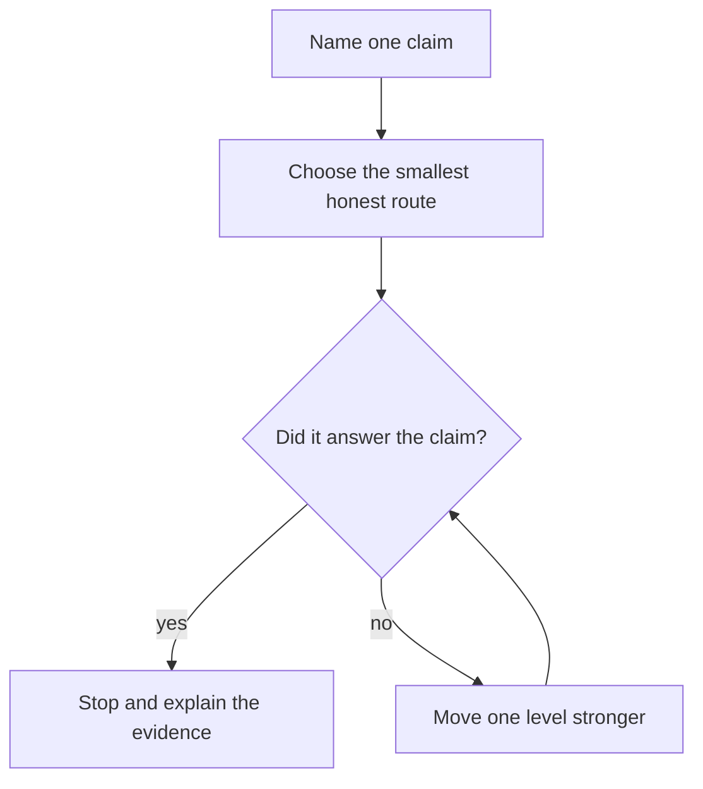

# Proof Ladder

Use this page when you know the question but not the right amount of evidence. The common
failure in this course is not laziness. It is overshooting the claim, running the heaviest
route available, and then losing the original question inside a much larger output bundle.

## Rule for using the ladder

Start at the smallest route that could honestly falsify your claim. Move down only when
the smaller route leaves an important part of the question unanswered.

That means:

- first contact should not start with `proof` or `capstone-confirm`
- a publish-boundary question does not need a full stewardship pass
- a profile question should start with profile evidence, not a generic run log

## The route shape

## The ladder

| Level | Start here when the question is... | First route |
| --- | --- | --- |
| 1 | what does this repository even claim to do | `make PROGRAM=reproducible-research/deep-dive-snakemake capstone-walkthrough` |
| 2 | how does the repository behave when executed once end to end | `make PROGRAM=reproducible-research/deep-dive-snakemake capstone-tour` |
| 3 | does the workflow still execute and validate its published outputs | `make PROGRAM=reproducible-research/deep-dive-snakemake test` |
| 4 | do I need a saved publish-contract bundle I can review later | `make PROGRAM=reproducible-research/deep-dive-snakemake capstone-verify-report` |
| 5 | do I need to compare local, CI, and scheduler policy surfaces | `make PROGRAM=reproducible-research/deep-dive-snakemake capstone-profile-audit` |
| 6 | do I need the sanctioned multi-bundle stewardship route | `make PROGRAM=reproducible-research/deep-dive-snakemake proof` |
| 7 | am I ready for the strongest clean-room confirmation pass | `make PROGRAM=reproducible-research/deep-dive-snakemake capstone-confirm` |

## How to choose a starting level

| If your question is mostly about... | Usually start here | Why |
| --- | --- | --- |
| orientation and first understanding | Level 1 | you need a bounded reading route before execution detail |
| one executed story of the workflow | Level 2 | one tour is often enough to make the system concrete |
| normal repository health | Level 3 | the ordinary test surface should answer ordinary health questions |
| downstream trust | Level 4 | publish evidence is stronger than raw terminal output |
| policy drift across environments | Level 5 | context comparison needs profile-aware evidence |
| maintainer-grade review | Level 6 | this is the repeatable stewardship surface |
| major change confirmation | Level 7 | use it when the claim really needs the strongest route |

## Start points by claim

| Claim | Start here |
| --- | --- |
| "I need a bounded first pass through the capstone." | capstone-walkthrough |
| "I need one executed workflow story with saved evidence." | capstone-tour |
| "I need to know whether the repository still works normally." | test |
| "I need durable publish-contract evidence, not terminal scrollback." | capstone-verify-report |
| "I need to review execution-policy differences across contexts." | capstone-profile-audit |
| "I need the full review route another maintainer could repeat." | proof |
| "I need the strongest confirmation before major change." | capstone-confirm |

## Worked examples

| Claim | Good starting route | Why not stronger first |
| --- | --- | --- |
| "I think publish output is too large." | `capstone-verify-report` | a clean-room pass adds weight, not clarity, to a publish-boundary question |
| "I do not understand what the capstone even builds." | `capstone-walkthrough` | `test` and `proof` assume more orientation than you have |
| "CI and local runs disagree." | `capstone-profile-audit` | a generic execution tour may hide the policy difference you actually need |

## Bad escalation habits

If you are using the ladder badly, it usually looks like one of these:

- choosing `capstone-confirm` because you feel uncertain, not because the question needs it
- using `proof` when `capstone-verify-report` would answer the publish question directly
- reading large saved bundles before you know what claim they are supposed to support
- treating a stronger route as automatically more honest than a narrower one

The stronger route is only better when it answers a different question.

## Best companion pages

- [Proof Matrix](proof-matrix.md) when you know the claim but need the first evidence surface
- [Command Guide](../capstone/command-guide.md) when the command layer itself is unclear
- [Capstone Map](../capstone/capstone-map.md) when you know the module but not the repository route
