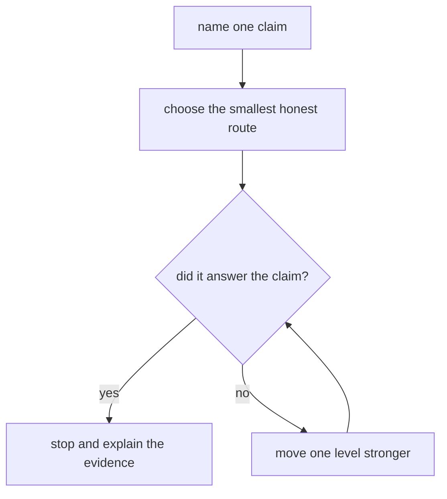

# Proof Ladder

Use this page when you know the question but not the right amount of evidence. The common
failure in this course is not laziness. It is overshooting the claim, running the
heaviest route available, and then losing the original question inside a much larger
bundle of output.

This page exists to teach proportionate proof.

## The core rule

Start with the smallest route that could honestly falsify your claim.

Move one step stronger only when the smaller route leaves an important part of the claim
unanswered.

That means:

- first contact should not begin with `proof` or `capstone-confirm`
- a publish-boundary question does not need a whole stewardship pass
- a policy question should start with policy-aware evidence, not with a generic tour

## Why stronger proof is not automatically better

Learners often assume the strongest route is the most honest route.

That is wrong when the claim is narrow.

A heavier route costs:

- more time
- more output to interpret
- more chances to forget the original question
- more surfaces that can distract you from the actual boundary under review

The honest route is the one proportionate to the claim, not the one that feels most
serious.

## How to use this ladder

Work in this order:

1. write the claim in one sentence
2. choose the smallest level that could falsify it
3. run or inspect that route
4. stop unless a real gap remains
5. escalate one level only if the claim still needs more evidence

If the claim still sounds vague, go back and sharpen the claim before you choose a route.

## The route shape

## The ladder levels

| Level | Start here when the question is... | First route | What this level is good for |
| --- | --- | --- | --- |
| 1 | what does this repository even claim to do | `make PROGRAM=reproducible-research/deep-dive-snakemake capstone-walkthrough` | bounded first understanding without execution overload |
| 2 | how does the repository behave through one executed story | `make PROGRAM=reproducible-research/deep-dive-snakemake capstone-tour` | one real run with saved evidence |
| 3 | does the workflow still execute and defend ordinary repository health | `make PROGRAM=reproducible-research/deep-dive-snakemake test` | normal health questions rather than publish or stewardship review |
| 4 | do I need saved publish-contract evidence I can inspect later | `make PROGRAM=reproducible-research/deep-dive-snakemake capstone-verify-report` | downstream trust and durable review bundles |
| 5 | do I need focused proof of context or performance claim integrity | `capstone-context-invariance-audit` or `capstone-performance-diagnostics-audit` from the program Makefile | semantic context drift or dishonest tuning questions |
| 6 | do I need the sanctioned maintainer-grade review route | `make PROGRAM=reproducible-research/deep-dive-snakemake proof` | repeatable stewardship review |
| 7 | do I need the strongest clean-room confirmation pass | `make PROGRAM=reproducible-research/deep-dive-snakemake capstone-confirm` | major-change confirmation or strongest final check |

## How to choose a starting level

| If your question is mostly about... | Usually start here | Why |
| --- | --- | --- |
| orientation and first understanding | Level 1 | a bounded walkthrough keeps the repository smaller than the lesson |
| one executed story of the workflow | Level 2 | one tour usually makes the system concrete without widening into stewardship |
| normal repository health | Level 3 | ordinary health questions deserve ordinary health routes |
| downstream trust | Level 4 | publish evidence is stronger than raw terminal scrollback |
| policy drift or performance-claim integrity | Level 5 | focused audits compare semantic and evidence invariants |
| maintainer-grade review | Level 6 | this is the repeatable stewardship surface |
| major change confirmation | Level 7 | the claim itself is already explicitly strong |

## Start points by claim

| Claim | Honest first route |
| --- | --- |
| I need a bounded first pass through the capstone. | `capstone-walkthrough` |
| I need one executed workflow story with saved evidence. | `capstone-tour` |
| I need to know whether the repository still works normally. | `test` |
| I need durable publish-contract evidence, not terminal scrollback. | `capstone-verify-report` |
| I need to review execution-policy invariance across contexts. | `capstone-context-invariance-audit` |
| I need to distinguish honest tuning, lost validation, and repeated work. | `capstone-performance-diagnostics-audit` |
| I need the full review route another maintainer could repeat. | `proof` |
| I need the strongest confirmation before a major change. | `capstone-confirm` |

## Worked examples

| Claim | Good starting route | Why not stronger first |
| --- | --- | --- |
| I think publish output is too large. | `capstone-verify-report` | a clean-room confirmation adds weight, not clarity, to a publish-boundary question |
| I do not understand what the capstone even builds. | `capstone-walkthrough` | `test` and `proof` assume more orientation than you currently have |
| CI and local runs disagree semantically. | `capstone-context-invariance-audit` | a generic tour may hide the policy difference you actually need |
| A faster candidate may have removed required work. | `capstone-performance-diagnostics-audit` | timing alone cannot prove artifact and evidence contracts survived |
| I need to know whether discovery is still explicit. | `capstone-tour` | `capstone-confirm` answers a broader stewardship question than the discovery claim |

## Bad escalation habits

If you are using the ladder badly, it usually looks like one of these:

- choosing `capstone-confirm` because you feel uncertain, not because the claim needs it
- using `proof` when `capstone-verify-report` would answer the publish question directly
- reading large saved bundles before you know what claim they are supposed to support
- treating a stronger route as automatically more honest than a narrower one

The stronger route is only better when it answers a different question.

## One honest ladder decision

Suppose your claim is:

> I need to know whether the publish bundle still defends itself after execution.

The honest first route is `capstone-verify-report` or `capstone-verify-artifacts`,
depending on whether you need saved review evidence or immediate artifact validation.

Jumping straight to `capstone-confirm` may feel safer, but it answers a broader question
than the one you asked.

## Good stopping point

Stop when you can say all three:

- which claim you tested
- which route gave the narrowest honest answer
- why the next stronger route would be unnecessary unless the claim changed

## Companion pages

- [Proof Matrix](proof-matrix.md) when you know the claim but need the best first command
- [Command Guide](../capstone/command-guide.md) when the command layer itself is unclear
- [Capstone Map](../capstone/capstone-map.md) when you know the module but not the
  repository route
