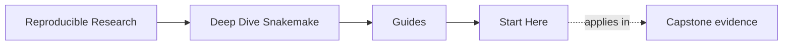

# Start Here

<!-- page-maps:start -->
## Page Maps

<!-- page-maps:end -->

Read the first diagram as a timing map: this page is for choosing the first honest route,
not for replacing the course. Read the second diagram as the loop: choose one route,
anchor in Module 00, and leave with one stable next move.

Deep Dive Snakemake begins with one text file and grows toward production workflow
stewardship. You will run examples, predict DAG behavior, inject failures, and complete
one hundred exercises. No previous Snakemake experience is required.

## Use this page when

- Snakemake still feels new and you want the safest ramp
- the workflow is already confusing and you need the smallest justifiable route
- you steward a workflow repository and need the course without random browsing

## Do not use this page to

- replace the module sequence with support-page browsing
- enter the capstone before the local concept is legible
- choose the strongest proof route by default

## Best first pass

1. Use [Platform Setup](platform-setup.md) to confirm that `snakemake --version` works.
2. Build [your first workflow](../module-00-orientation/index.md#your-first-workflow).
3. Read the [Course Map](../module-00-orientation/course-map.md).
4. Continue to [Module 01](../module-01-file-contracts-workflow-graph-truth/index.md).

Stop there before opening the capstone or the reference shelf. The first workflow and
Module 01 provide enough context to make those larger surfaces useful later.

## Choose the route that matches your pressure

| If you need... | Read next | Keep nearby |
| --- | --- | --- |
| first contact with Snakemake | [Module 01](../module-01-file-contracts-workflow-graph-truth/index.md), [Module 02](../module-02-dynamic-dags-discovery-integrity/index.md) | [Module Checkpoints](module-checkpoints.md) |
| repair of an existing workflow | [Pressure Routes](pressure-routes.md), [Module 03](../module-03-production-operations-policy-boundaries/index.md), [Module 04](../module-04-scaling-workflows-interface-boundaries/index.md) | [Boundary Review Prompts](../reference/boundary-review-prompts.md) |
| stewardship of a long-lived workflow repository | [Module 06](../module-06-publishing-downstream-contracts/index.md), [Module 07](../module-07-workflow-architecture-file-apis/index.md), [Module 10](../module-10-governance-migration-tool-boundaries/index.md) | [Capstone Review Worksheet](../capstone/capstone-review-worksheet.md) |

## What to keep open

- [First-Contact Map](../module-00-orientation/first-contact-map.md)
- [Course Guide](course-guide.md)
- [Module Promise Map](module-promise-map.md)
- [Module Checkpoints](module-checkpoints.md)
- [Boundary Review Prompts](../reference/boundary-review-prompts.md)
- [Capstone Guide](../capstone/index.md), but only as a later corroboration surface

## Success signal

You are using the course correctly if you can explain:

- what makes a workflow contract truthful
- why a target selects the rules Snakemake needs
- why the capstone is not your first lesson
- which support page answers the next question without opening everything
- which proof route is proportionate to the claim in front of you
