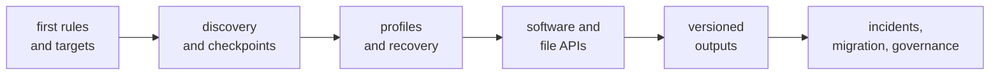

# Course Map

<!-- page-maps:start -->
## Page Maps

<!-- page-maps:end -->

Use this page to see how ten learning days turn a first file contract into a workflow
you can operate, publish, diagnose, and govern. The modules build on one another; later
operational techniques cannot repair an unclear file graph.

## Arc 1: file contracts and dynamic discovery

Modules 01 and 02 establish the workflow's semantic floor.

- **Module 01** starts with static rules, targets, dry-runs, wildcards, and explicit file
  contracts. You finish with a small workflow whose rebuild behavior you can explain.
- **Module 02** adds configuration-driven discovery and checkpoints. You learn to reserve
  dynamic behavior for facts that cannot be known before execution.

Leave this arc able to explain what the workflow plans to build and how discovery stays
reviewable.

## Arc 2: operations and software boundaries

Modules 03 to 05 turn workflow truth into a maintainable repository.

- **Module 03** separates workflow meaning from profiles, retries, staging, and recovery
  policy. You compare local and shared-compute execution without changing file truth.
- **Module 04** splits a growing workflow into rule families and explicit interfaces.
  You learn when modularity clarifies ownership and when it merely scatters logic.
- **Module 05** moves substantial computation into scripts, wrappers, environments, or
  notebooks with reproducible software and provenance boundaries.

Leave this arc able to separate workflow meaning from execution policy and helper code.

## Arc 3: publish trust and architecture

Modules 06 to 08 scale the repository into a downstream-facing system.

- **Module 06** turns internal results into a versioned, checksummed publish contract that
  downstream users can validate without understanding the working directory.
- **Module 07** treats paths and file formats as APIs. You design repository layers and
  helper boundaries that remain legible as the workflow grows.
- **Module 08** maps resources, storage, latency, retries, and executors through profiles.
  You test whether local, CI, and cluster contexts preserve the same workflow meaning.

Leave this arc able to explain which surfaces are public, internal, or policy-only.

## Arc 4: incidents and governance

Modules 09 to 10 finish with long-lived workflow judgment.

- **Module 09** uses benchmarks, logs, summaries, and run metadata to diagnose performance
  and failures from evidence rather than intuition.
- **Module 10** applies characterization, migration, governance, and tool-boundary
  decisions to a long-lived workflow without discarding trusted behavior.

Leave this arc able to review a real workflow repository and justify what should change next.

## Practice commitment

Every technical module contains ten exercises:

- Exercises 1-5 establish and test the local concept.
- Exercises 6-10 apply it through implementation, failure injection, review, or repair.

That makes a hundred exercises across the course. The answer pages explain reasoning and
trade-offs; they are not substitutes for making a prediction and testing it yourself.

## Route markers

- Read [First-Contact Map](first-contact-map.md) when you need the smallest honest
  starting route.
- Read [Mid-Course Map](mid-course-map.md) when Modules 01 to 03 already feel stable and
  you need the bridge into scaling, software seams, publish trust, and operating contexts.
- Read [Mastery Map](mastery-map.md) when the pressure is stewardship, migration, or
  long-lived workflow trust review.
